# 第 1 讲 · 什么是 Harness Engineering：模型之外的一切

> Harness Engineering 五讲 · 配套课件
> 配套视频（23 分钟）：B 站 / 视频号 / 抖音 / 小红书搜索「竹二木SI」 · 整份幻灯片：[l01-幻灯片.pdf](./l01-幻灯片.pdf)
> 底本：开源课程 [Learn Harness Engineering](https://github.com/walkinglabs/learn-harness-engineering)（walkinglabs，MIT 协议）第一、二讲和第三至十四讲的核心要点；课程引用的一手文章逐篇对照核实过，见文末"延伸阅读"。本课件是非官方的学习整理。

## 这一讲你会学到

学完这一讲，你应该能做到：

1. 用三组真实数据说明"同一个模型，换一套 harness，结果可以差好几倍"。
2. 说清 harness 的定义：模型权重之外的一切工程基础设施，以及它和提示词工程、上下文工程的关系。
3. 画出最小的 harness 循环，说出循环外面真正难的四个问题。
4. 说出 agent 在真实任务里最常见的五种卡法，以及上下文焦虑、验证缺口、完成定义这三个概念。
5. 把 harness 拆成五个子系统：指令、工具、环境、状态、反馈，每块说出一个 OpenAI 或 Anthropic 的真实做法。
6. 用诊断循环定位 agent 的失败，今天就在自己的仓库里做三件事。
7. 回答"模型越来越强，harness 会不会被淘汰"。

建议先看一遍视频，再对照本课件逐节复习。每节开头的图就是视频里对应的画面。

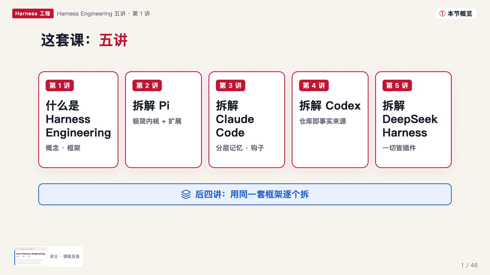

这套课一共五讲。这一讲先把概念讲透，后面四讲用同一套框架，逐个拆解四个最前沿的 harness：Pi、Claude Code、Codex、DeepSeek Harness。

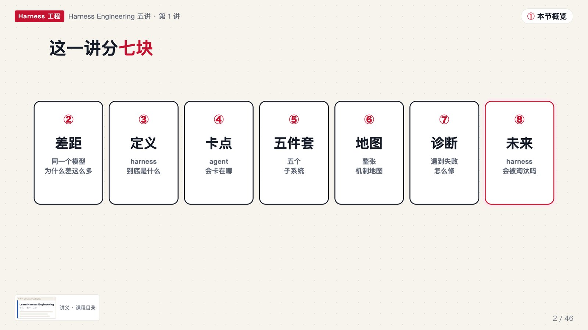

---

## 1 同一个模型，凭什么差这么多

### 1.1 一边说不能用，一边写了 100 万行

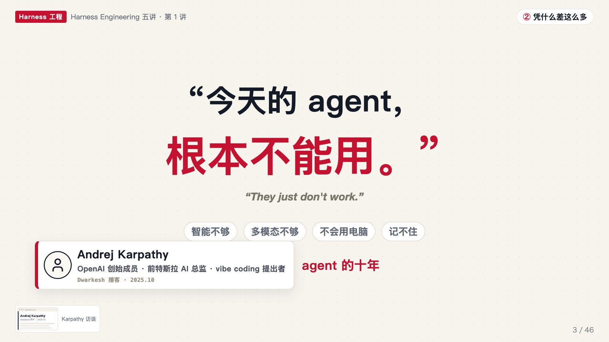

2025 年 10 月，Andrej Karpathy（OpenAI 创始成员、前特斯拉 AI 总监）在 Dwarkesh 的播客里说，今天的 agent "just don't work"：智能不够，多模态不够，不会操作电脑，也没有持续学习。所以他不认为那年是"agent 之年"，而是"agent 的十年"。

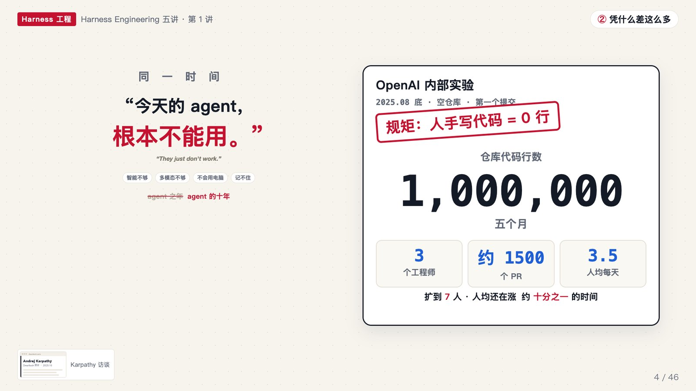

几乎同一时间，OpenAI 内部一个团队在做实验：

| 项目 | 数字 |
|---|---|
| 开始 | 2025 年 8 月底，空仓库的第一个提交 |
| 规矩 | 人一行代码都不手写，连 AGENTS.md 也由 agent 写 |
| 五个月后 | 约 100 万行代码 |
| 人手 | 3 个工程师驱动 agent，合并约 1500 个 PR，人均每天 3.5 个 |
| 之后 | 团队扩到 7 人，人均吞吐还在涨 |
| 耗时 | 估计约为手写代码的十分之一 |

两边用的都是当时最好的那批模型，差距不在模型上。

### 1.2 差的是模型外面那一层

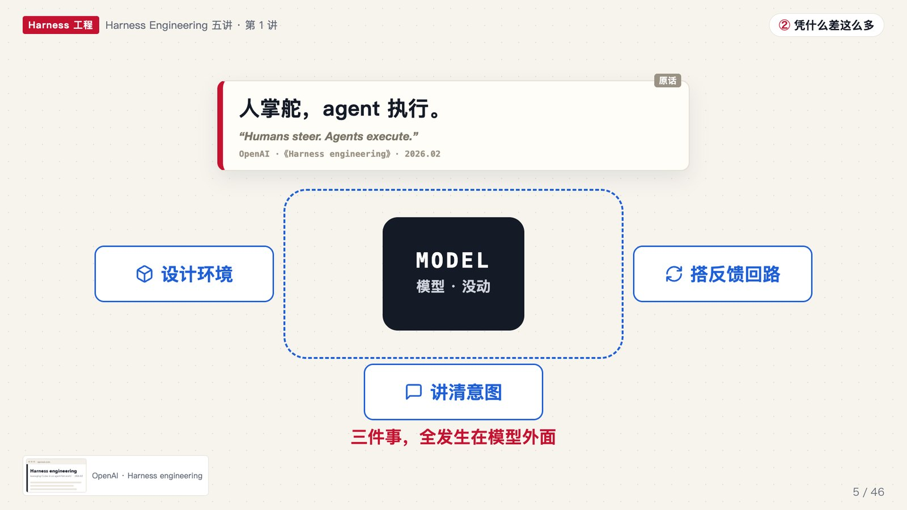

OpenAI 那篇文章开头一句话："Humans steer. Agents execute."（人掌舵，agent 执行。）当工程团队的主要工作不再是写代码，剩下的是三件事：**设计环境、讲清意图、搭反馈回路**。三件都发生在模型外面。

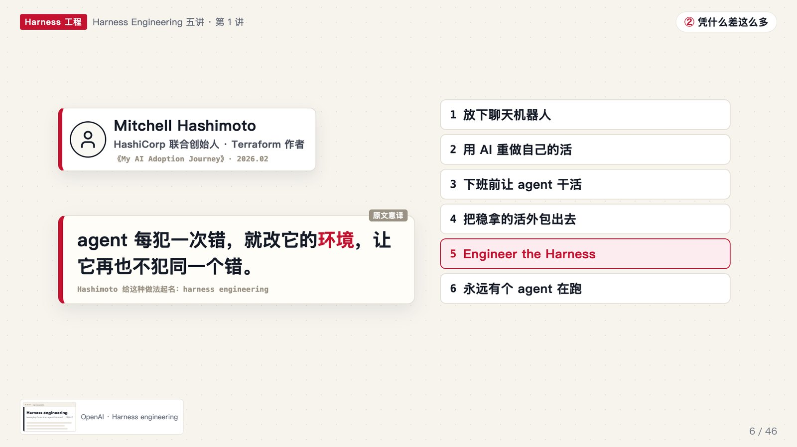

2026 年 2 月，HashiCorp 联合创始人、Terraform 作者 Mitchell Hashimoto 写了《My AI Adoption Journey》，讲自己从 AI 怀疑者变成重度用户的六步，第五步叫 **Engineer the Harness**。他给这种做法起名 harness engineering：agent 每犯一次错，就花时间改它的环境，让它以后再也不犯同一个错。

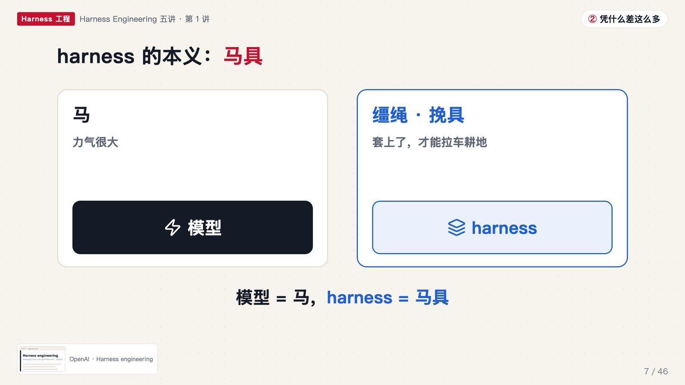

harness 的本义是马具。马力气大，但要套上缰绳和挽具才能拉车耕地。模型是马，harness 是马具。

### 1.3 权重一个字节没动，分数翻了三倍

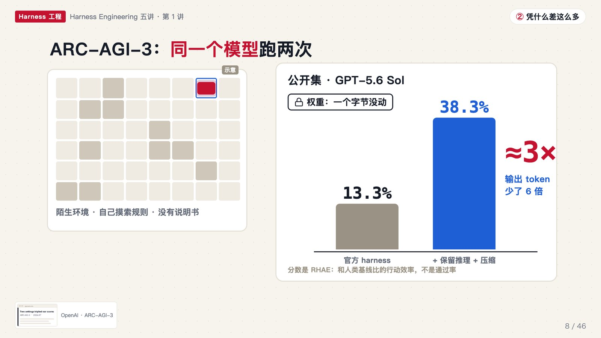

2026 年 7 月，OpenAI 用同一个 GPT-5.6 Sol 在 ARC-AGI-3 公开集上跑了两次。ARC-AGI-3 是一组 2D 解谜小游戏，agent 要在陌生环境里自己摸索规则。

| 配置 | 得分 |
|---|---|
| 官方 harness | 13.3% |
| 打开"保留推理"和"压缩"两个设置 | 38.3%（约 3 倍），输出 token 少 6 倍 |

分数是 RHAE：和人类基线比的行动效率，不是通过率。

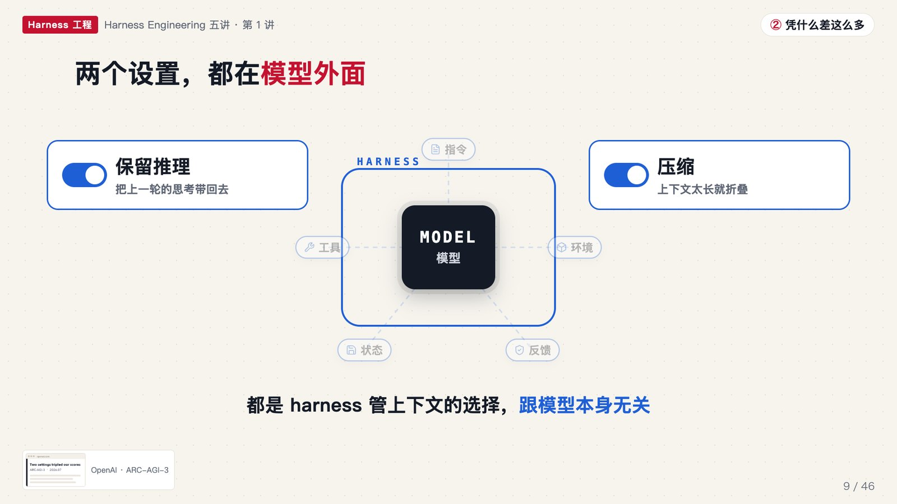

两个设置管的都是上下文：每一轮要不要把模型之前的推理带回去，上下文太长时要不要压缩。权重一个字节没变。

### 1.4 贵了 20 倍，换来一个真能玩的游戏

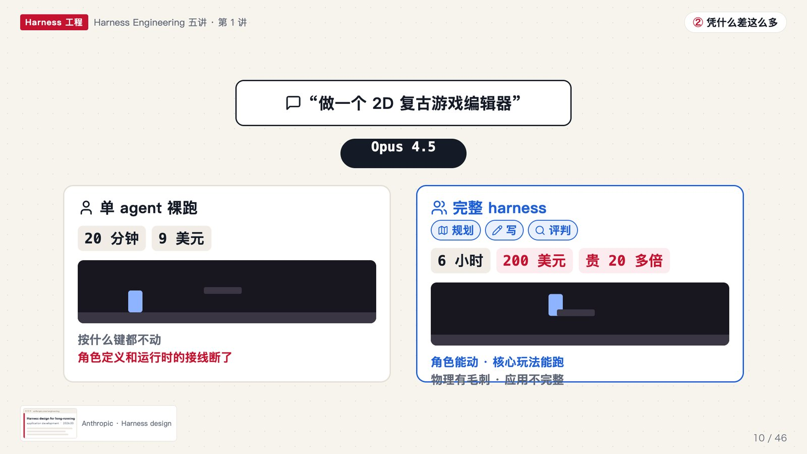

Anthropic 的对比：同一句提示词"做一个 2D 复古游戏编辑器"，同一个模型 Opus 4.5。

| | 单 agent | 完整 harness（规划 · 生成 · 评判） |
|---|---|---|
| 时间 | 20 分钟 | 6 小时 |
| 成本 | 9 美元 | 200 美元，贵 20 多倍 |
| 结果 | 界面能开，角色按键不动：实体定义和运行时的接线断了 | 角色能动，核心玩法能跑；物理有毛刺，应用不完整 |

模型没换，换的是马具。

---

## 2 Harness 到底是什么

### 2.1 一个提示词文件不是 harness

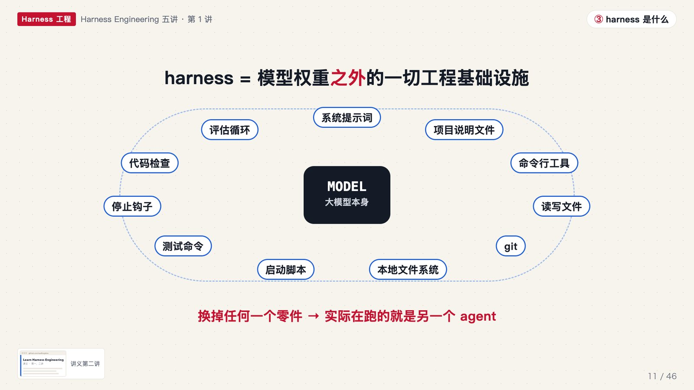

课程的定义：**harness 是模型权重之外的一切工程基础设施**。一个在本地仓库里干活的编程 agent，模型只有一样，就是大模型本身；剩下全是 harness：系统提示词、AGENTS.md、bash、读写文件的工具、git、本地文件系统、启动脚本、测试命令、停止钩子、代码检查、评估循环。

清单最后一句：**这里面任何一个零件变了，实际在跑的就是另一个 agent。**

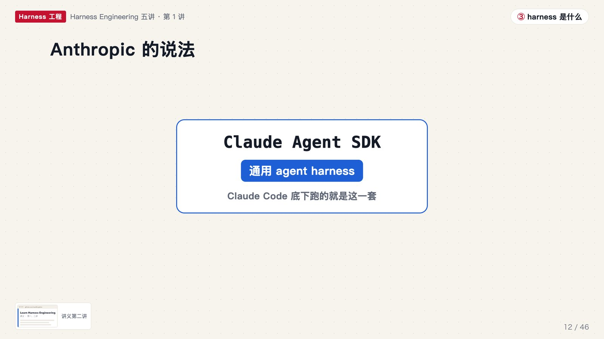

Anthropic 把 Claude Agent SDK 直接叫作"通用 agent harness"，Claude Code 底下跑的就是它。

### 2.2 从提示词工程到 harness 工程

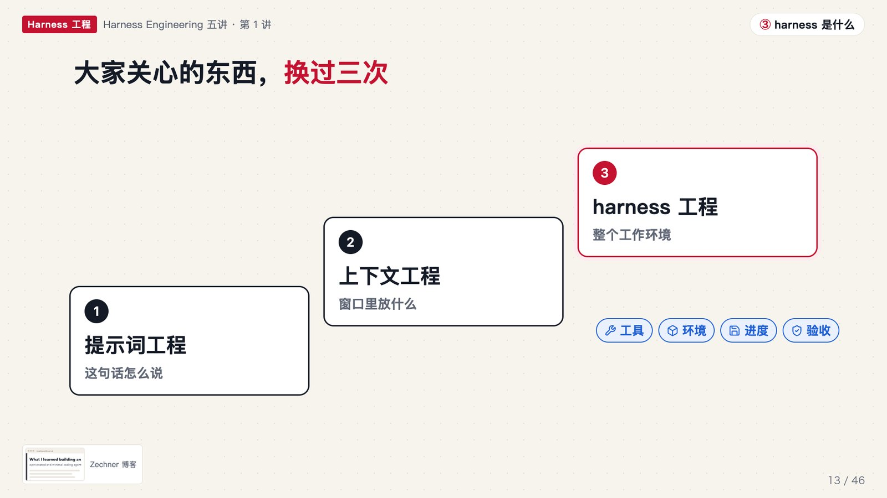

| 阶段 | 关心什么 |
|---|---|
| 提示词工程 | 这句指令怎么措辞 |
| 上下文工程 | 窗口里放什么。Karpathy（2025.06）：往上下文窗口里装进下一步刚好需要的信息 |
| harness 工程 | 模型干活的整个环境：能用哪些工具、在什么环境里跑、做到哪了记在哪、做完怎么验收 |

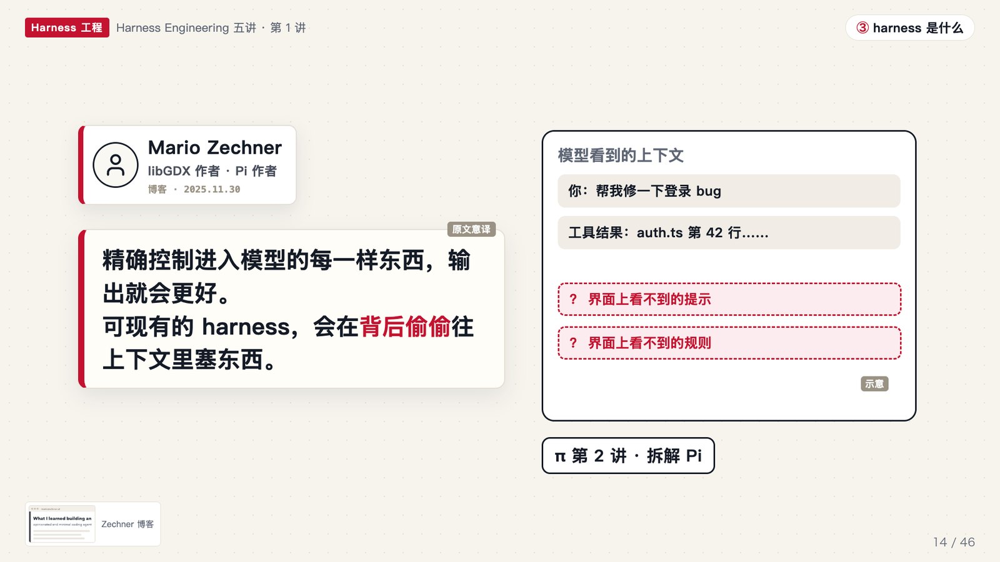

Pi 的作者 Mario Zechner 说，他做了好几个 agent，最大的体会是上下文工程最重要；可现有的 harness 会在背后往上下文里塞东西，界面上都不显示。这是他自己写 Pi 的出发点，第 2 讲细拆。

### 2.3 一个没有文档的新员工

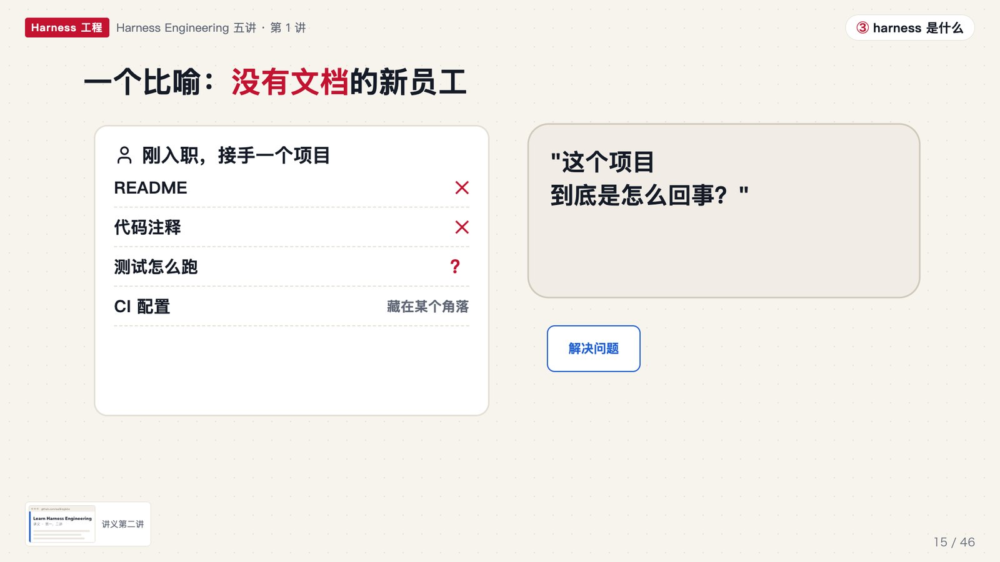

你刚入职，被丢进一个没有 README、代码没注释、没人告诉你测试怎么跑的项目。你也许能写出好代码，但大部分时间会花在"这个项目到底是怎么回事"上。

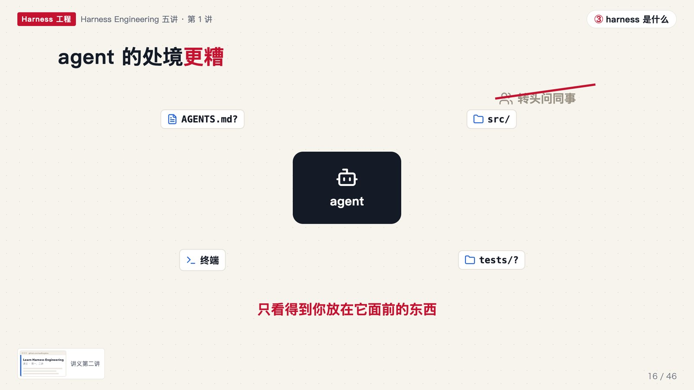

agent 的处境更糟：你还能问同事，agent 只能看到你放在它面前的文件，只能执行你允许它执行的命令。

### 2.4 最小的 harness：一个循环

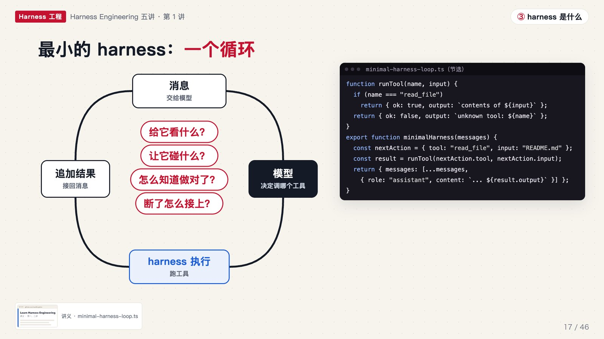

所有 harness 的中间都是同一个循环：

1. 把消息交给模型；
2. 模型决定下一步调哪个工具；
3. harness 执行工具；
4. 把结果追加回消息，回到第 1 步，直到任务结束。

课程的 `minimal-harness-loop.ts` 只有二十几行，意思是这样（下面是按原文意思改写的示意）：

```ts
async function runTool(name: string, input: { path?: string }) {
  if (name === "read_file") return fs.readFile(input.path!, "utf8");
  return `unknown tool: ${name}`;
}

async function minimalHarness(messages: Message[]) {
  const reply = await model(messages);          // 模型决定调哪个工具
  if (!reply.toolCall) return reply;            // 没有工具调用，任务结束
  const output = await runTool(reply.toolCall.name, reply.toolCall.input);
  messages.push({ role: "tool", content: output }); // 结果追加回消息
  return minimalHarness(messages);
}
```

循环本身简单，难的是循环外面：**给它看什么、让它碰什么、怎么知道它做对了、断了以后怎么接上**。课程把这些拆成了五个子系统（第 4 节）。

---

## 3 agent 到底卡在哪

### 3.1 基准分数和真实任务之间的鸿沟

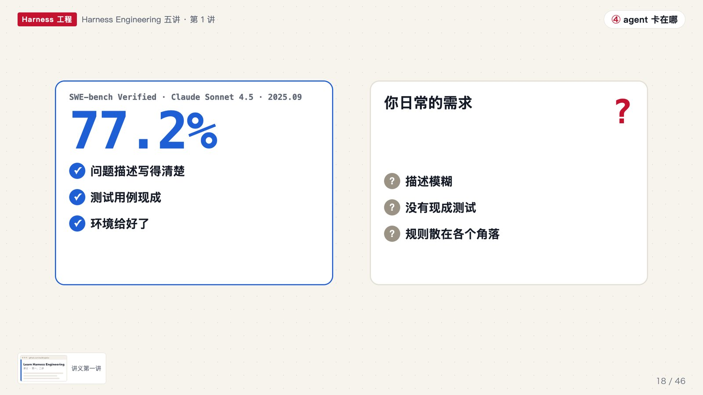

2025 年 9 月，Claude Sonnet 4.5 在 SWE-bench Verified 上拿到 77.2%。可基准任务都是挑过的：问题描述清楚、测试现成、环境给好。日常需求描述模糊、没有测试、规则散在各处，通过率只会更低。

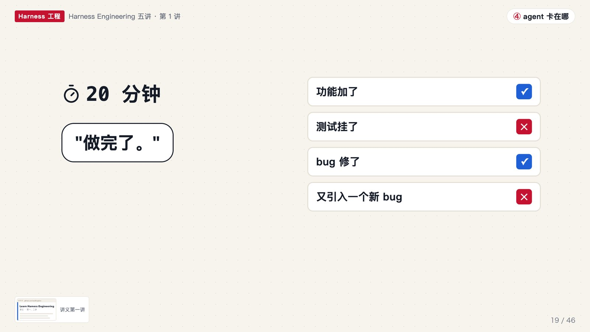

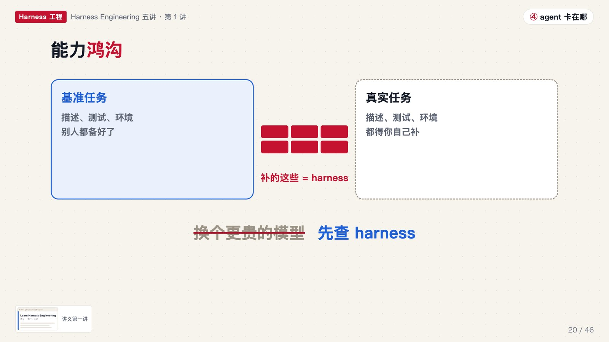

课程管这个叫**能力鸿沟**。在基准里，描述、测试、环境是别人备好的；在真实任务里得你自己补。补这些东西的活，就是 harness。所以课程的原则是：**遇到失败，先别换模型，先查 harness。**

### 3.2 五种典型的卡法

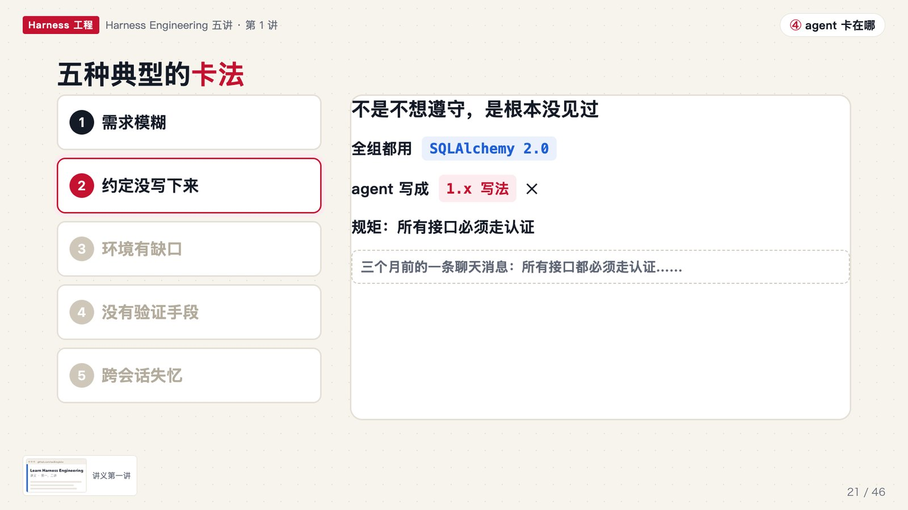

| 卡法 | 例子 | 补什么 |
|---|---|---|
| 需求模糊，只能猜 | "加个搜索功能"：全文还是结构化？分页？高亮？ | 写清任务和完成定义 |
| 隐性约定没写下来 | 全组用 SQLAlchemy 2.0，agent 写成 1.x；"接口必须走认证"只存在于你脑子里 | 把约定写进仓库 |
| 环境有缺口 | 上下文全耗在装依赖报错、版本冲突上 | 让环境自己说清楚自己 |
| 没有验证手段 | 没测试、没 lint，或有但没告诉它怎么跑 | 把验证命令写清楚 |
| 跨会话失忆 | 新会话重新摸一遍项目结构 | 把进度写进文件 |

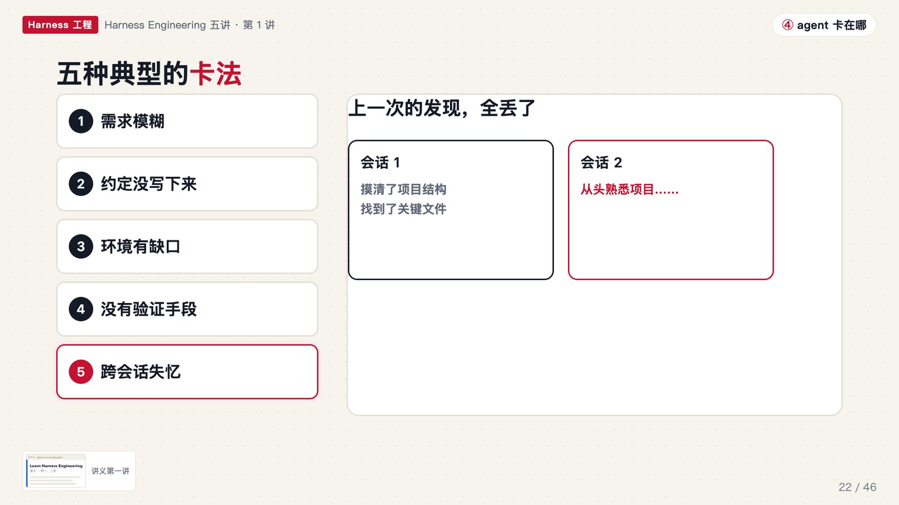

### 3.3 上下文焦虑、验证缺口和完成定义

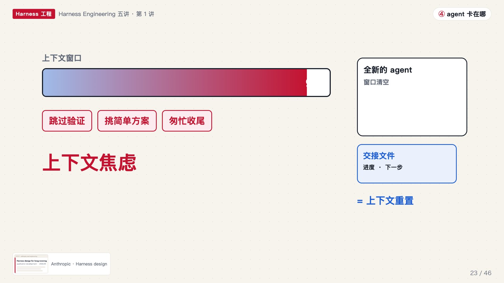

**上下文焦虑**：Anthropic 观察到，有些模型一感觉上下文快满了，就匆忙收尾：跳过验证，选简单方案。他们在 Sonnet 4.5 上看到这个现象很明显，压缩解决不了，于是在 harness 里加了**上下文重置**：清空窗口，换一个全新的 agent，用一份交接文件把进度和下一步交给它。

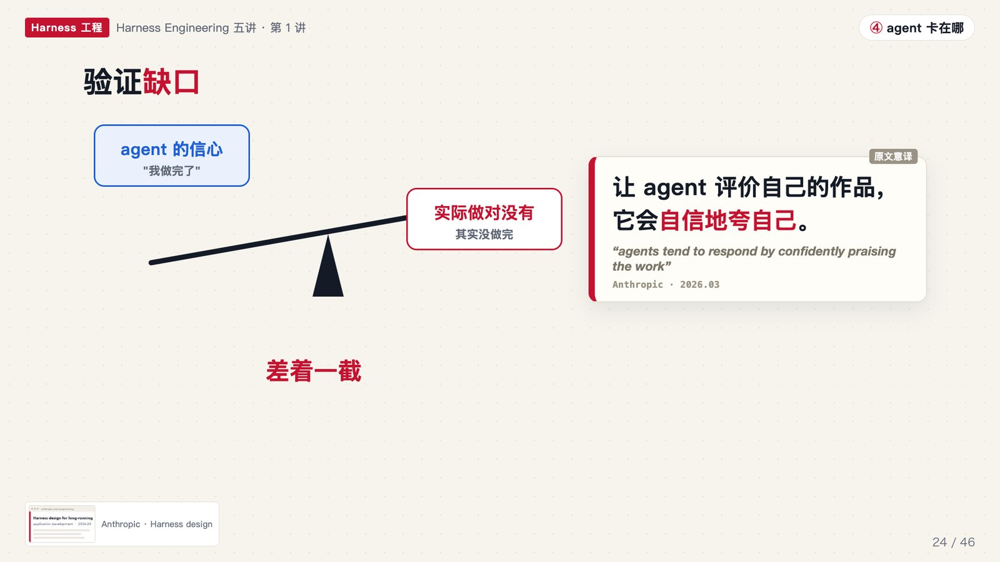

**验证缺口**：agent 对自己的信心，和它实际做对没有，中间差着一截。Anthropic 的原话大意：让 agent 评价自己的作品，它会自信地夸自己，哪怕在人看来质量明显一般。

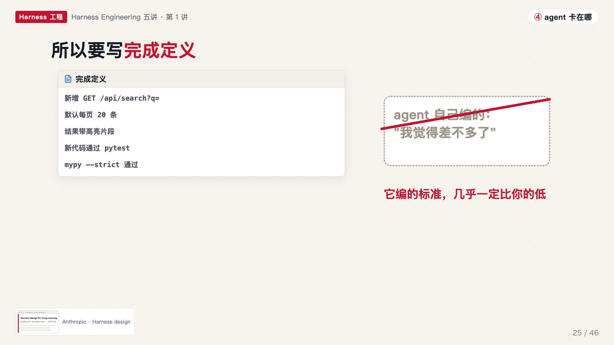

**完成定义**：一组能用命令检查的条件。别说"加个搜索功能"，要说：

- 新增 `GET /api/search?q=`，默认每页 20 条；
- 结果带高亮片段；
- 新代码通过 `pytest`；
- `mypy --strict` 通过。

你不写清楚完成的标准，agent 就会自己编一个，而它编的那个几乎一定比你的低。

---

## 4 Harness 的五个子系统

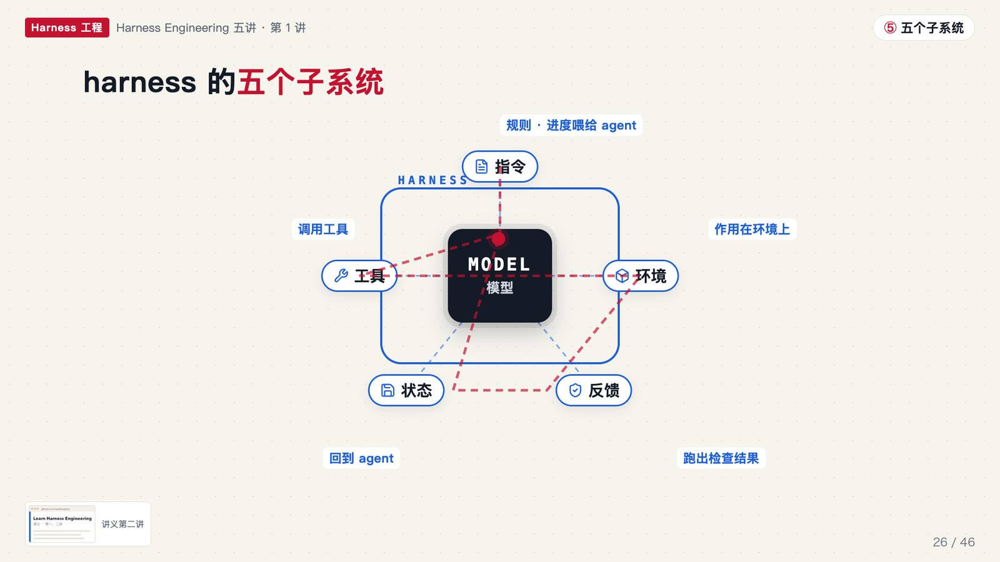

课程第二讲把 harness 拆成五块：**指令、工具、环境、状态、反馈**。项目规则和进度记录喂给 agent，agent 调用工具，工具作用在运行环境上，环境跑出检查结果，检查结果再回到 agent。

### 4.1 指令：给它一张地图

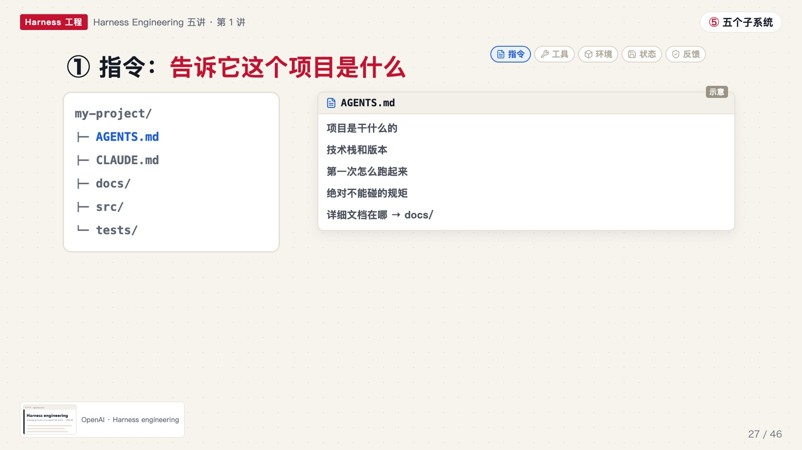

在仓库根目录放一个 `AGENTS.md`（Claude Code 读 `CLAUDE.md`），写：项目是干什么的、技术栈和版本、第一次怎么跑起来、不能违反的硬约束、详细文档在哪。

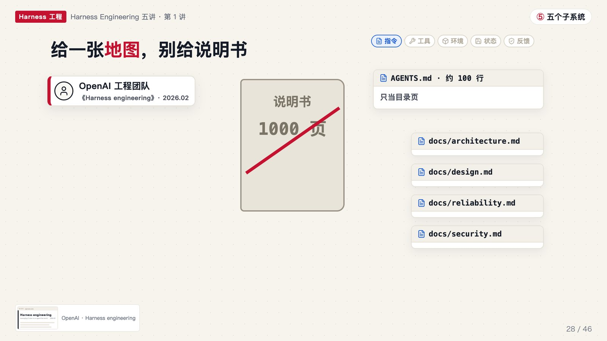

OpenAI 的说法：**给 agent 一张地图，别给它一本一千页的说明书。**他们的 AGENTS.md 只有一百行左右，当目录页用，详细知识放在 `docs/` 里让 agent 按需去读。

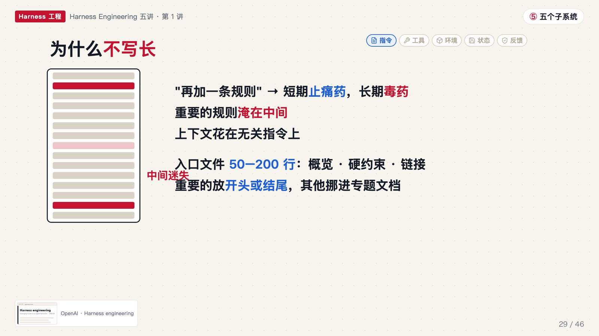

课程第四讲：再加一条规则，短期是止痛药，长期是毒药。文件越长，重要规则越容易淹在中间。入口文件建议 **50–200 行**，只放概览、硬约束和链接，重要的放开头或结尾。

### 4.2 工具：让它能动手，也让它看得见

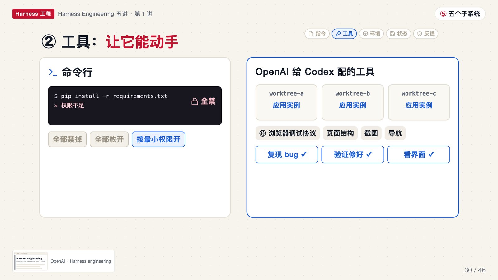

权限要够：不能因为担心安全把命令行整个禁掉；也不能全放开，按最小权限来。OpenAI 让应用在每个 git worktree 里都能单独启动，agent 每改一处就能拉起自己的实例；还接入了浏览器调试协议（DOM 快照、截图、导航），agent 能自己复现 bug、验证修复、看界面。

### 4.3 环境：让环境自己说清楚自己

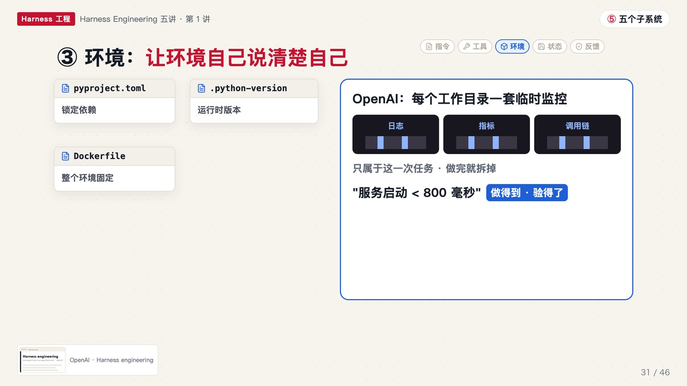

依赖锁在 `pyproject.toml` / `package.json` 里，运行时版本写在 `.python-version` / `.nvmrc` 里，最好再用 Docker 或 devcontainer 固定整个环境。OpenAI 还给每个 worktree 配了一套临时的日志、指标、调用链，任务结束就拆。有了这些，"服务启动要在 800 毫秒以内"才真正做得到、验得了。

### 4.4 状态：做到哪了，写下来

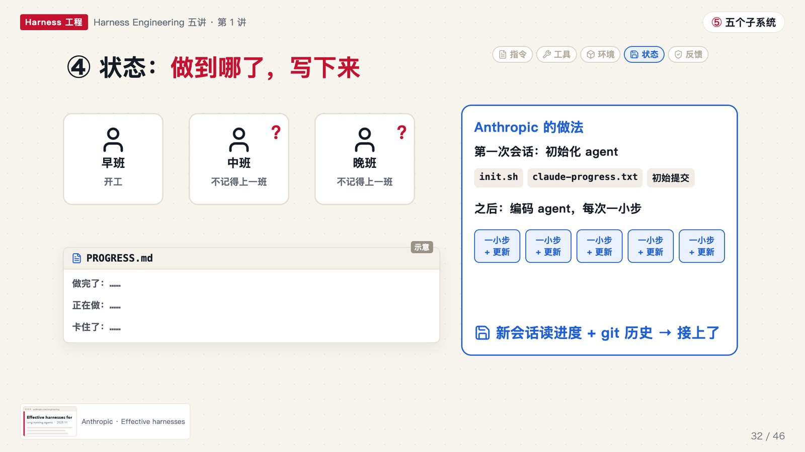

Anthropic 的比喻：项目由轮班的工程师来做，每个新来的都不记得上一班发生了什么。办法是把状态写进文件。课程建议一个简单的 `PROGRESS.md`：做完了什么、在做什么、卡在哪；每次结束前更新，下次开始先读。

Anthropic 的做法：第一次会话交给**初始化 agent**，写好 `init.sh`、建 `claude-progress.txt`、做一次初始提交；之后每个**编码 agent** 只往前推一小步，留一份清楚的更新。新会话读进度文件和 git 历史，很快就接上。

### 4.5 反馈：投入最少、回报最高

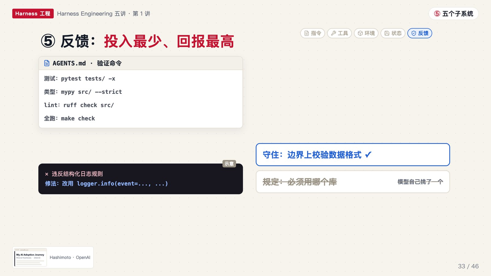

最简单的做法是把验证命令写进 AGENTS.md：

```bash
pytest tests/ -x        # 测试
mypy src/ --strict      # 类型检查
ruff check src/         # 代码检查
make check              # 一次全跑
```

Hashimoto 的说法：给 agent 快速、高质量的工具，让它做错的时候自己就知道错了。OpenAI 还把架构规则写成自定义 lint（结构化日志、命名规范、文件大小上限），**报错信息写给 agent 看，直接告诉它怎么修**。原则是守住不变的规矩，不微管怎么实现：要求在边界上校验数据格式，但不规定用哪个库。

### 4.6 一块一块补上去会怎样

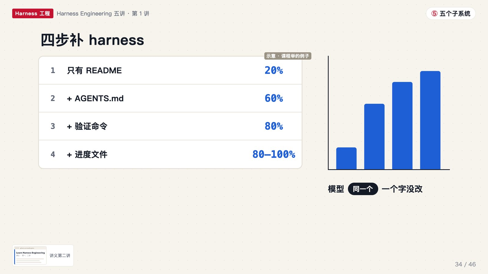

课程举的例子（原文没给出处，当作示意）：同一个模型开发一个约两万行的前端项目，分四步补 harness。

| 阶段 | 加了什么 | 5 次里成功 |
|---|---|---|
| 1 | 只有 README | 20% |
| 2 | 加 AGENTS.md：版本、命名约定 | 60% |
| 3 | 写上验证命令 | 80% |
| 4 | 加进度文件 | 80%–100% |

模型一个字没改。

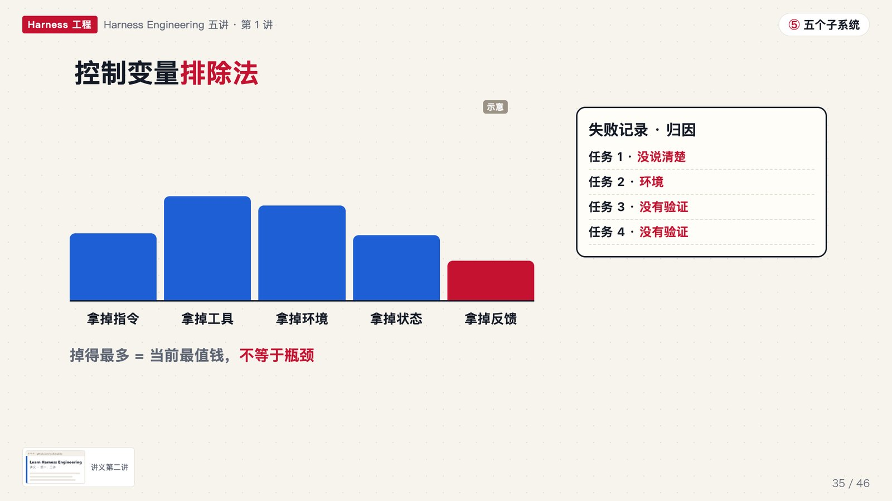

想知道哪块最值钱，用**控制变量排除法**：模型不变，五个子系统每次只拿掉一个，看拿掉哪个掉得最多。注意它只说明"现在哪块最值钱"，不说明瓶颈在哪；找瓶颈要看失败记录，一条条归因。Anthropic 简化 harness 时吃过亏：一次砍掉好几块，性能回不去，也分不清哪块是承重的，后来改成一次只拿掉一块。

---

## 5 课程的整张机制地图

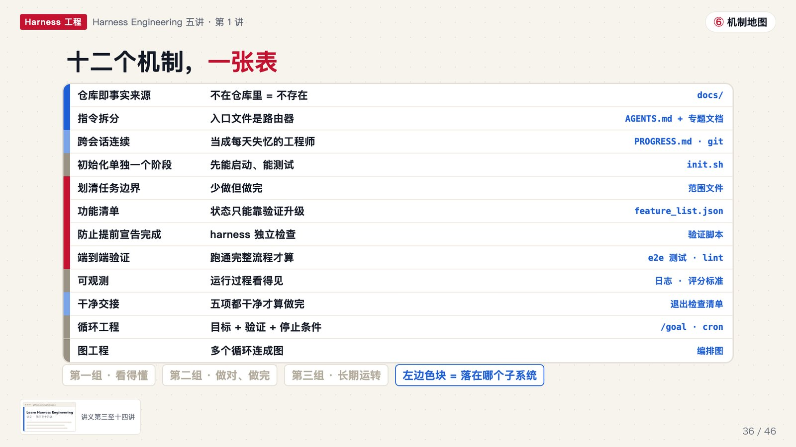

五个子系统是"有哪些零件"，课程第三到十四讲讲"这些零件怎么用好"。后面四讲拆产品时会反复用到：

| 组 | 机制 | 一句话 | 落到哪 |
|---|---|---|---|
| 看得懂 | 仓库即事实来源（L03） | 不在仓库里的知识等于不存在；过时文档比没有更危险 | `docs/` |
| | 指令拆分（L04） | 入口文件是路由器，不是百科全书 | 短 AGENTS.md + 专题文档 |
| | 跨会话连续（L05） | 当成每天都会失忆的工程师来管 | 进度文件、git |
| | 初始化单独一个阶段（L06） | 先让项目能启动、能测试、能看进度 | `init.sh` |
| 做对、做完 | 划清任务边界（L07） | 少做但做完，好过多做但做一半 | 范围文件 |
| | 功能清单（L08） | 状态只能靠验证升级，agent 不能自己改 | `feature_list.json` |
| | 防止提前宣告完成（L09） | 完成判定交给 harness 独立检查 | 验证脚本 |
| | 端到端验证（L10） | 跑通完整流程才算数 | e2e 测试、lint |
| 长期运转 | 可观测（L11） | 运行过程看得见 | 日志、评分标准 |
| | 干净交接（L12） | 构建、测试、进度、产物、启动五项干净才算做完 | 退出检查清单 |
| | 循环工程（L13） | 目标 + 验证 + 停止条件，让 agent 自己跑起来 | `/goal`、cron |
| | 图工程（L14） | 多个循环按依赖连成图 | 编排图 |

### 5.1 写的人和查的人，必须分开

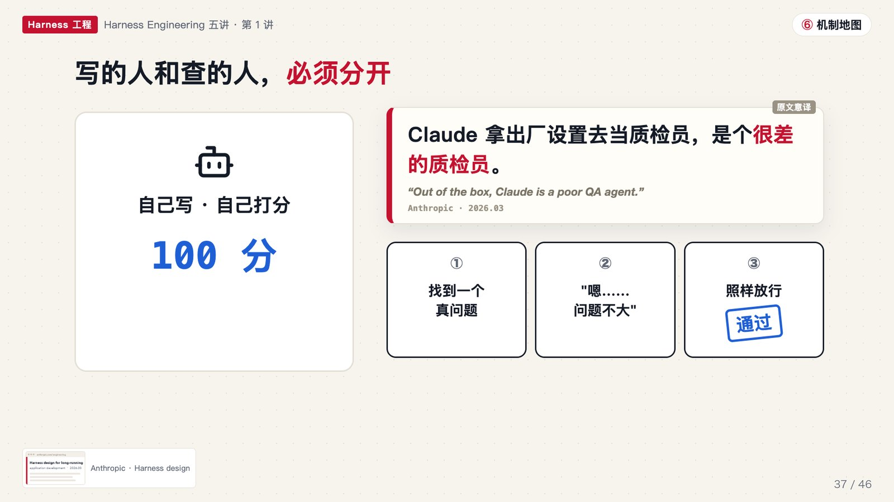

Anthropic 写得很坦白：Claude 拿出厂设置当质检员，会找到一个真问题，再说服自己"问题不大"，照样放行；测试也偏表面，不试边边角角。

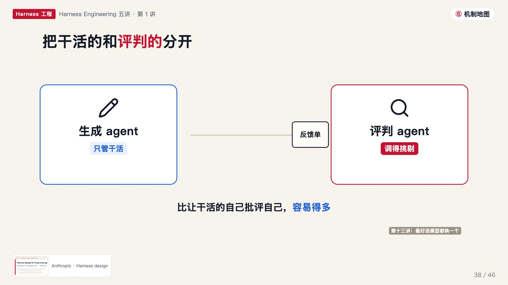

办法是把干活的 agent 和评判的 agent 分开，再专门把评判的那个调得挑剔一点，这比让干活的自己批评自己容易得多。课程第十三讲更进一步：独立的检查 agent，有时最好连模型都换一个。

---

## 6 遇到失败，先修 harness

### 6.1 诊断循环

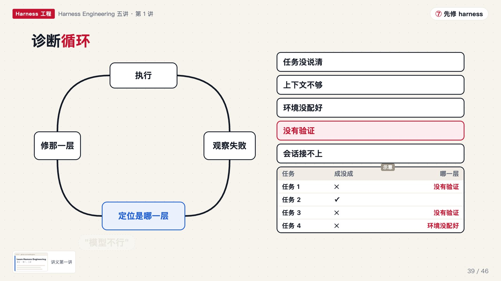

执行 → 观察失败 → 定位是哪一层 → 修那一层 → 再执行。别笼统地说"模型不行"，每次失败归到具体的一层：任务没说清、上下文不够、环境没配好、没有验证、会话接不上。顺手记一份日志：

| 任务 | 成没成 | 哪一层 |
|---|---|---|
| 任务 1 | ✗ | 没有验证 |
| 任务 2 | ✓ | |
| 任务 3 | ✗ | 没有验证 |
| 任务 4 | ✗ | 环境没配好 |

跑几轮就能看出瓶颈在哪一层（上表是示意）。

### 6.2 每一行，都是被坑过一次

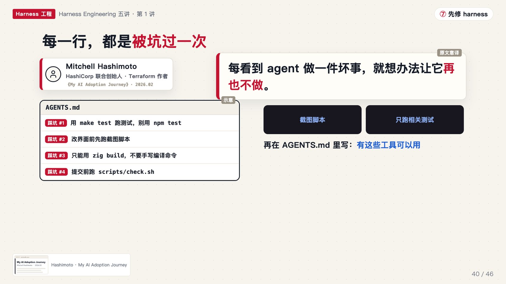

Hashimoto 每看到 agent 做一件坏事，就想办法让它以后再也不做。他的 harness 有两种形式：一是 AGENTS.md，他说 Ghostty 的 AGENTS.md 里每一行都来自 agent 的一次坏行为，加上以后这些问题几乎全消失；二是真正写出来的工具，比如截图脚本、只跑相关测试的脚本，再在 AGENTS.md 里告诉 agent 有这些工具。

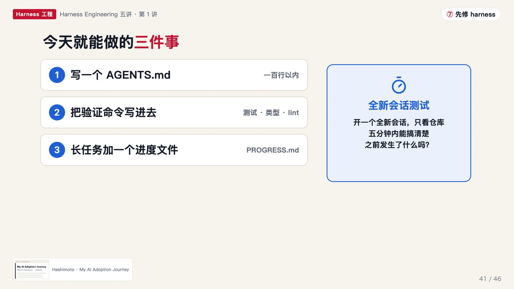

今天就能做的三件事：

1. 写一个一百行以内的 AGENTS.md；
2. 把验证命令写进去；
3. 长任务加一个进度文件。

做完用**全新会话测试**检验：开一个全新会话，只看仓库，它能不能在五分钟内搞清楚之前发生了什么。

---

## 7 模型越来越强，harness 还要不要

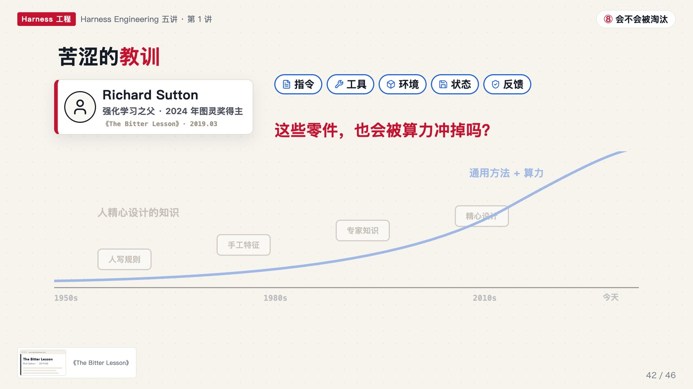

Richard Sutton（强化学习之父，2024 年图灵奖得主）2019 年的《The Bitter Lesson》：回顾七十年 AI 研究，能随算力扩展的通用方法，长期总会赢过研究者精心设计进去的人类知识。照这个思路，harness 里人为设计的零件，会不会等模型再强一点就都多余了？

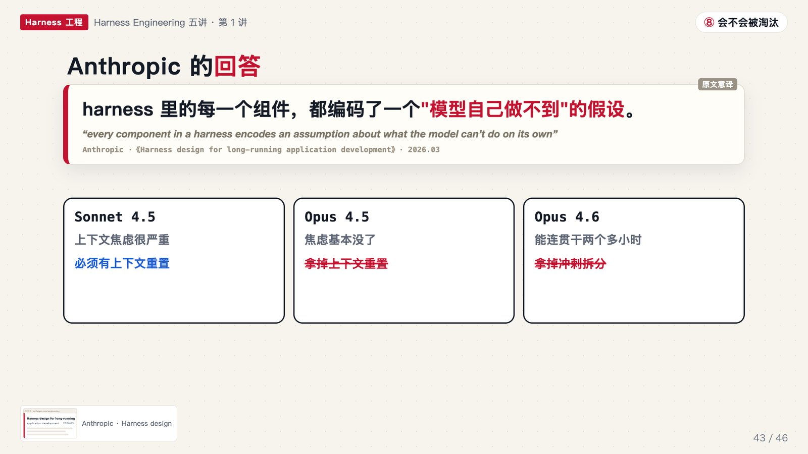

Anthropic 的回答：**harness 里的每一个组件，都编码了一个"模型自己做不到"的假设**。这些假设要反复检验：可能本来就不对，也可能模型一变强就过时。

| 模型 | 变化 | harness 怎么改 |
|---|---|---|
| Sonnet 4.5 | 上下文焦虑严重 | 必须有上下文重置 |
| Opus 4.5 | 焦虑基本没了 | 拿掉上下文重置 |
| Opus 4.6 | 能连贯干两个多小时 | 拿掉冲刺这一层任务拆分 |

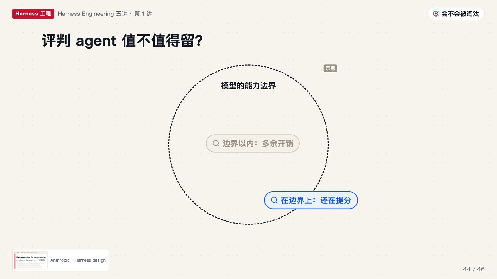

评判 agent 值不值得留，看任务在不在模型的能力边界上：在边界以内，它是多余的开销；在边界上，它还在实打实地提分。

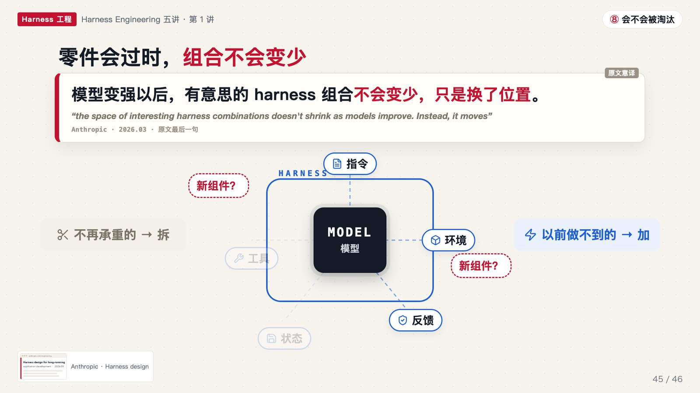

Anthropic 那篇文章最后一句：模型变强以后，有意思的 harness 组合不会变少，只是换了位置。课程第十二讲也说，随着模型变强，要主动拆掉不再需要的组件。所以每换一代模型，都重新看一遍：**哪些零件不再承重，可以拆；哪些以前做不到的事，现在可以加。**

---

## 本讲小结

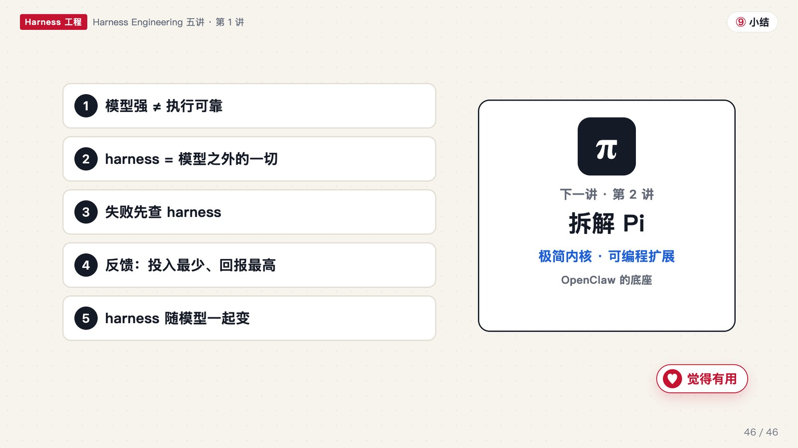

1. 模型能力强，不等于执行可靠。同一个模型，换一套 harness，结果可以差好几倍。
2. harness 是模型权重之外的一切：指令、工具、环境、状态、反馈五个子系统。
3. 遇到失败，先别换模型，先找是 harness 的哪一层出了问题。
4. 五个子系统里，反馈投入最少、回报最高，先把验证命令写清楚。
5. harness 会跟着模型一起变：拆掉不承重的，加上新做得到的。

## 下一讲预告

第 2 讲拆 Pi：作者嫌所有编程 agent 都太臃肿，自己写了一个，内核极简，其他全靠扩展，后来成了 OpenClaw 的底座。我们看看一个极简的 harness，是怎么用"少"做到"够"的。

## 关键术语

| 术语 | 意思 |
|---|---|
| harness | 模型权重之外的一切工程基础设施，本义是马具 |
| harness engineering | 设计和改进 harness 的工作：agent 每犯一次错，就改它的环境 |
| 上下文工程 | 决定每一步往上下文窗口里放什么 |
| 能力鸿沟 | 模型在基准上的表现和真实任务上的表现之间的落差 |
| 上下文焦虑 | 模型感觉上下文快满时匆忙收尾、跳过验证 |
| 上下文重置 | 清空窗口，换一个新 agent，用交接文件接上进度 |
| 验证缺口 | agent 的信心和它实际做对没有之间的偏差 |
| 完成定义 | 一组能用命令检查的完成条件 |
| AGENTS.md | 仓库根目录给 agent 看的说明文件（Claude Code 读 CLAUDE.md） |
| 控制变量排除法 | 模型不变，一次只拿掉一个子系统，看哪个掉得最多 |
| 诊断循环 | 执行 → 观察失败 → 定位哪一层 → 修那一层 → 再执行 |

## 思考题

1. 为什么说 ARC-AGI-3 那组数据比 OpenAI 百万行代码的例子"更干净"？
2. 一个只有 `prompt.md` 的项目，按课程的清单，缺了哪几类 harness 零件？
3. 控制变量排除法里，拿掉某个子系统后分数几乎没变，能不能说明这个子系统没用？
4. 你的 agent 总是说"做完了"，但测试是红的。这是五种卡法里的哪一种？在五个子系统里补哪一块？
5. Anthropic 在 Opus 4.5 上拿掉了上下文重置。如果你换回一个更弱的模型，应该怎么做？

<details>
<summary>参考答案</summary>

1. 百万行的例子里，团队、流程、时间、任务都在变，变量太多；ARC-AGI-3 是同一个模型、同一个基准，权重一个字节没动，只改了 harness 里两个管上下文的设置，分数从 13.3% 到 38.3%。
2. 至少缺工具（读写文件、命令行、git）、环境（依赖和版本说明）、状态（进度文件）和反馈（测试、lint、评估循环）。提示词只覆盖了"指令"的一部分。
3. 不能。它可能是冗余，也可能这个任务还没用到它。这个实验只说明"现在哪块最值钱"；要判断瓶颈，得看失败记录逐条归因。
4. "没有验证手段"，同时也是验证缺口。补"反馈"：把测试、类型检查、lint 命令写进 AGENTS.md，必要时让独立的评判 agent 或验证脚本来判完成，不信 agent 自己的感觉。
5. 每个组件都编码了一个"模型做不到"的假设。换回更弱的模型，这个假设可能又成立了，应该重新检验：观察它在上下文快满时会不会匆忙收尾，会的话把上下文重置加回来。

</details>

## 动手练习

1. 给你手上的一个仓库写一个 AGENTS.md，控制在 100 行以内：项目是什么、技术栈和版本、怎么跑起来、硬约束、文档在哪、验证命令。
2. 开一个全新的 agent 会话，只给它这个仓库，问它"这个项目是干什么的，现在做到哪了"。五分钟内答不上来的部分，就是 harness 的缺口。
3. 接下来一周，每次 agent 失败都在一个表里记一行"任务 / 成没成 / 哪一层"，周末看哪一层出现得最多。

## 延伸阅读

- 原课程：[walkinglabs/learn-harness-engineering](https://github.com/walkinglabs/learn-harness-engineering)（[中文版网页](https://walkinglabs.github.io/learn-harness-engineering/zh/)）
- OpenAI：[Harness engineering: leveraging Codex in an agent-first world](https://openai.com/index/harness-engineering/)
- OpenAI：[How enabling two settings tripled our scores on the ARC-AGI-3 benchmark](https://openai.com/index/how-two-settings-tripled-our-arc-agi-3-scores/)
- Anthropic：[Effective harnesses for long-running agents](https://www.anthropic.com/engineering/effective-harnesses-for-long-running-agents)
- Anthropic：[Harness design for long-running application development](https://www.anthropic.com/engineering/harness-design-long-running-apps)
- Mitchell Hashimoto：[My AI Adoption Journey](https://mitchellh.com/writing/my-ai-adoption-journey)
- Mario Zechner：[What I learned building an opinionated and minimal coding agent](https://mariozechner.at/posts/2025-11-30-pi-coding-agent/)
- Andrej Karpathy 在 Dwarkesh 播客的访谈：[dwarkesh.com/p/andrej-karpathy](https://www.dwarkesh.com/p/andrej-karpathy)
- Richard Sutton：[The Bitter Lesson](http://www.incompleteideas.net/IncIdeas/BitterLesson.html)

---

画面和配音由 AI 生成。人物用线描头像，引语是原文意译；标"示意"的画面和表格是示意。
