# 第 2 讲 · 拆解 Pi：只有四个工具，凭什么撑起 OpenClaw

> Harness Engineering 五讲 · 配套课件
> 配套视频（20 分钟）：B 站 / 视频号 / 抖音 / 小红书搜索「竹二木SI」 · 整份幻灯片：[l02-幻灯片.pdf](./l02-幻灯片.pdf)
> 底本：开源课程 [Learn Harness Engineering](https://github.com/walkinglabs/learn-harness-engineering)（walkinglabs，MIT 协议）"前沿 Harness 拆解"栏目的《拆解 Pi 的 harness 设计》。课程里已经过时的地方（扩展的事件名、包名、仓库地址），按 2026-11 的 Pi 源码和文档改写；一手出处见文末"延伸阅读"。本课件是非官方的学习整理。

## 这一讲你会学到

学完这一讲，你应该能做到：

1. 说出 Pi 的出发点：上下文工程最重要，harness 不该在背后往上下文里塞东西。
2. 描述 Pi 的极简内核：四个包、十来行的系统提示、四个工具，以及作者认为"够用"的两条理由。
3. 列出 Pi 刻意不做的五样东西和替代办法，解释为什么"不做"的准确意思是"不进内核"。
4. 用第 1 讲的五个子系统拆 Pi，重点讲清会话树、压缩的默认参数和可替换策略、动态上下文。
5. 说清扩展机制：主要的生命周期事件、一道权限门怎么写、Pi 怎么改造它自己，以及四种运行模式。
6. 判断 Pi 的代价和适合的人群，把四条设计抄进自己的 harness。

建议先看一遍视频，再对照本课件逐节复习。每节开头的图就是视频里对应的画面。

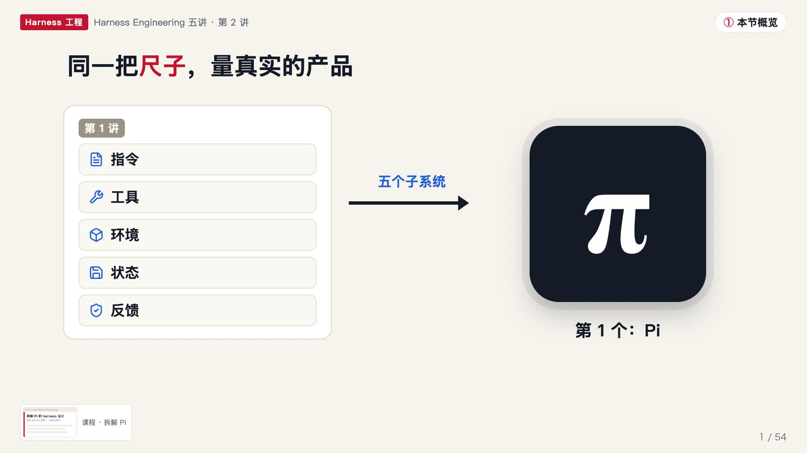

上一讲给了一把尺子：指令、工具、环境、状态、反馈五个子系统。从这一讲起用它量真实的产品，第一个是 Pi。

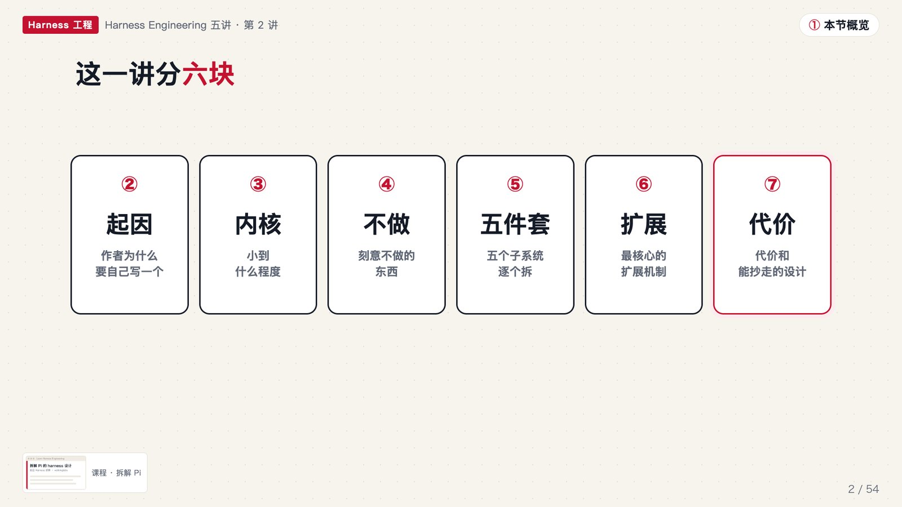

---

## 1 他嫌弃所有编程 agent，干脆自己写了一个

### 1.1 Claude Code 变成了一艘宇宙飞船

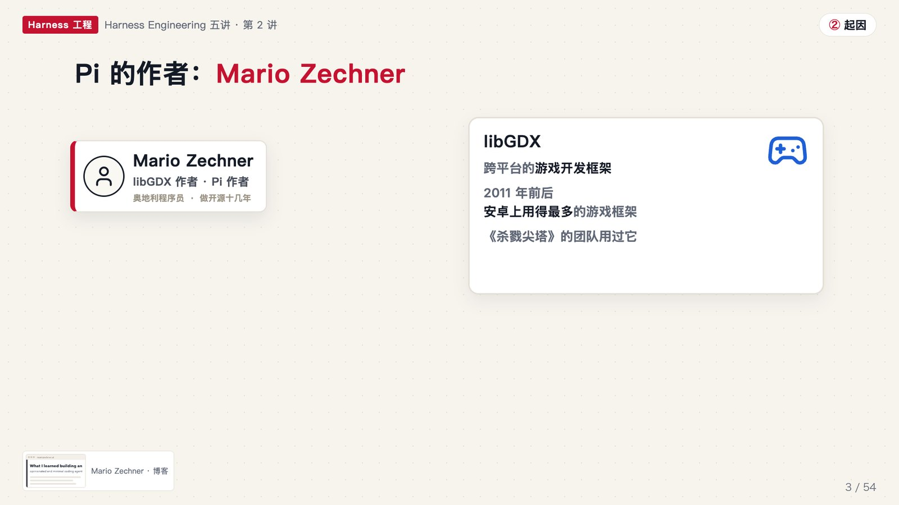

Mario Zechner 是奥地利程序员，做开源十几年，最出名的作品是跨平台游戏框架 libGDX（2011 年前后安卓上用得最多的游戏框架，《杀戮尖塔》的团队用过它）。

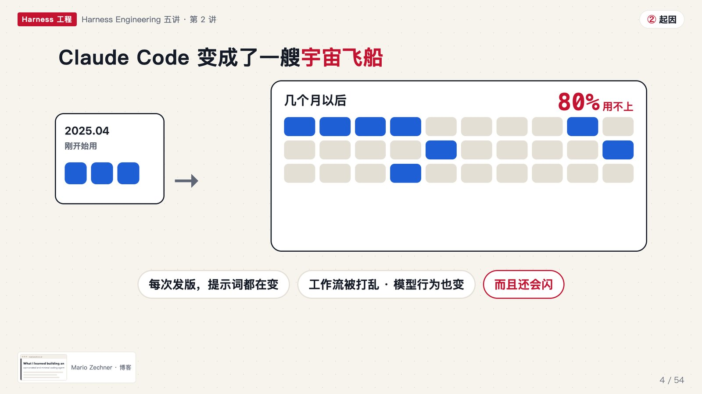

他 2025 年 4 月开始用 Claude Code，几个月后觉得它"变成了一艘宇宙飞船，80% 的功能用不上"；系统提示和工具每次发版都在变，打乱工作流，也改变模型行为。

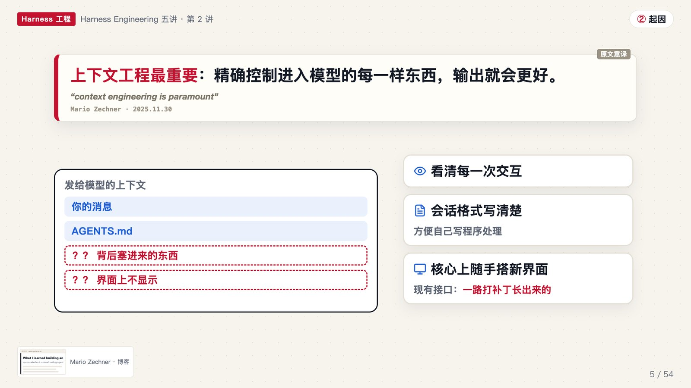

更要紧的理由：

- **上下文工程最重要**：精确控制进入模型的每一样东西，输出就更好。现有 harness 会在背后往上下文里塞东西，界面上都不显示。
- 他想**看清每一次交互**，想要**写清楚格式的会话记录**方便自己写程序处理，想能在 agent 核心上**随手搭新界面**。

### 1.2 起一个谷歌搜不到的名字

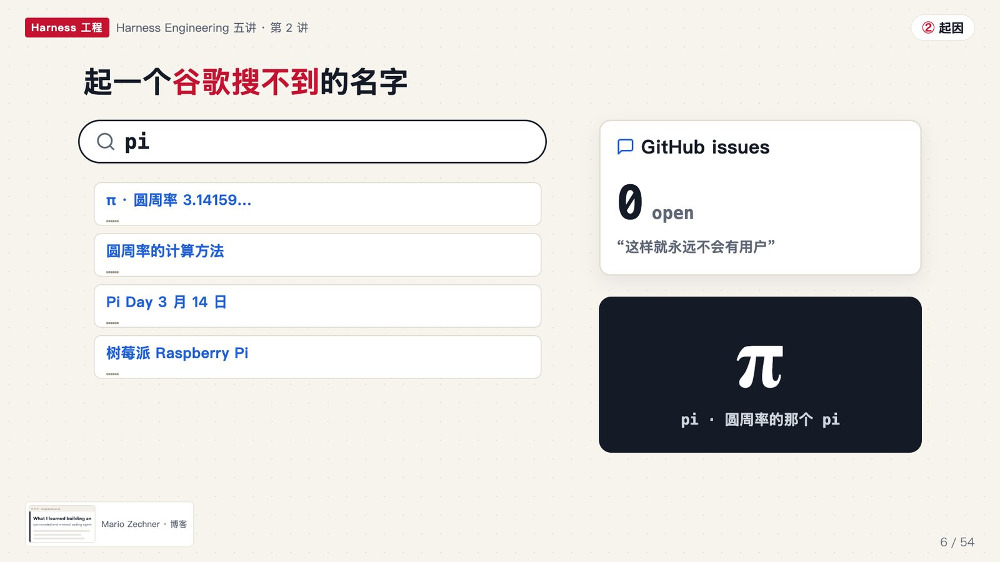

他故意给自己的 harness 起了个搜不到的名字 pi，"这样就永远不会有用户，GitHub 上也就永远不会有 issue"。

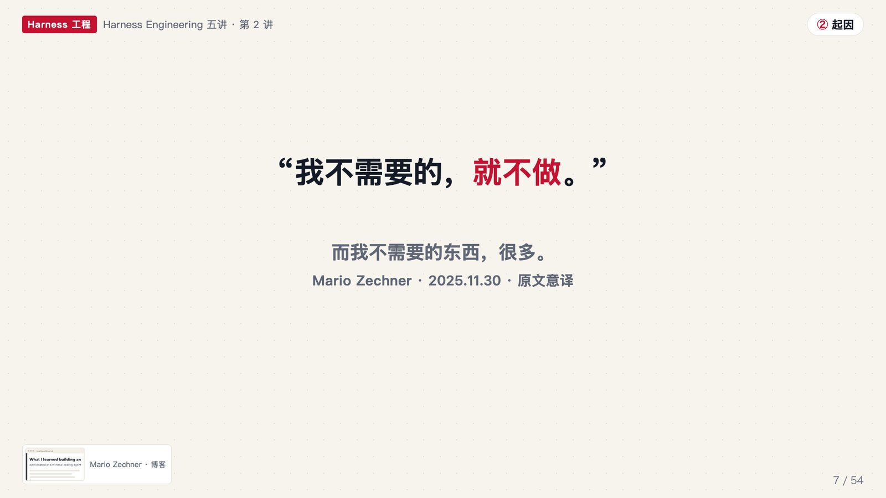

原则只有一句："我不需要的，就不做。而我不需要的东西很多。"

### 1.3 结果它成了 OpenClaw 的底座

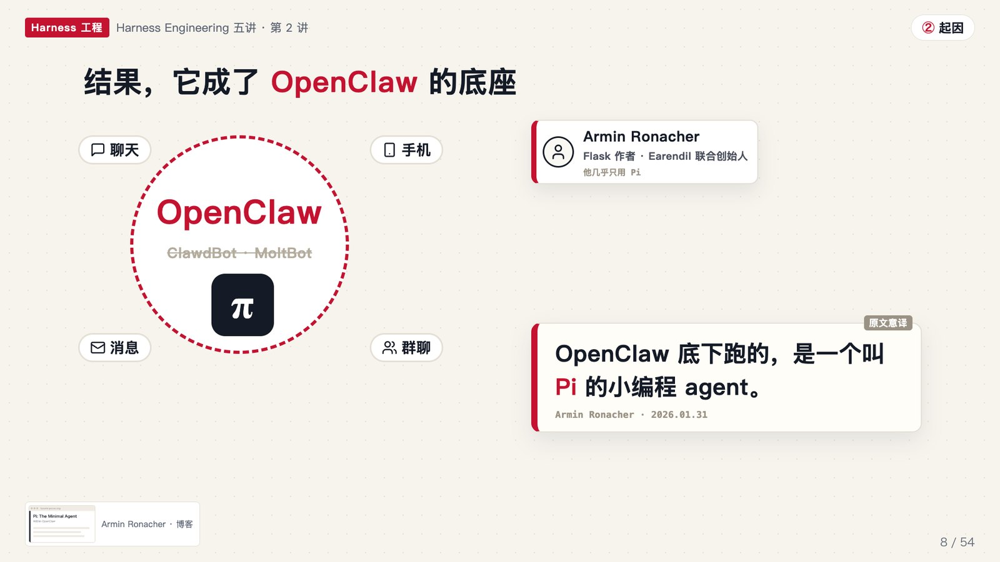

2026 年 1 月底，PSPDFKit 创始人 Peter Steinberger 的 OpenClaw（先后叫过 ClawdBot、MoltBot）火遍全网：一个接在聊天软件上、能直接写代码跑代码的 agent。Flask 作者 Armin Ronacher 在博客里写：OpenClaw 底下跑的就是 Pi，Pi 也是他几乎唯一在用的编程 agent。

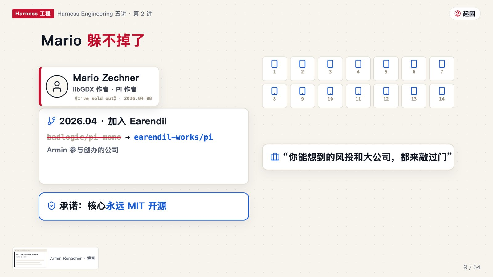

此后两个月 Mario 每天开三到五个电话会，"你能想到的风投和大公司都来敲过门"。2026 年 4 月他带着 Pi 加入 Armin 参与创办的 Earendil：仓库从 `badlogic/pi-mono` 搬到 `earendil-works/pi`，承诺**核心永远 MIT**。

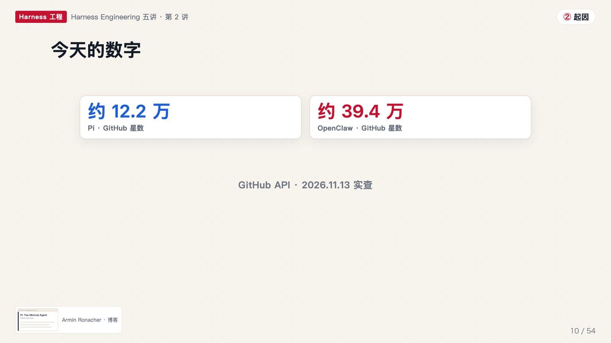

| 项目 | GitHub 星数（2026-11-13 实查） |
|---|---|
| earendil-works/pi | 约 12.2 万 |
| openclaw/openclaw | 约 39.4 万 |

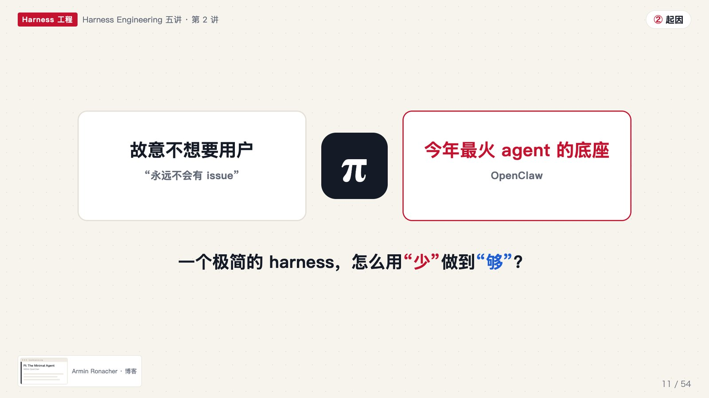

---

## 2 极简内核长什么样

### 2.1 四个包，一个朴素的循环

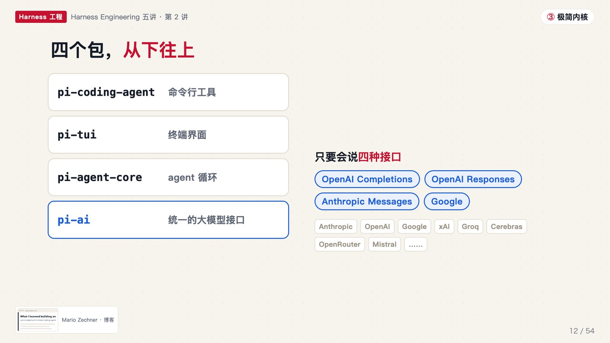

| 包 | 做什么 |
|---|---|
| pi-ai | 统一的大模型接口：十几家厂商，流式、工具调用、推理、计 token 和费用 |
| pi-agent-core | agent 循环：执行工具、校验参数、发出事件 |
| pi-tui | 极简终端界面，差分渲染 |
| pi-coding-agent | 命令行工具，把上面三个连起来 |

他的判断：几乎所有大模型只要会说四种接口就够了（OpenAI Completions、OpenAI Responses、Anthropic Messages、Google）。

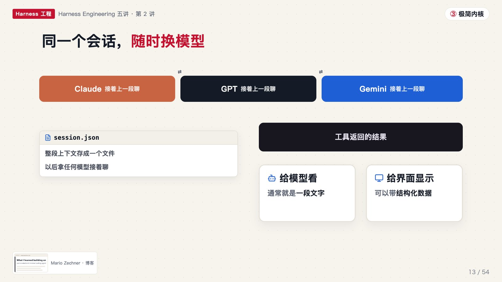

pi-ai 的两个设计：

- **同一会话随时换模型**：从 Claude 换到 GPT 再换到 Gemini，前面的对话接得上；整段上下文能存成一个文件，以后拿任何模型接着聊。
- **工具结果拆两份**：给模型看的通常是一段文字，给界面显示的可以带结构化数据，模型的上下文不会被界面要用的东西撑满。

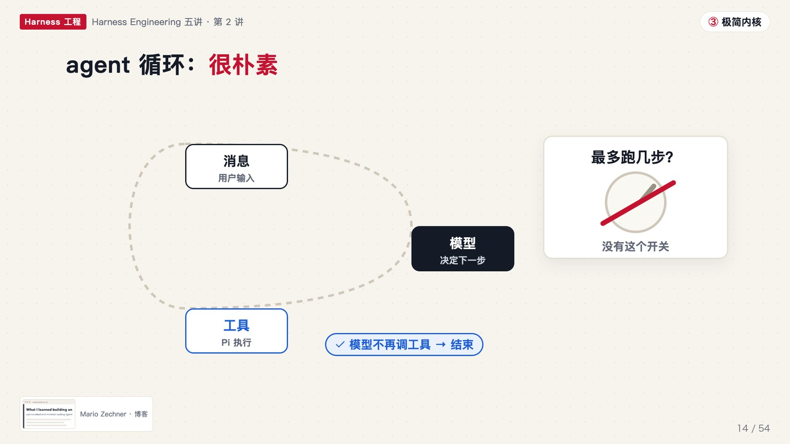

循环本身很朴素：处理消息 → 执行工具 → 结果交回模型 → 重复，直到模型不再调工具。没有"最多跑几步"的开关，作者说从没遇到需要的场景。

### 2.2 整个系统提示，就这么几行

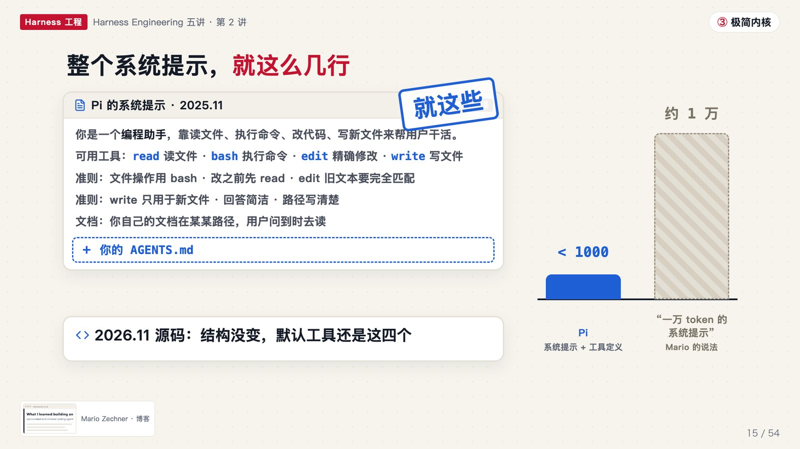

Mario 在博客里贴出的系统提示（2025-11 版本），意思是：

> 你是一个编程助手，靠读文件、执行命令、改代码、写新文件来帮用户干活。
> 可用工具：read、bash、edit、write。
> 准则：文件操作用 bash；改之前先 read；edit 的旧文本要完全匹配；write 只用于新文件或整个重写；回答简洁；路径写清楚。
> 文档：你自己的文档在某某路径，用户问到功能、配置时去读。

最后只追加你的 AGENTS.md。**系统提示加工具定义不到 1000 token。**2026-11 的源码 `system-prompt.ts` 结构没变：一句开场白、工具列表、几条规则、Pi 文档的位置，再接追加的系统提示、项目上下文、技能列表和当前目录，每块用 XML 标签分开，方便扩展单独替换；默认工具仍是 `read, bash, edit, write`。

### 2.3 只有四个工具，为什么够

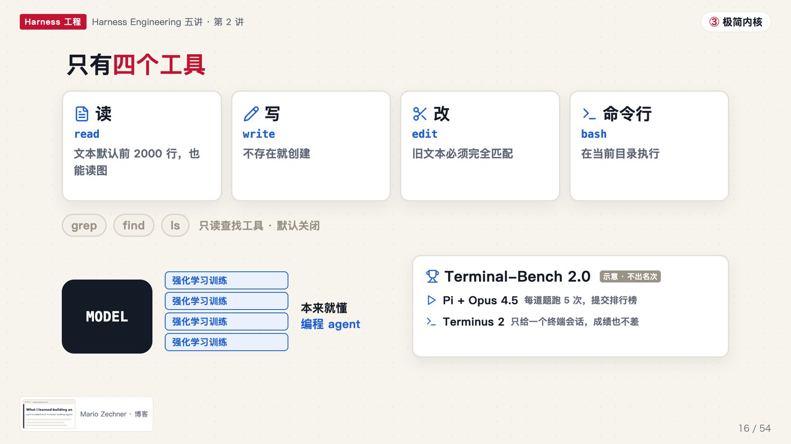

| 工具 | 做什么 |
|---|---|
| read | 读文件，文本默认前 2000 行，也能读图片 |
| write | 写文件，不存在就创建，自动建目录 |
| edit | "旧文本 → 新文本"精确替换，旧文本必须完全匹配 |
| bash | 在当前目录执行命令 |

另有只读的 grep、find、ls，默认关闭。作者的两条理由：

1. 前沿模型都被强化学习反复训练过，本来就懂编程 agent，也会用 bash 和这类读写工具。
2. 他用 Opus 4.5 配 Pi 完整跑了一轮 Terminal-Bench 2.0（每题五次）提交排行榜；基准团队自己的 Terminus 2 只给模型一个 tmux 会话，成绩也不差。（名次只在原文截图里，这里不报。）

---

## 3 五个"不做"，和一个反转

### 3.1 不做的五样东西

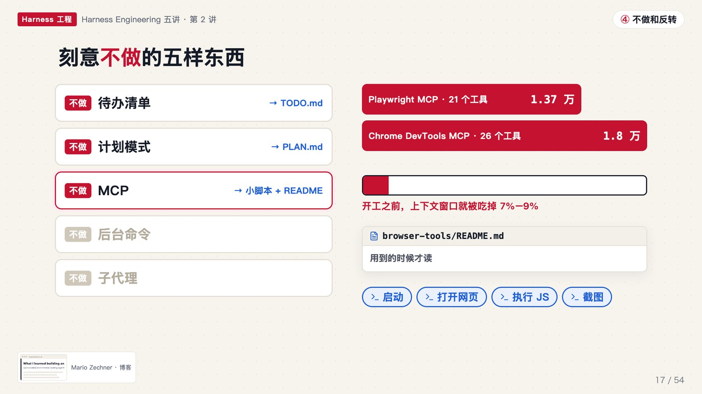

| 不做 | 理由 | 替代办法 |
|---|---|---|
| 内置待办清单 | 多一份要跟踪、要更新的状态，模型更糊涂 | 写进 `TODO.md`，用复选框 |
| 计划模式 | 会话里的计划，会话结束就没了 | 写进 `PLAN.md`，能跨会话、进版本库；要只读就 `pi --tools read,grep,find,ls` |
| MCP | Playwright MCP 21 个工具约 1.37 万 token，Chrome DevTools MCP 26 个工具约 1.8 万 token，开工前吃掉 7%–9% 上下文 | 命令行小脚本 + README，用到时才读；浏览器只要四个脚本：启动、打开网页、执行 JS、截图 |
| 后台 bash | 要跟踪进程、缓存输出、退出清理，还看不见 | 用 tmux，人也能钻进去一起调试 |
| 子代理 | "黑盒里套黑盒"，看不见它做了什么 | 让 Pi 通过 bash 再起一个自己（`pi --print`），最常用于代码评审 |

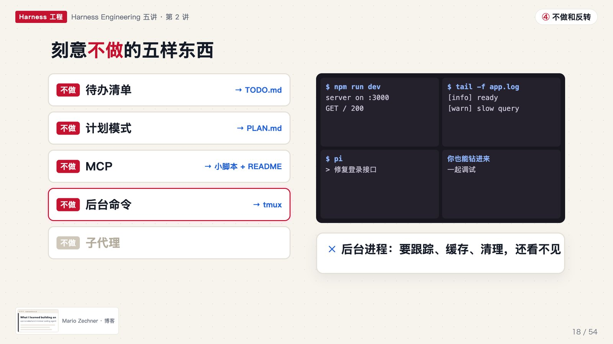

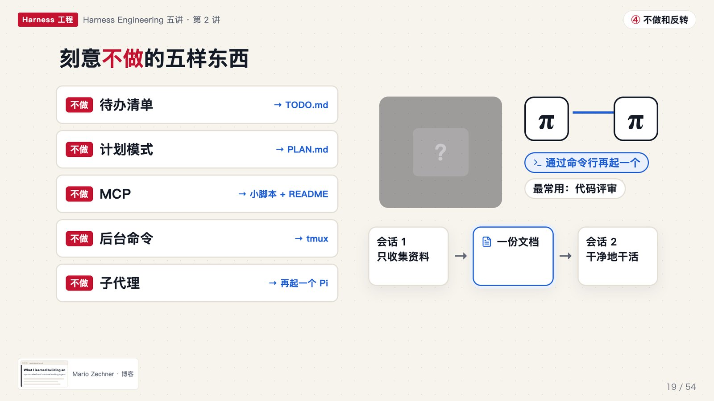

他对子代理还有两句话：

- 会话中途用子代理收集资料，说明没提前规划。应该先单开一个会话收集，写成文档，再开干净的新会话拿着文档干活。
- 并行起一堆子代理同时写功能是**反模式**，除非你不在乎代码库变成一堆垃圾。

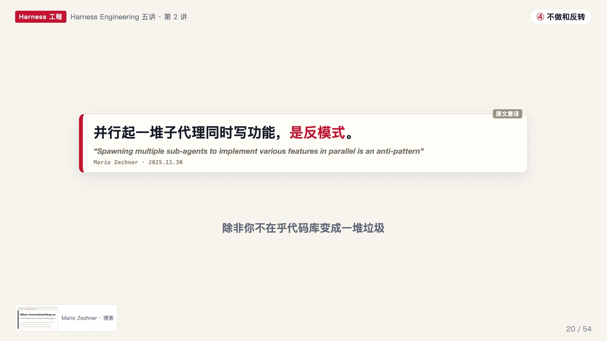

### 3.2 默认全放开

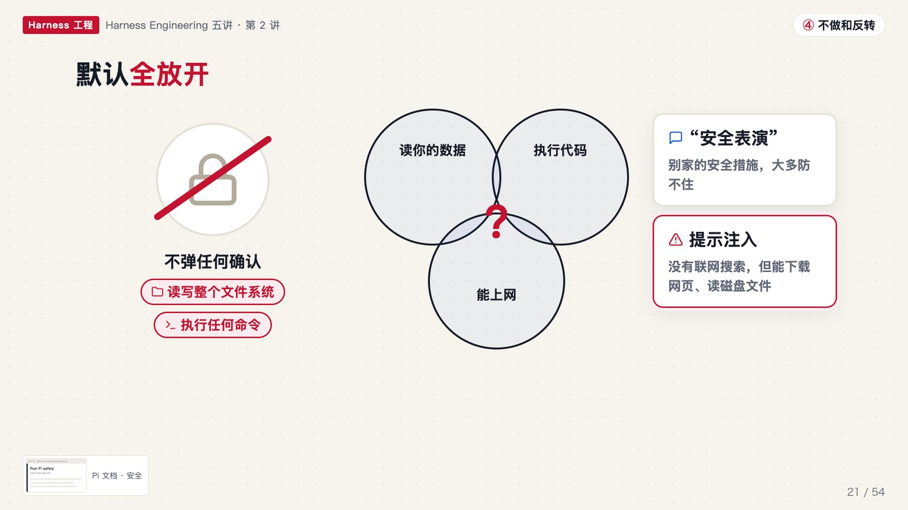

Pi 默认不弹任何确认，能读写整个文件系统、执行任何命令。作者的理由：读私有数据、执行代码、访问网络三样同时具备，就基本防不住，别家的安全措施"大多是安全表演"。他也提醒：Pi 默认没有联网搜索，但能用 curl 下载、能读磁盘文件，这些内容都可能藏着提示注入。

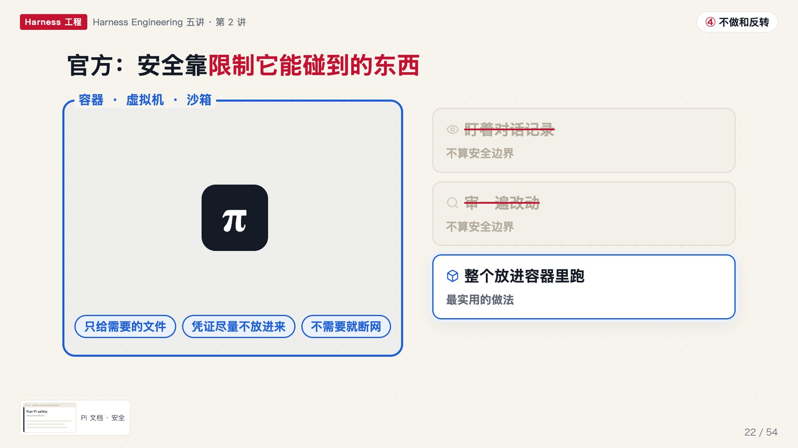

现在的官方安全文档立场不变：安全来自**限制 Pi 能访问的文件、凭证、进程和网络**；盯着对话记录、审改动、项目信任都**不构成安全边界**；最实用的做法是整个跑在容器、虚拟机或沙箱里。

### 3.3 反转：MCP 进来了，但没进内核

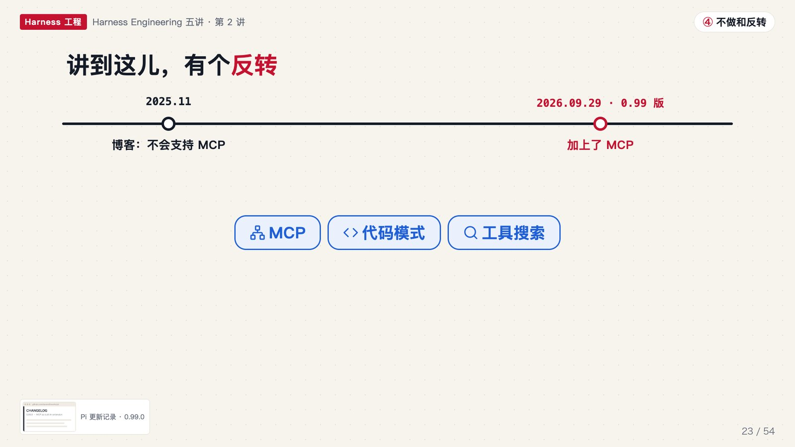

2026-09-29 的 0.99.0 版，Pi 加上了 MCP、codemode（模型写 JavaScript 并行调工具）和工具搜索，但都是**内置扩展**：`pi config` 里能关掉，`--no-extensions` 也会一起关掉。MCP 工具还能设成延迟声明，用到时才通过工具搜索进上下文。

Armin 解释过为什么要这么讲究：在大多数厂商那里，工具说明要在会话开头一次性放进上下文；中途加一个、改一个，要么缓存作废，要么让模型搞不清之前的调用。

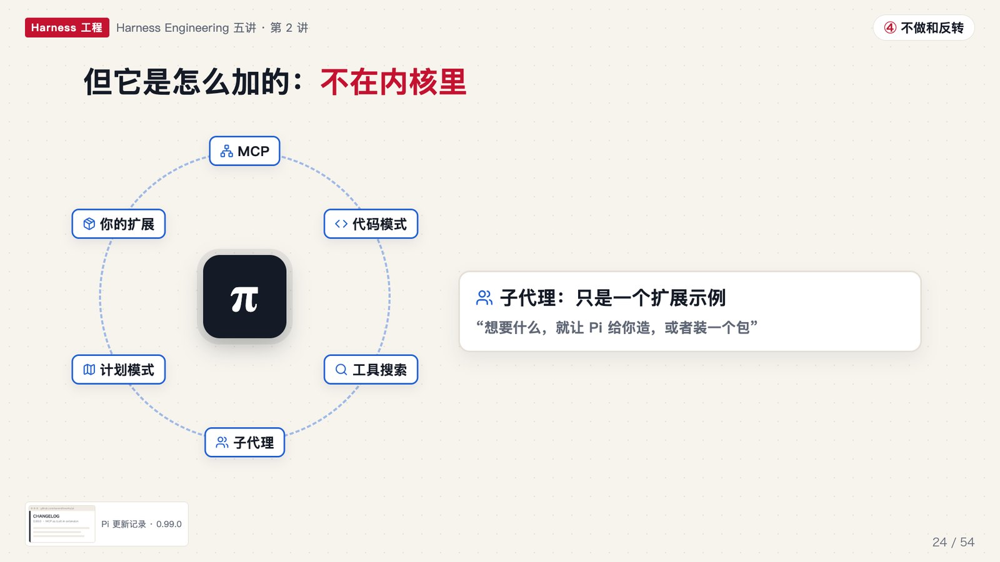

子代理至今不在内核里，只是一个扩展示例。README 和官网写着：Pi 默认跳过子代理和计划模式，"想要什么，就让 Pi 给你造，或者装一个照你的方式做的包"。

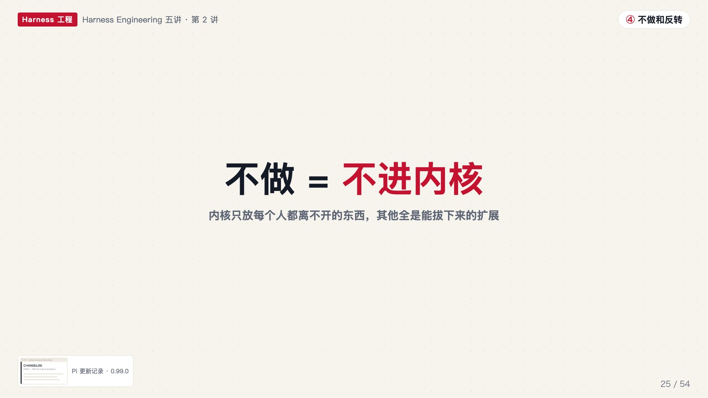

---

## 4 用五个子系统拆 Pi

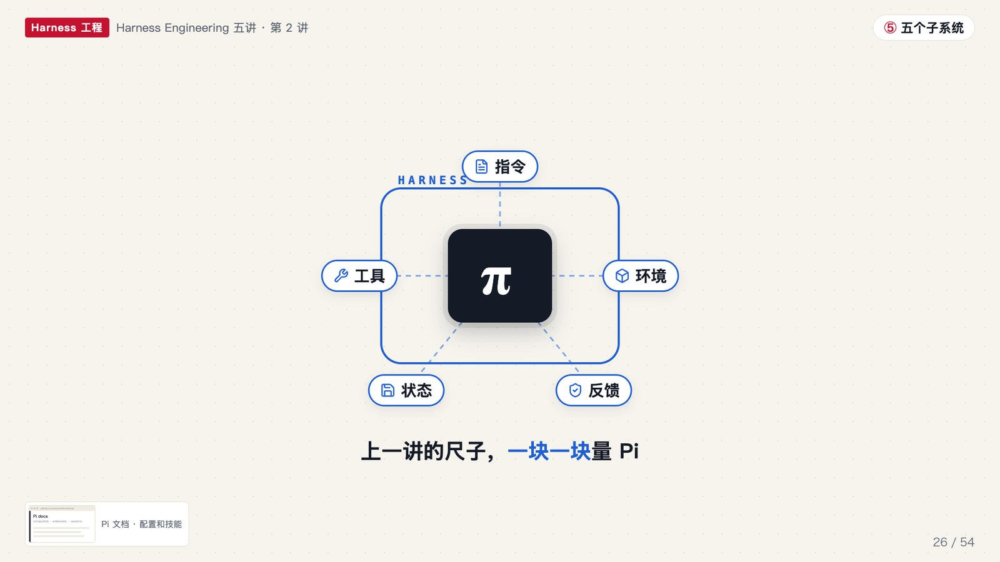

### 4.1 指令：规矩写在文件里

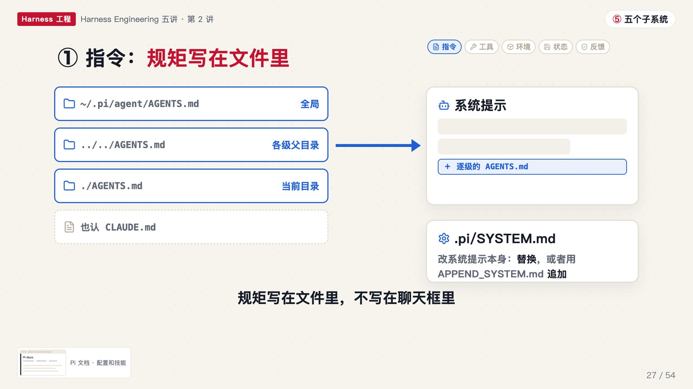

- **AGENTS.md**：启动时加载全局 `~/.pi/agent/AGENTS.md`、各级父目录、当前目录的 AGENTS.md（也认 CLAUDE.md）。同一目录放 `AGENTS.override.md` 可以只替换这一层。
- **`.pi/SYSTEM.md` / `.pi/APPEND_SYSTEM.md`**：替换或追加默认系统提示。

### 4.2 工具：技能按需加载

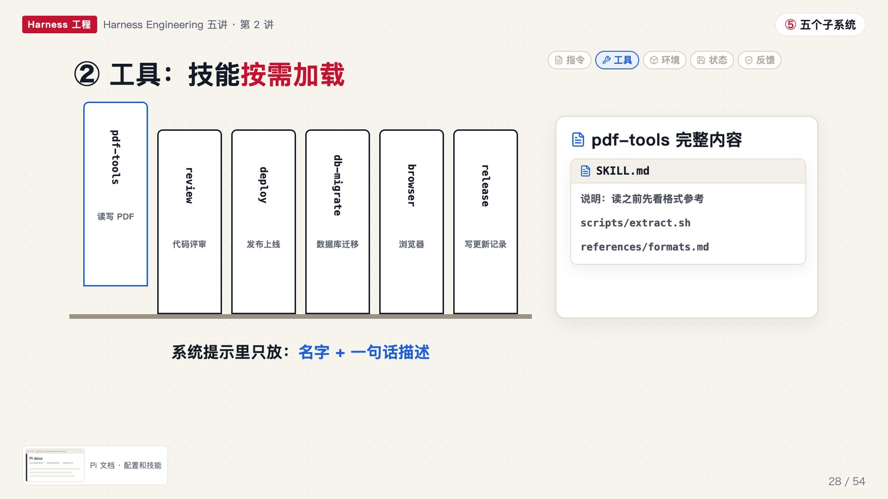

一个技能是一个目录加一个 `SKILL.md`，可以带脚本和参考资料，遵循 Agent Skills 规范。系统提示里只列名字和一句话描述，模型判断用得上时才读完整内容。

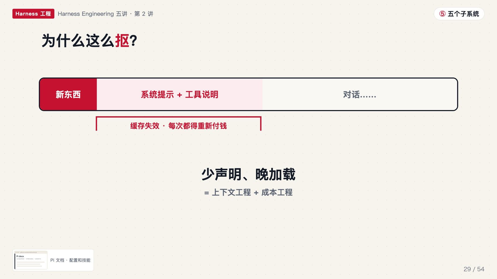

系统提示和工具说明每次请求都要带上，前面的内容一变，提示缓存就失效。**少声明、晚加载，既是上下文工程，也是成本工程。**

### 4.3 环境：靠你自己说清楚

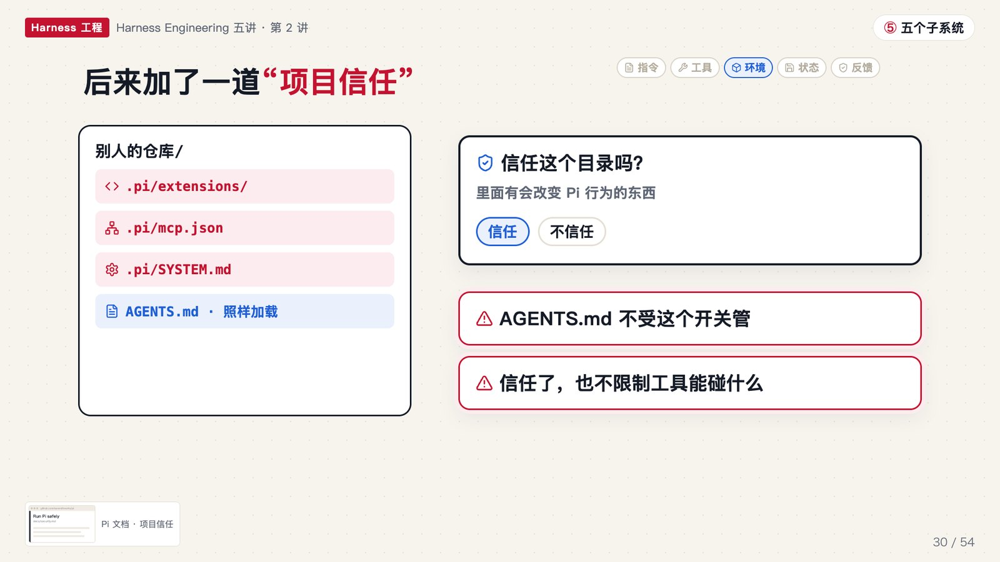

Pi 不管运行环境：依赖、版本、测试命令要你写进 AGENTS.md，隔离要你自己放进容器。后来加的**项目信任**：目录里有 `.pi/extensions`、`.pi/mcp.json`、`.pi/SYSTEM.md` 这类会改变行为的资源时，先问你信不信这个目录。注意：AGENTS.md 不受这个开关管，照样加载；信任了也不限制工具能碰什么。

### 4.4 状态：会话是一棵树

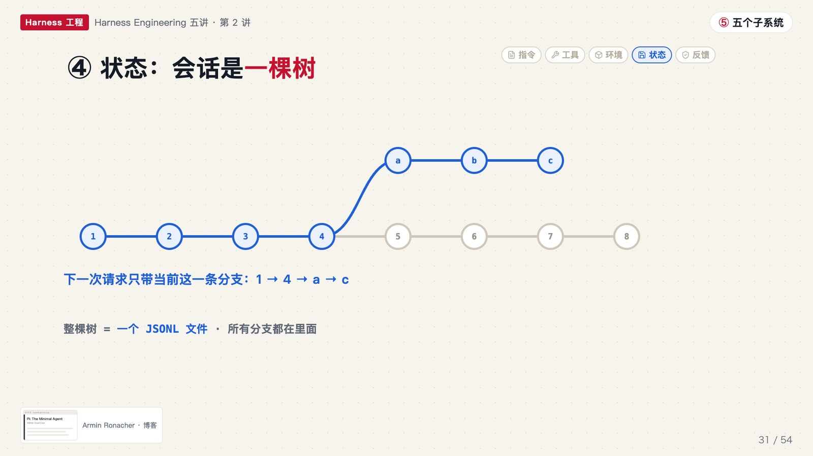

会话存成 JSONL 文件，每条记录有 ID 并指向父记录。当前所在的路径叫活动分支，下一次请求的历史只从这条分支上取。`/tree` 跳回任意节点继续就长出新分支，所有分支都在同一个文件里。

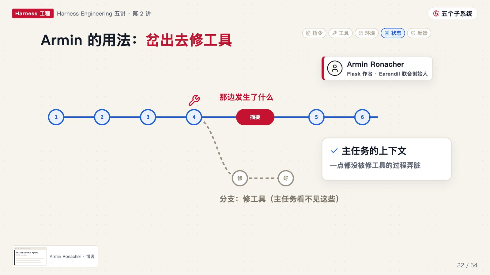

Armin 的用法：主任务做到一半发现工具坏了，岔出一条分支去修，修好跳回原处，Pi 把那条分支的经过总结一下带回来，主任务的上下文不被修工具的过程弄脏。

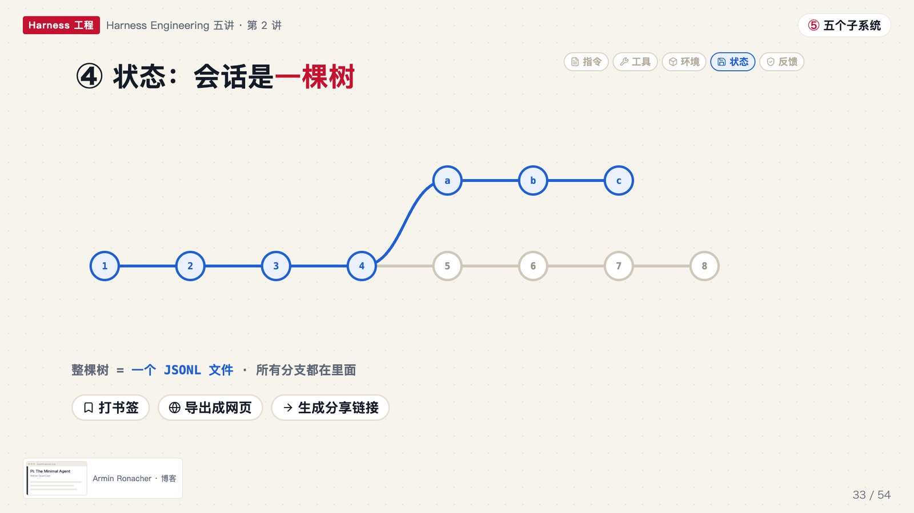

节点能打书签，会话能导出成 HTML 或生成分享链接。

### 4.5 状态：压缩，可以换成你自己的

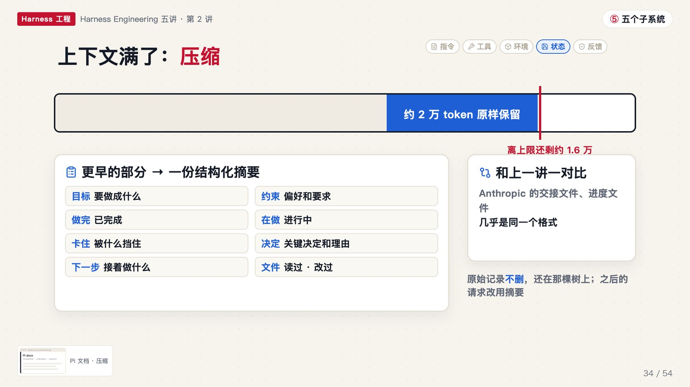

| 项目 | 默认 |
|---|---|
| 触发 | 上下文 > 窗口 − 16,384 token，或手动 `/compact`；溢出时压缩一次再重试 |
| 原样保留 | 从最新往回约 2 万 token |
| 更早的部分 | 结构化摘要：目标、约束和偏好、进度（做完 / 在做 / 卡住）、关键决定、下一步、关键上下文，附读过和改过的文件 |
| 原始记录 | 不删，还在会话树上，之后的请求改用摘要 |

这个摘要格式和第 1 讲 Anthropic 的交接文件、进度文件几乎一样。

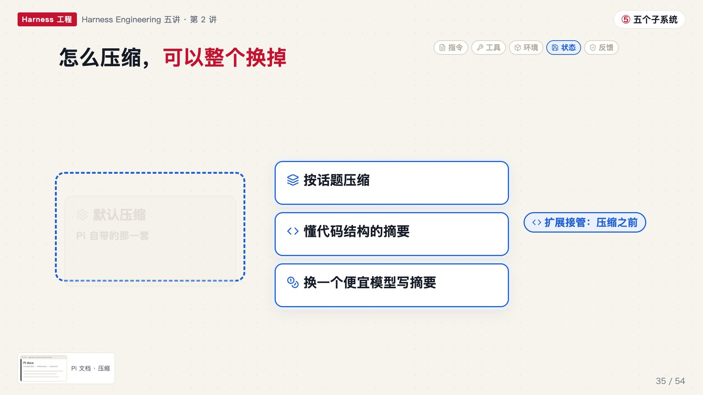

扩展可以接管 `session_before_compact`，换成按话题压缩、懂代码结构的摘要，或者换一个便宜模型写摘要。

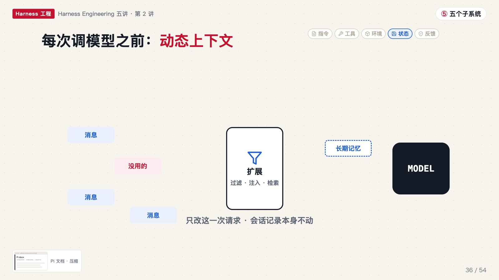

扩展的 `context` 事件在每次调模型前触发：过滤、注入、接检索或长期记忆；只改这一次请求，会话记录不动。

### 4.6 反馈：Pi 不带，交给你

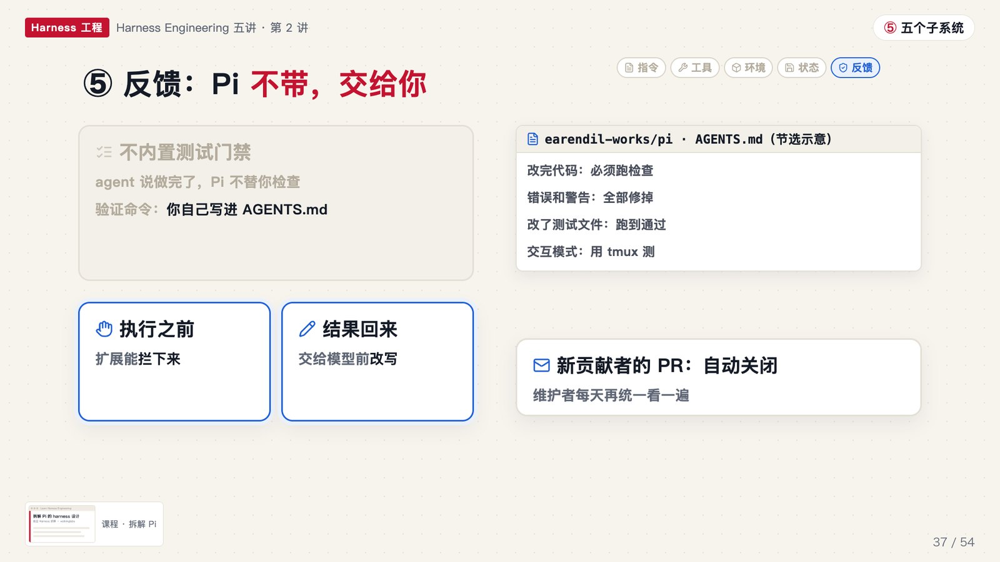

Pi 不内置测试门禁，也不在 agent 说做完后替你检查。验证命令写进 AGENTS.md；要强制就用扩展：`tool_call` 在执行前拦下或改参数，`tool_result` 在结果交给模型前改写。

Pi 自己的仓库是个好例子：AGENTS.md 150 行，要求改完代码跑 `npm run check` 并修掉所有错误和警告、改了测试就跑到通过、用 tmux 测交互模式；新贡献者的 issue 和 PR 自动关闭，维护者每天再统一看。

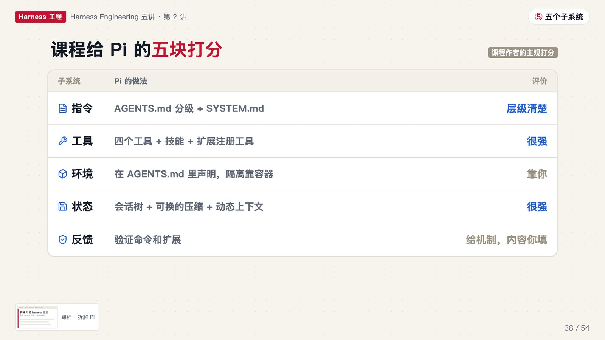

| 子系统 | Pi 的做法 | 评价（课程作者的主观打分） |
|---|---|---|
| 指令 | AGENTS.md 分级 + SYSTEM.md | 层级清楚 |
| 工具 | 四个工具 + 技能 + 扩展注册工具 | 很强 |
| 环境 | 在 AGENTS.md 里声明，隔离靠容器 | 靠你 |
| 状态 | 会话树 + 可换的压缩 + 动态上下文 | 很强 |
| 反馈 | 验证命令和扩展 | 给机制，内容你填 |

课程里还举了一个社区仓库 pi-agent-harness（用扩展维护 `PROGRESS.md`、`LESSONS.md`、记录 token 用量）。那是一个个人项目，说明扩展能做到这些，不是 Pi 自带的功能。

---

## 5 扩展：让 agent 改它自己的 harness

### 5.1 把运行时的事件全部打开

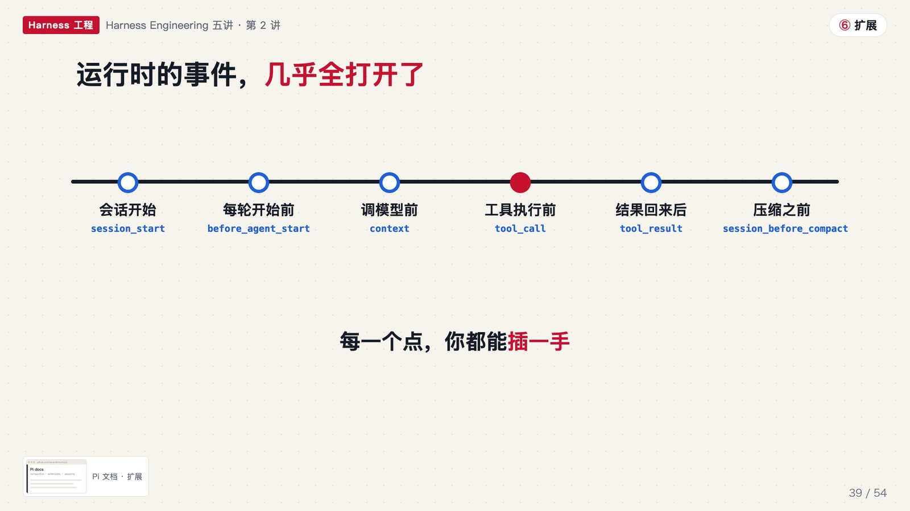

扩展是跑在 Pi 进程里的 TypeScript 模块，能注册工具和命令、画终端界面、往会话里存自己的数据。主要事件：

| 时机 | 事件 | 能做什么 |
|---|---|---|
| 会话开始 | `session_start` | 加载记忆 |
| 每轮开始前 | `before_agent_start` | 改系统提示、换工具集 |
| 每次调模型前 | `context` | 过滤、注入消息 |
| 工具执行前 | `tool_call` | 拦下危险命令、改参数 |
| 工具结果回来后 | `tool_result` | 改写结果 |
| 压缩前 | `session_before_compact` | 换成自己的压缩 |

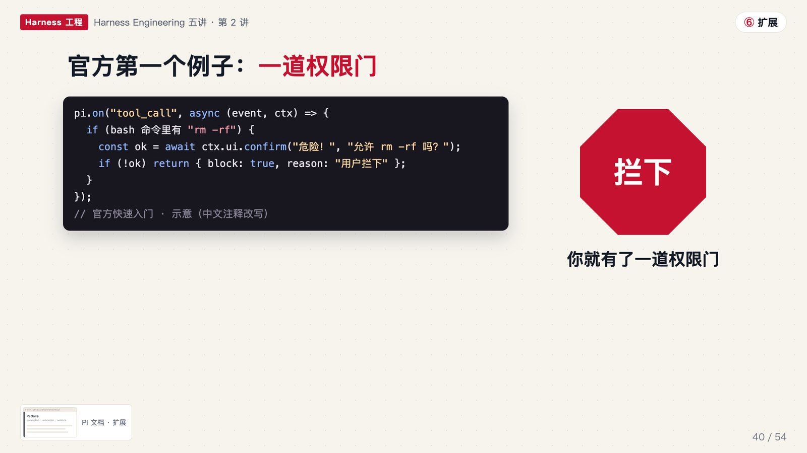

官方快速入门里的权限门：

```ts
pi.on("tool_call", async (event, ctx) => {
  if (isToolCallEventType("bash", event) && event.input.command.includes("rm -rf")) {
    const ok = await ctx.ui.confirm("Dangerous!", "Allow rm -rf?");
    if (!ok) return { block: true, reason: "Blocked by user" };
  }
});
```

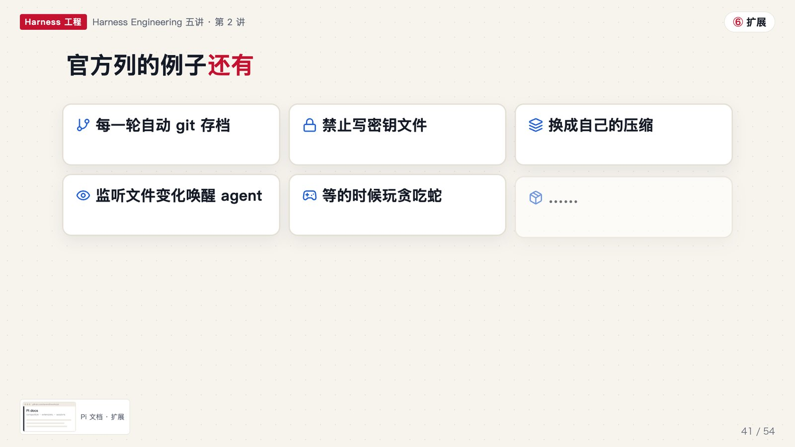

其他官方例子：每轮 git 存档、禁止写 `.env`、自定义压缩、文件监听或 Webhook 唤醒 agent、等的时候玩贪吃蛇。Armin 自己只给 agent 加过一个工具（待办清单），其他全是技能和界面扩展：工具能不加就不加。


官网：子代理、计划模式、权限门、沙箱、MCP 集成，都可以用扩展自己搭，有 50 多个示例。

### 5.2 让 Pi 自己写扩展

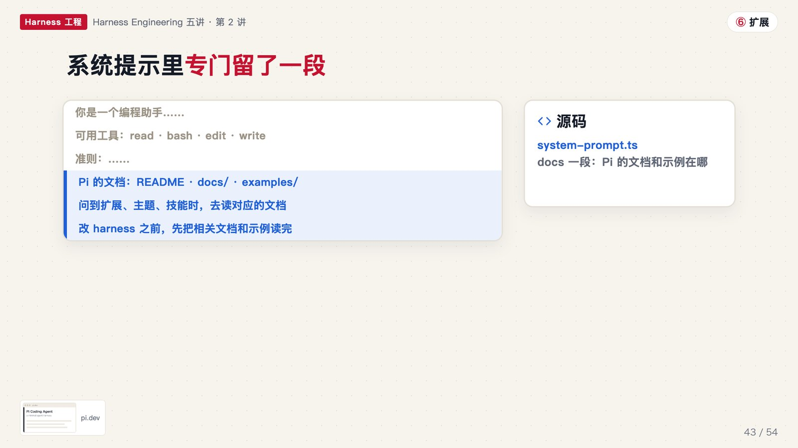

官网的意思是：需要一个命令、工具、工作流或界面上的小改动，就让 Pi 去造，它会当场改造自己；改完 `/reload` 热加载接着干活。系统提示里专门有一段告诉模型 Pi 的文档和示例在哪，改 harness 前先读完。

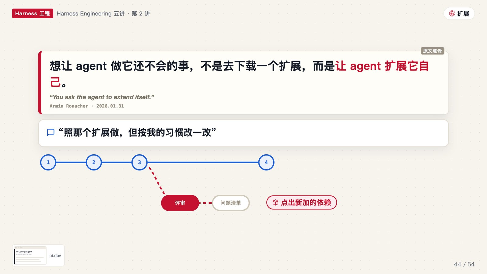

Armin 说这是 Pi 的核心想法：想让 agent 做它还不会的事，不是去下载扩展，而是**让 agent 扩展它自己**，甚至可以指着一个现成扩展说"照那个做，按我的习惯改一改"。他的 `/review` 命令就是从当前位置岔出一条干净分支做评审，拿到问题清单再带回主会话，并专门点出新加的依赖。

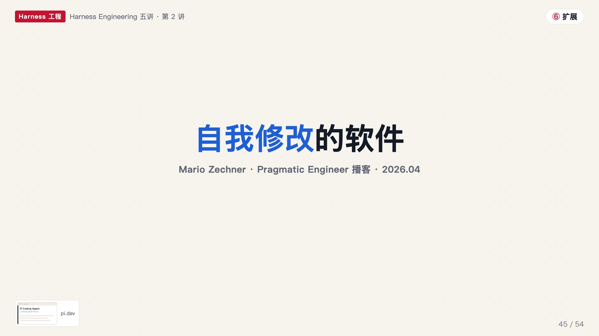

Mario 在播客里把这叫"自我修改的软件"。

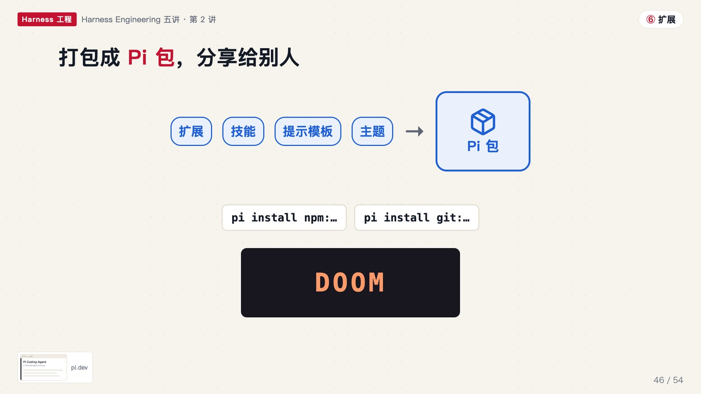

扩展、技能、提示模板、主题可以打包成 Pi 包，用 `pi install npm:…` 或 `pi install git:…` 安装分享。Mario 自己做过一个在 Pi 终端里跑《毁灭战士》的包。

### 5.3 四种用法

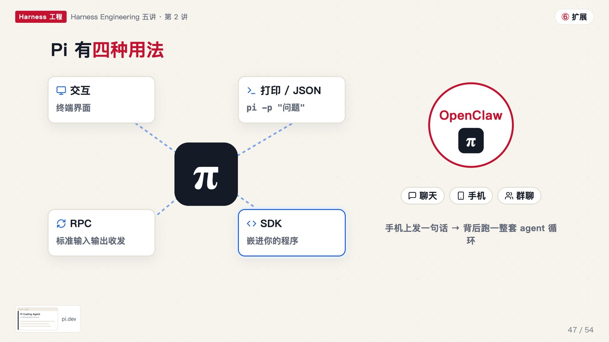

| 模式 | 用法 |
|---|---|
| 交互 | 终端界面 |
| 打印 / JSON | `pi -p "问题"`，`--mode json` 输出事件流 |
| RPC | 标准输入输出收发 JSON |
| SDK | 嵌进你的 TypeScript 程序 |

四种模式用同一套 agent 和会话机制。OpenClaw 用的是 SDK：把 Pi 嵌进自己的程序，再接到聊天软件上。

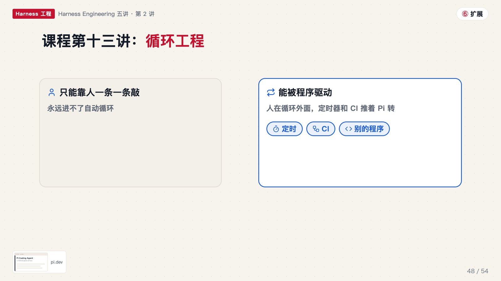

这对应课程第十三讲的循环工程：只能靠人在终端里一条条敲的 harness 进不了自动循环；能被脚本、CI、别的程序驱动，才接得进去。

---

## 6 代价、适合谁，和能抄走的四条

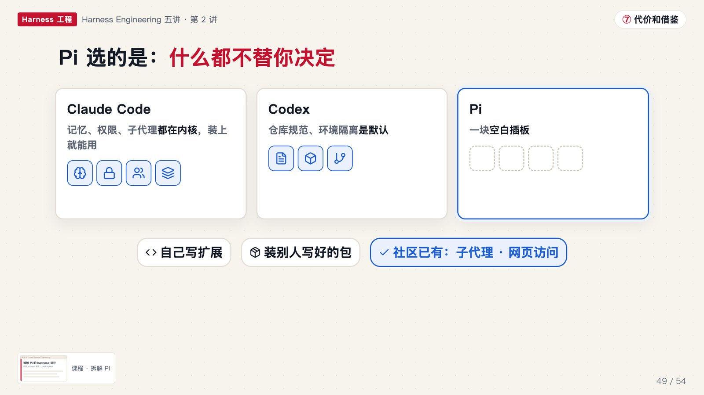

和后两讲对比：Claude Code 把记忆、权限、子代理做进内核，开箱即用；Codex 把仓库规范、环境隔离做成默认；Pi 什么都不替你决定。代价是要么自己写扩展，要么装别人的包（社区已有子代理、网页访问这类包）。

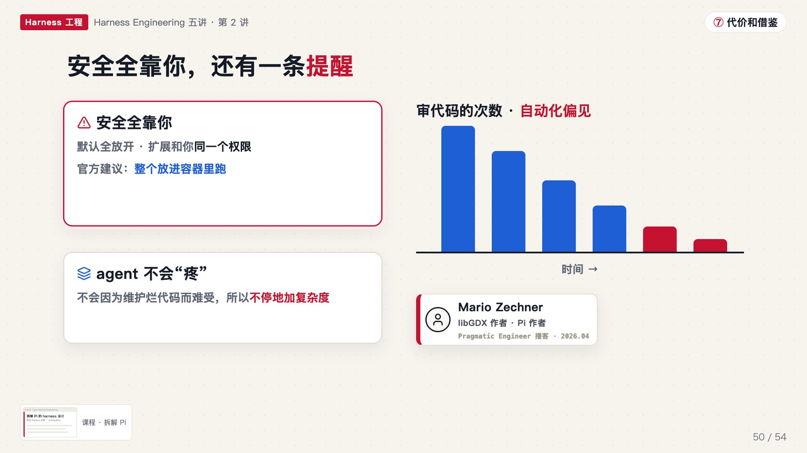

安全全靠你：默认全放开，扩展和你同一个权限，官方建议整个放进容器跑。Mario 在播客里提醒**自动化偏见**：看 agent 写过几次像样的代码，就越来越少审它，可它照样会产出垃圾；agent 也不会因为维护烂代码而"疼"，所以会不停加复杂度。

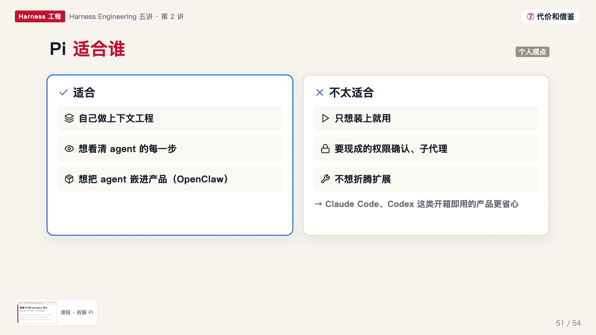

（以下是我的看法，不是课程内容。）

| 适合 | 不太适合 |
|---|---|
| 自己做上下文工程 | 只想装上就用 |
| 想看清 agent 的每一步 | 要现成的权限确认、子代理、计划模式 |
| 想把 agent 嵌进自己的产品（像 OpenClaw） | 不想折腾扩展 |


哪怕主力用别的工具，也可以拿 Pi 当一面镜子：一个不到 1000 token 的系统提示能走多远？你的 harness 里哪些零件真正在承重？


课程总结的四条设计：

1. **压缩做成可替换的策略**，别写死成一个参数。
2. **用会话树代替硬摘要**，能回放的历史往往比"上一轮总结"更可靠。
3. **对提示缓存友好**：技能按需加载，别把所有规则一次塞进系统提示。
4. **让 agent 能改自己的 harness**：扩展面够开放，优化 agent 行为本身就能交给 agent 半自动完成。

---

## 本讲小结


1. Pi 的出发点是上下文工程：别在背后往上下文里塞东西，让人看得见、控制得了。
2. 内核极小：系统提示加工具定义不到 1000 token，四个工具 read、write、edit、bash。
3. "不做"是不进内核：待办、计划写进文件，子代理和 MCP 是能拔掉的扩展。
4. 状态拆得最细：会话树、可替换的压缩、每次请求前的动态上下文。
5. 扩展把运行时事件全部打开，Pi 能自己写扩展、热加载，改造自己的 harness。

## 下一讲预告

第 3 讲拆 Claude Code，正好是 Pi 的反面：记忆、压缩、权限、钩子、子代理都做进了产品里。看 Anthropic 怎么管住一个会自夸的 agent，第 1 讲引用的那几篇 Anthropic 文章会在产品里一一对上。

## 关键术语

| 术语 | 意思 |
|---|---|
| 极简内核 | 内核只放每个人都离不开的东西，其他做成可拔掉的扩展 |
| 扩展（extension） | 跑在 Pi 进程里的 TypeScript 模块，订阅生命周期事件、注册工具和命令 |
| 技能（skill） | 一个目录 + `SKILL.md`，系统提示里只放名字和描述，用到时才读全文 |
| 渐进式披露 | 先只告诉模型有什么，需要时再给完整内容 |
| 提示缓存 | 请求前缀不变时可以复用的缓存；前缀一改就失效 |
| 会话树 | 每条记录指向父记录，可以从任意节点长出分支；请求只带活动分支 |
| 压缩（compaction） | 上下文快满时把较早的部分换成结构化摘要，原始记录保留 |
| 动态上下文 | 每次调模型前由扩展过滤、注入、检索消息，只改这一次请求 |
| 项目信任 | 加载目录里会改变行为的资源前先问你；不是安全边界 |
| 自动化偏见 | 因为 agent 以前表现不错，就越来越少审它的输出 |

## 思考题

1. Pi 不做 MCP 的理由是上下文开销。可 0.99 版又加上了 MCP，这和"我不需要的就不做"矛盾吗？
2. 会话树和"上一轮写一份总结"相比，跨会话恢复时各有什么优缺点？
3. Pi 的压缩摘要格式为什么会和 Anthropic 的交接文件几乎一样？
4. 如果你要在 Pi 上实现"agent 说做完就必须跑一遍测试"，会挂在哪个事件上？怎么写？
5. 作者说别家的安全措施大多是"安全表演"。你同意吗？在什么条件下权限确认是有用的？

<details>
<summary>参考答案</summary>

1. 不矛盾。MCP 没有进内核，是可以整个关掉的内置扩展，工具还能延迟声明。"不做"的准确意思是不进内核：不需要的人一点开销都不付。
2. 会话树保留了原始记录，可以精确回放、在任意节点分支，不会因为摘要写漏而丢信息；代价是文件变大，而且回放太长的历史还是要压缩。总结短、省上下文，但写漏的东西就永远丢了。
3. 两者要解决的是同一个问题：让一个"不记得之前发生了什么"的新上下文快速接上进度。所以都需要目标、约束、做完了什么、在做什么、卡在哪、下一步。
4. 一种做法是在 `tool_result` 或回合结束的事件里检查：模型声称完成、但这一轮没有跑过测试命令时，注入一条消息要求先跑测试；或者在 `before_agent_start` 里把"做完必须跑测试"加进系统提示，再在扩展里用 `pi.exec` 自己跑一遍。
5. 开放题。权限确认防不住读数据、执行代码、上网三样同时具备时的数据外泄，但能防住误操作（比如误删）。真正的边界还是限制它能碰到的文件、凭证和网络。

</details>

## 动手练习

1. 照官方快速入门，给 Pi（或你用的任何支持钩子的 agent）写一道"危险命令执行前确认"的权限门。
2. 用 `/tree` 做一次分支：主任务做到一半岔出去修一个小问题，再跳回来，看 Pi 带回来的摘要写了什么。
3. 数一数你现在用的 agent，系统提示和工具说明加起来大概多少 token；把用不上的工具关掉，看行为有没有变。

## 延伸阅读

- 原课程：[walkinglabs/learn-harness-engineering](https://github.com/walkinglabs/learn-harness-engineering)（[中文版网页](https://walkinglabs.github.io/learn-harness-engineering/zh/)）
- Mario Zechner：[What I learned building an opinionated and minimal coding agent](https://mariozechner.at/posts/2025-11-30-pi-coding-agent/)
- Mario Zechner：[What if you don't need MCP at all?](https://mariozechner.at/posts/2025-11-02-what-if-you-dont-need-mcp/)
- Mario Zechner：[I've sold out](https://mariozechner.at/posts/2026-04-08-ive-sold-out/)
- Armin Ronacher：[Pi: The Minimal Agent Within OpenClaw](https://lucumr.pocoo.org/2026/1/31/pi/)
- Pi 官网：[pi.dev](https://pi.dev/)；仓库：[earendil-works/pi](https://github.com/earendil-works/pi)（文档在 `packages/coding-agent/docs/`：how-pi-works、compaction、extensions、skills、mcp、security）
- Pragmatic Engineer 播客：[Building Pi, and what makes self-modifying software so fascinating](https://newsletter.pragmaticengineer.com/p/building-pi-and-what-makes-self-modifying)

---

画面和配音由 AI 生成。人物用线描头像，引语是原文意译；"适合谁"一段是个人观点；标"示意"的画面是示意。
