# 第 3 讲 · 拆解 Claude Code：怎么管住一个会自夸的 agent

> Harness Engineering 五讲 · 配套课件
> 配套视频（20 分钟）：B 站 / 视频号 / 抖音 / 小红书搜索「竹二木SI」 · 整份幻灯片：[l03-幻灯片.pdf](./l03-幻灯片.pdf)
> 底本：开源课程 [Learn Harness Engineering](https://github.com/walkinglabs/learn-harness-engineering)（walkinglabs，MIT 协议）"前沿 Harness 拆解"栏目的《拆解 Claude Code 的 harness 设计》。和一手资料对不上的地方（会话存储、权限模式数量、引语出处），按 Claude Code 官方文档（2026-11-14 核对）、Anthropic 工程博客和 VILA Lab 的拆解报告改写；出处见文末"延伸阅读"。本课件是非官方的学习整理。

## 这一讲你会学到

学完这一讲，你应该能做到：

1. 说出 Claude Code 官方对 agentic harness 的定义，以及"核心是一个简单循环、大部分代码在循环外"这个结论。
2. 说出 Anthropic 自己承认的三种毛病，以及它们共同的根源。
3. 区分两类指令：模型决定的（CLAUDE.md、技能）和 harness 强制的（钩子、拒绝规则），并判断一条规则该放哪一边。
4. 讲清 CLAUDE.md 的四个作用域和加载规则、自动记忆、上下文成本表、五层压缩和子代理隔离。
5. 写出一个 Stop 钩子，说清判断"做完没有"的四档做法、六种权限模式和检查点。
6. 说出会话记录怎么支持继续和分叉，长任务的功能清单怎么防止提前宣告完成，并和 Pi 做对比。

建议先看一遍视频，再对照本课件逐节复习。每节开头的图就是视频里对应的画面。

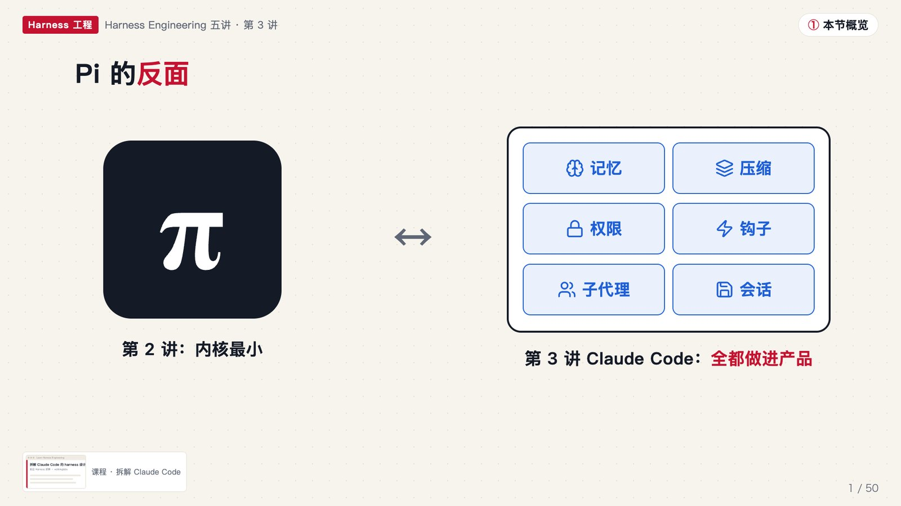

上一讲的 Pi 把内核做到最小，这一讲的 Claude Code 正好相反：记忆、压缩、权限、钩子、子代理，都做进了产品里。

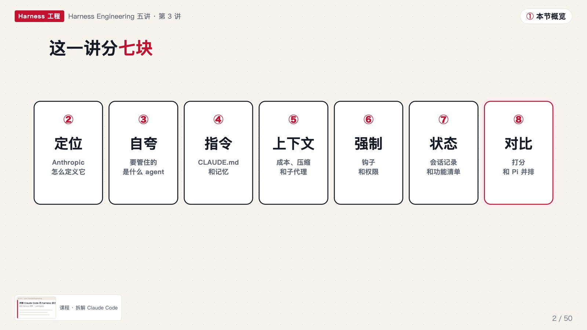

---

## 1 Pi 的反面：Anthropic 自己说，这是一个 harness

### 1.1 官方定义

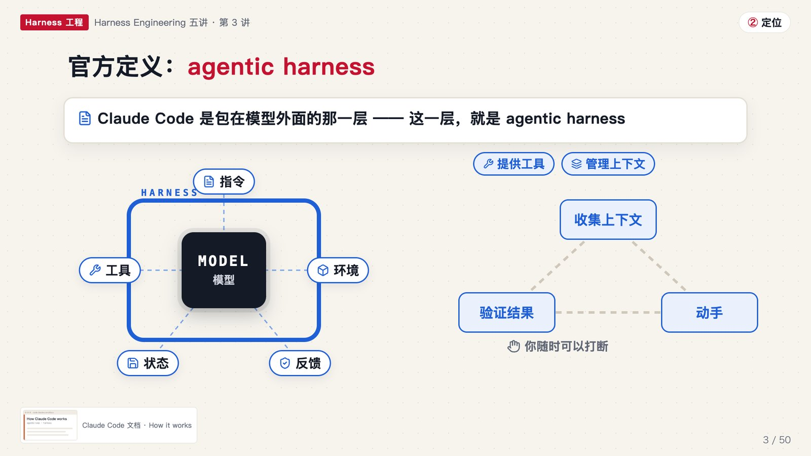

《How Claude Code works》：agent 循环由两样东西驱动，负责推理的模型和负责动手的工具；**Claude Code 是包在模型外面的那一层，提供工具、管理模型看到的上下文，这一层就是"agentic harness"指的东西**。循环分三个阶段：收集上下文、动手、验证结果，你随时可以打断。

### 1.2 一次意外，让人数清了 harness 有多大

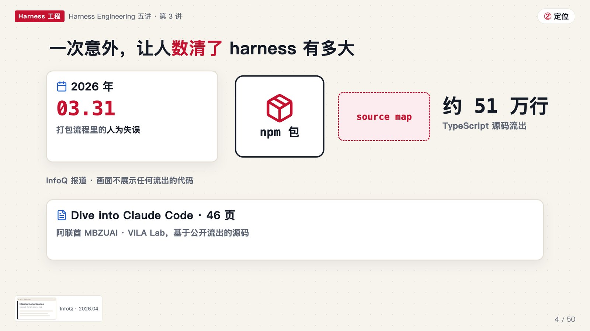

2026 年 3 月 31 日，Claude Code 2.1.88 版的 npm 包误带了 source map，约 51 万行 TypeScript 源码流出，原因是打包时的人为失误（InfoQ 报道）。MBZUAI 的 VILA Lab 基于这份公开流出的源码写了 46 页的《Dive into Claude Code》。本课件不展示任何流出的代码。

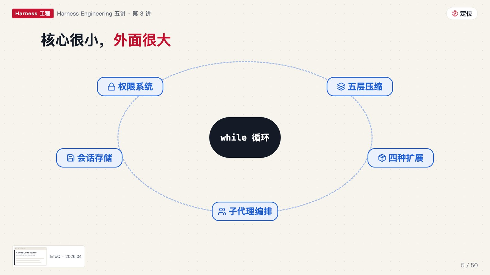

报告的结论：核心是一个简单的 while 循环（调用模型、执行工具、重复）；大部分代码在循环外面：权限系统、五层上下文压缩、四种扩展机制、子代理编排、会话存储。

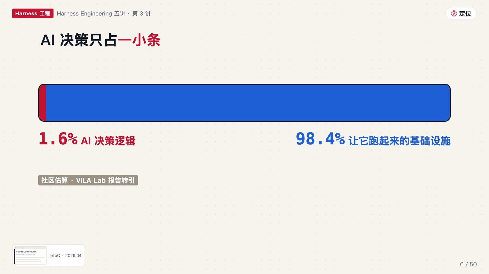

报告转引的社区估算：只有约 **1.6%** 的代码是 AI 决策逻辑，**98.4%** 是运行它的基础设施。

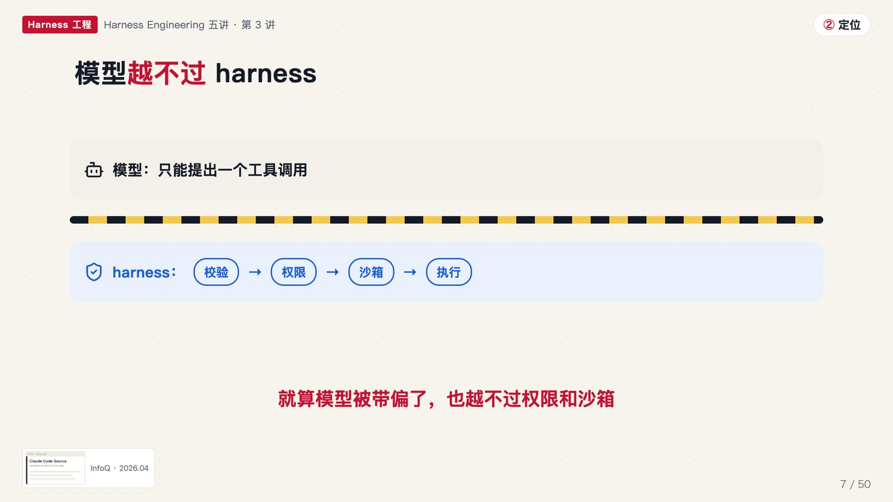

模型从不直接访问文件系统、执行命令或发网络请求，只能提出一个结构化的工具调用，由 harness 校验后执行；推理和执行在两条代码路径上，所以被操纵的模型也越不过权限检查和沙箱。

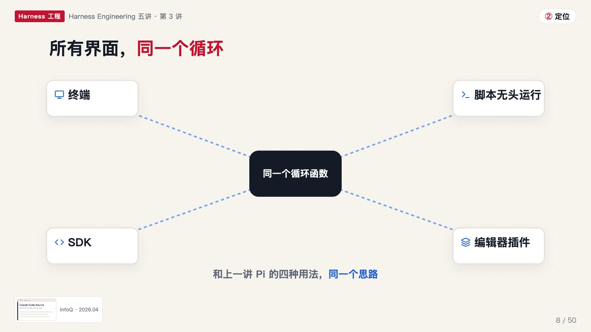

终端、无头脚本、SDK、编辑器插件，底下都是同一个循环函数，只有界面层不同。这和上一讲 Pi 的四种用法是同一个思路。

---

## 2 一个会自夸的 agent

### 2.1 三种毛病

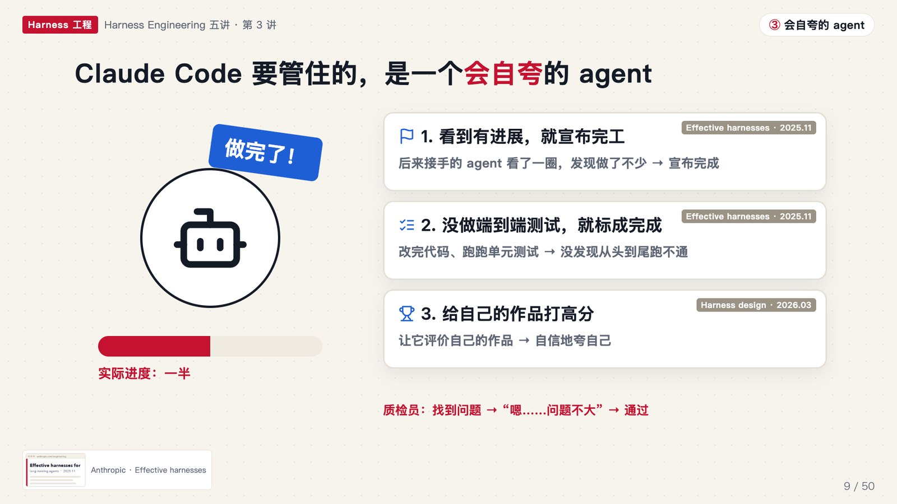

Anthropic 在 Claude Agent SDK（Claude Code 底下那套 harness）上做长任务时记下的：

| 毛病 | 出处 |
|---|---|
| 看到已经有进展，就宣布任务完成 | 《Effective harnesses for long-running agents》 |
| 改完代码、跑跑单元测试就标完成，没发现功能端到端跑不通 | 同上 |
| 评价自己的作品时自信地夸自己；出厂的 Claude 是很差的质检员，找到问题又说服自己"问题不大" | 《Harness design for long-running application development》 |

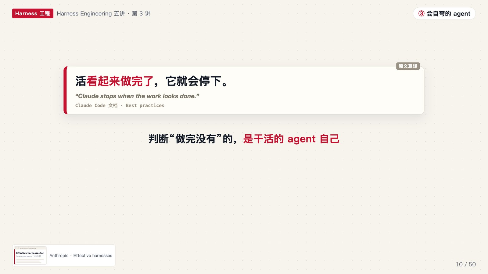

最佳实践文档的一句话："Claude stops when the work looks done."（活看起来做完了，它就会停下。）根源是：**判断做完没有的，是干活的 agent 自己。**

### 2.2 两种指令

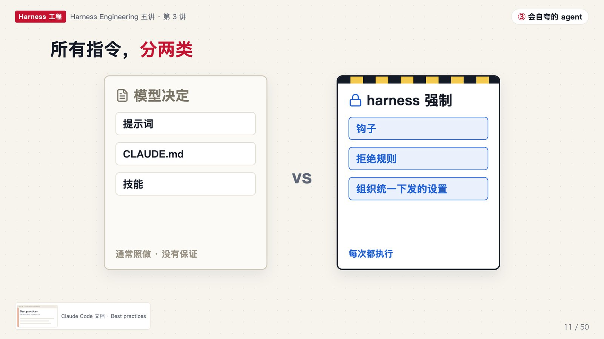

| | 模型决定（非确定性） | harness 强制（确定性） |
|---|---|---|
| 做什么 | 提示词、CLAUDE.md、模型自己挑的技能 | 钩子、只有你能启动的技能 |
| 能碰什么 | 自动模式的分类器 | 拒绝规则、严格模式沙箱、组织设置 |
| 什么时候算完 | 要它给证据、`/goal`、`/code-review` | 测试、类型检查、Stop 钩子、CI |
| 花多少 | 推理强度、它自己的节奏 | 最大轮数、预算上限 |
| 谁说了算 | Claude 对自己做了什么的总结 | 分支保护、批准合并的人 |

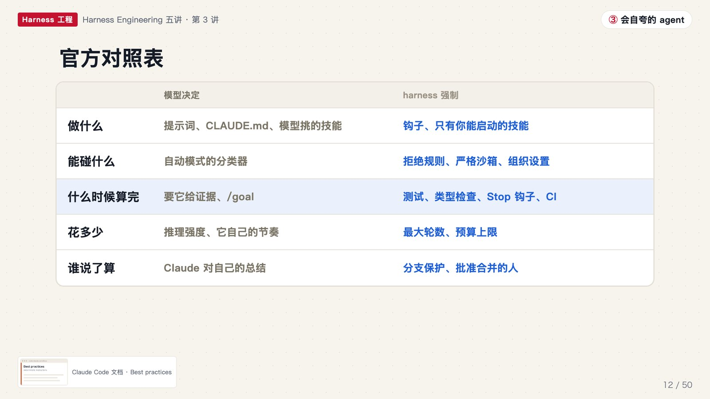

官方建议：大部分时候让模型判断（几乎每条规则都有例外）；**必须每次都发生、或永远不能发生的事，才交给 harness 强制。**

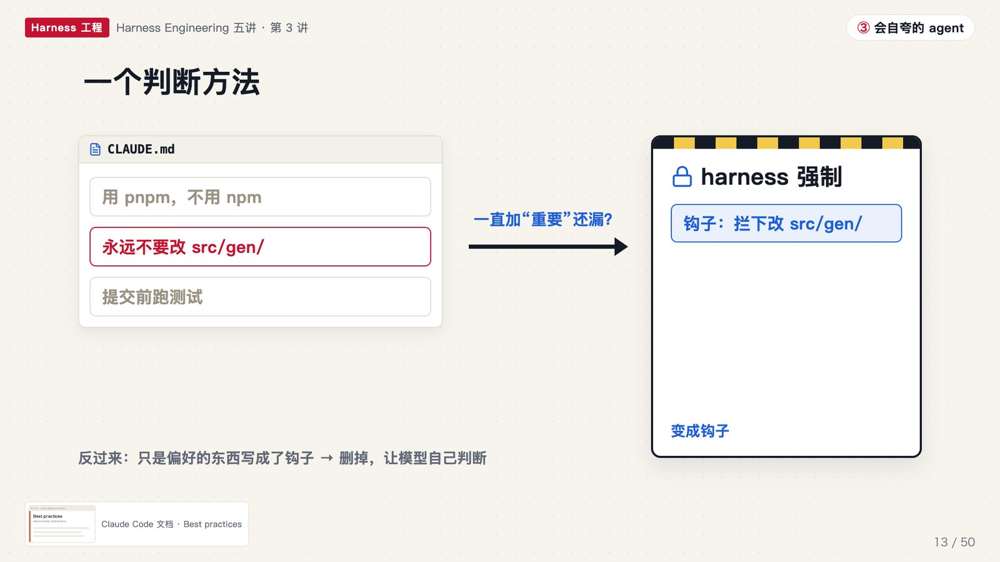

判断方法：一直给 CLAUDE.md 里某一行加"重要"它还是会漏，这一行就该变成钩子；反过来，只是偏好的东西写成了钩子，就删掉。

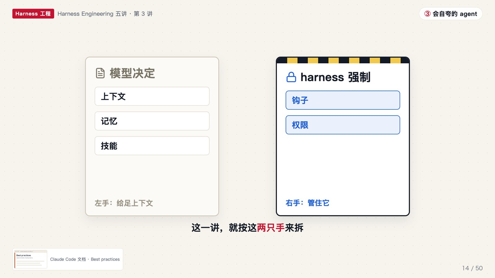

---

## 3 指令：分层的 CLAUDE.md 和自动记忆

### 3.1 四个作用域和加载规则

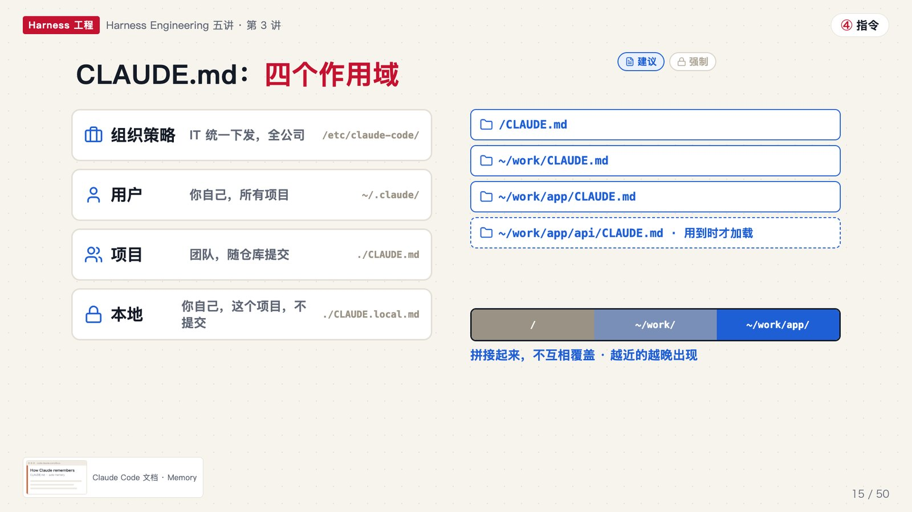

| 作用域 | 位置 | 给谁 |
|---|---|---|
| 组织策略 | macOS `/Library/Application Support/ClaudeCode/CLAUDE.md`、Linux `/etc/claude-code/CLAUDE.md` | IT 统一下发 |
| 用户 | `~/.claude/CLAUDE.md` | 你自己，所有项目 |
| 项目 | `./CLAUDE.md` 或 `./.claude/CLAUDE.md` | 团队，随仓库提交 |
| 本地 | `./CLAUDE.local.md` | 你自己，这个项目，加进 `.gitignore` |

- 从根目录到当前目录，每一级都加载，**拼接不覆盖**，越近的越晚出现。
- 子目录里的 CLAUDE.md 不在启动时加载，读、写、改那个子目录的文件时才加载。

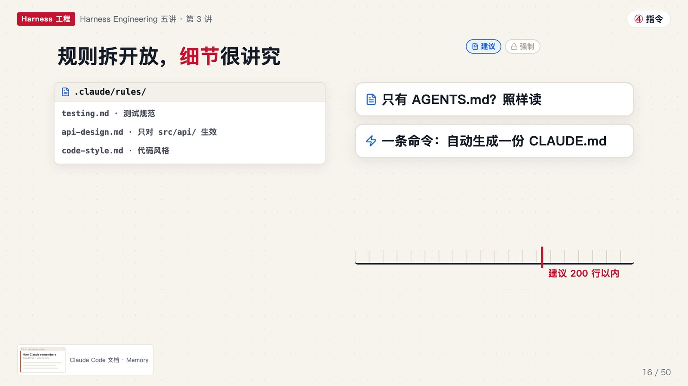

- 用 `.claude/rules/` 按主题拆规则，可以只对某些路径生效。
- 仓库只有 AGENTS.md 时照样读；`/init` 自动生成一份起步的 CLAUDE.md；建议每个文件 200 行以内。

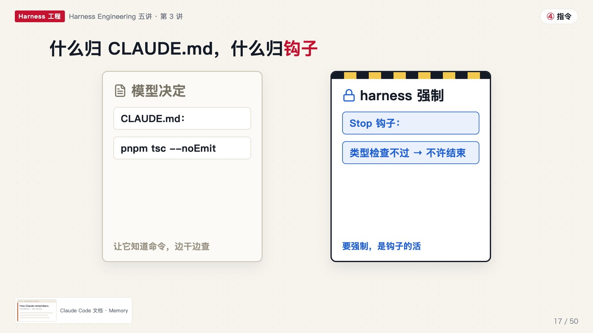

CLAUDE.md 里写一行类型检查命令，让 Claude 知道怎么边干边查；要"检查不过不许结束"，那是 Stop 钩子的活。

### 3.2 自动记忆

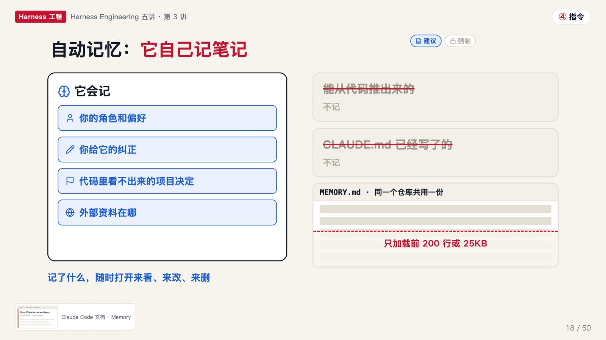

Claude 自己记四类笔记：你的角色和偏好、你给的纠正、代码里看不出来的项目决定、外部资料在哪。能从代码推出来的、CLAUDE.md 写了的不记。笔记在 `~/.claude/projects/<项目>/memory/`，同一个 git 仓库的所有 worktree 共用；每次只加载 `MEMORY.md` 的前 200 行或 25KB；可以用 `/memory` 查看和修改。

### 3.3 只是上下文，不是强制

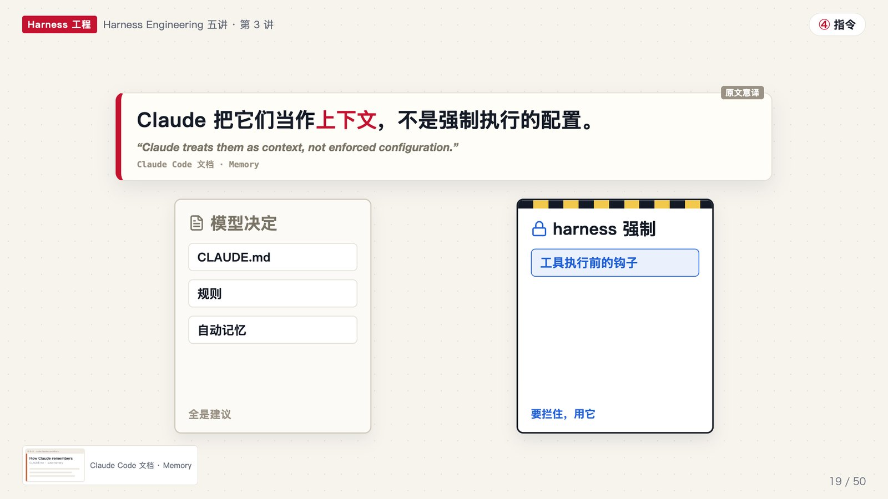

记忆文档原话："Claude treats them as context, not enforced configuration."要不管 Claude 怎么想都拦住某个动作，用 PreToolUse 钩子。

---

## 4 上下文：每样东西都有价，压缩分五层

### 4.1 上下文成本表

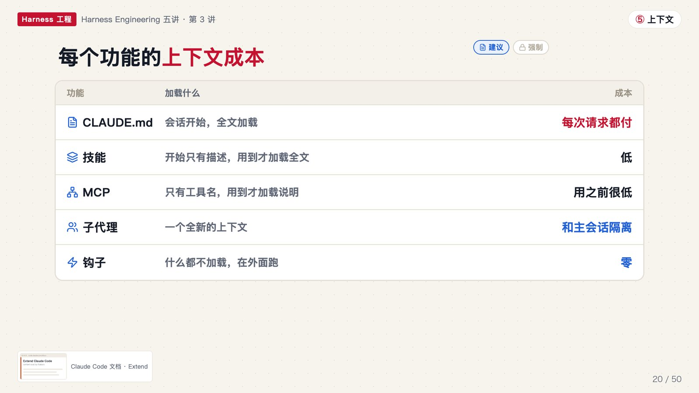

| 功能 | 加载什么 | 成本 |
|---|---|---|
| CLAUDE.md | 会话开始，全文 | 每次请求都付 |
| 技能 | 开始只有描述，用到才加载全文 | 低 |
| MCP | 只有工具名，完整说明用到才加载（工具搜索） | 用之前很低 |
| 子代理 | 一个全新的上下文 | 和主会话隔离 |
| 钩子 | 什么都不加载，在外面跑 | 零（除非往回写内容） |

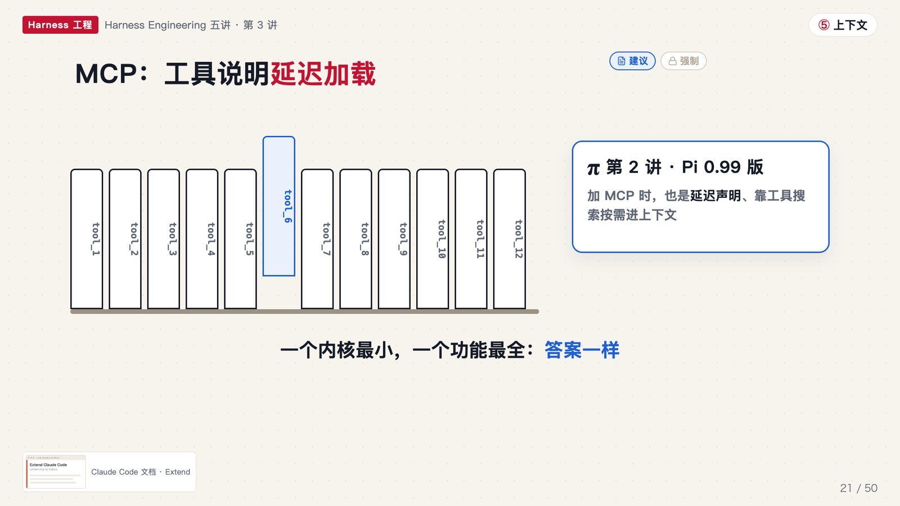

MCP 工具说明默认延迟加载。上一讲 Pi 在 0.99 版加 MCP 时也是延迟声明：两家在"别让工具说明撑满上下文"上答案一样。

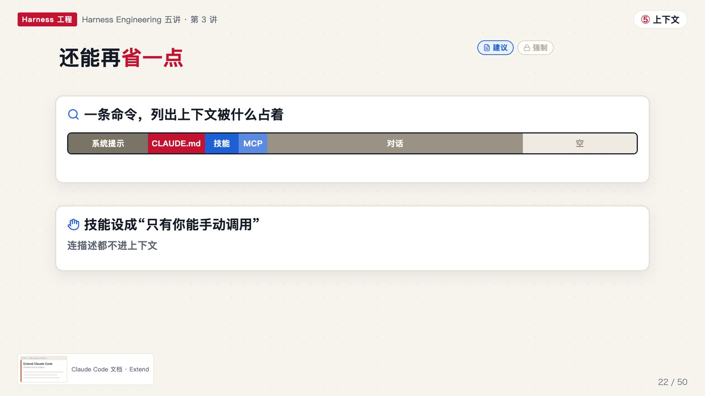

`/context` 列出上下文被什么占着；技能可以设 `disable-model-invocation: true`，只有你能手动调用，连描述都不进上下文。

### 4.2 压缩

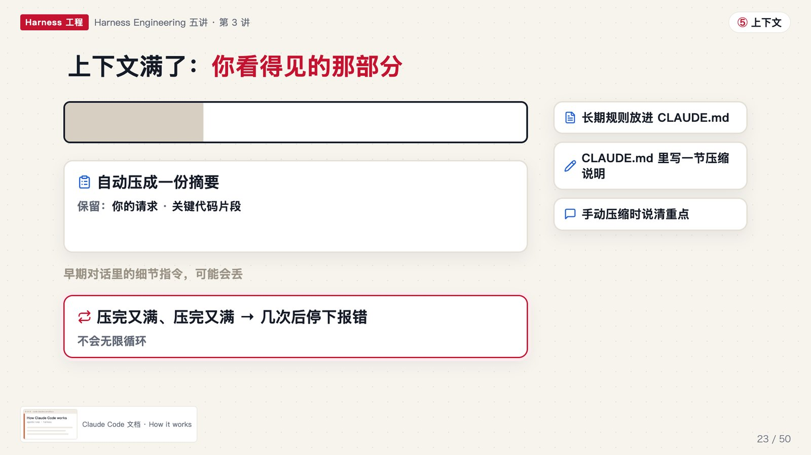

- 快到上限时自动压成摘要，保留你的请求和关键代码，早期的细节指令可能丢 → 长期规则放进 CLAUDE.md。
- 在 CLAUDE.md 里写一节 "Compact Instructions"，或 `/compact 重点保留 API 的改动`。
- 某个输出大到每次压完又满，压缩几次后停下报错，不无限循环。

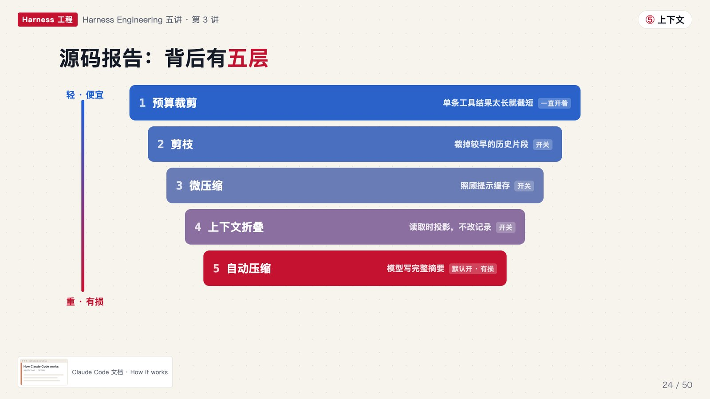

VILA Lab 从源码拆出的五层，按力度从轻到重：

| 层 | 做什么 | 默认 |
|---|---|---|
| 1 预算裁剪 | 单条工具结果超过上限就截短 | 一直开着 |
| 2 剪枝（snip） | 裁掉较早的历史片段 | 功能开关 |
| 3 微压缩 | 细粒度、照顾提示缓存 | 功能开关 |
| 4 上下文折叠 | 读取时的虚拟投影，不改存储的记录 | 功能开关 |
| 5 自动压缩 | 模型写完整摘要（有损） | 默认开，可关 |

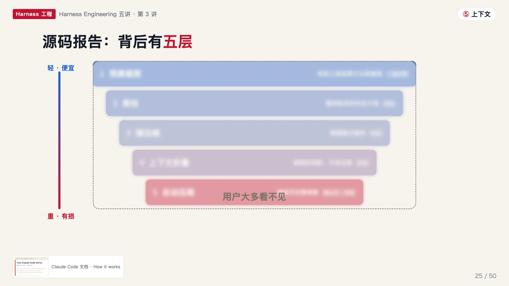

报告的解释：没有一种压缩策略能应付所有情况，所以分级；代价是压缩大多用户看不见。

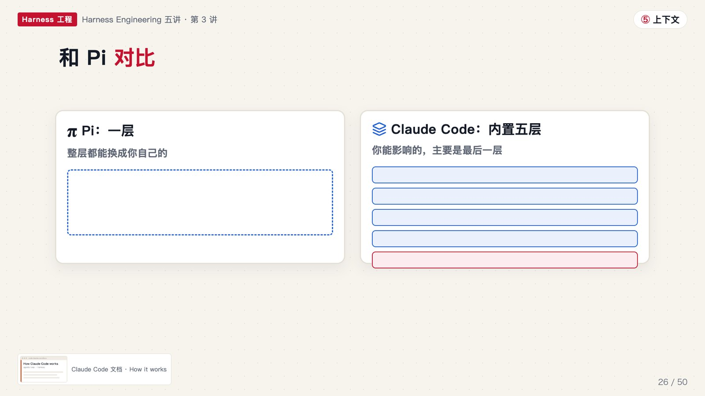

Pi 只有一层，但整层可替换；Claude Code 内置五层，你能影响的主要是最后一层。

### 4.3 子代理

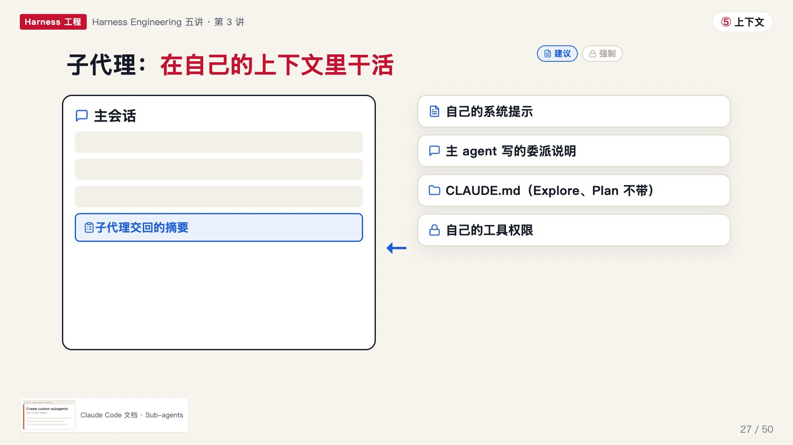

子代理在自己的上下文窗口里跑，有自己的系统提示、工具权限，靠主 agent 写的委派说明开工，会加载 CLAUDE.md（内置的 Explore、Plan 为了快不加载）。做完只交回摘要。

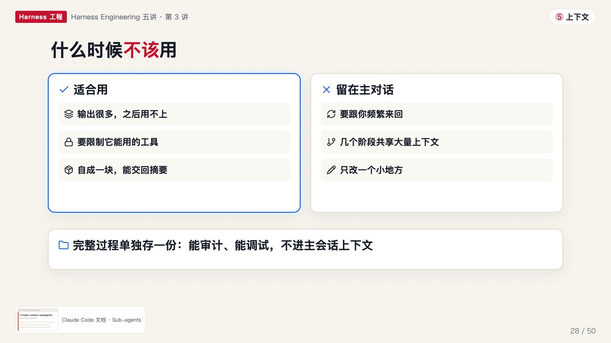

| 适合用 | 留在主对话 |
|---|---|
| 输出很多，之后用不上 | 要和你频繁来回 |
| 要限制它能用的工具 | 几个阶段共享大量上下文 |
| 自成一块，能交回摘要 | 只改一个小地方 |

VILA Lab：每个子代理的完整过程另存一份 sidechain 记录，能审计、能调试，不进主会话上下文。所有自定义子代理的描述超过 1.5 万 token，启动时会提醒精简。

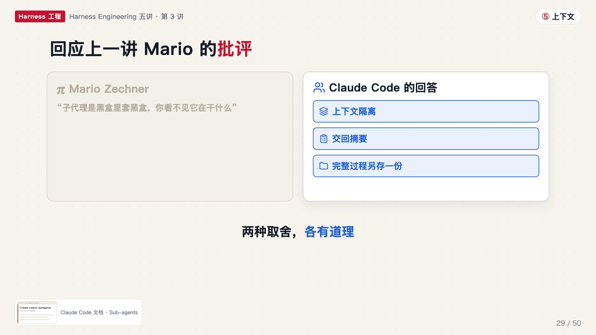

上一讲 Mario 说子代理是"黑盒里套黑盒"；Claude Code 的回答是隔离上下文、交回摘要、完整过程另存。两种取舍各有道理。

---

## 5 强制：钩子和权限

### 5.1 钩子

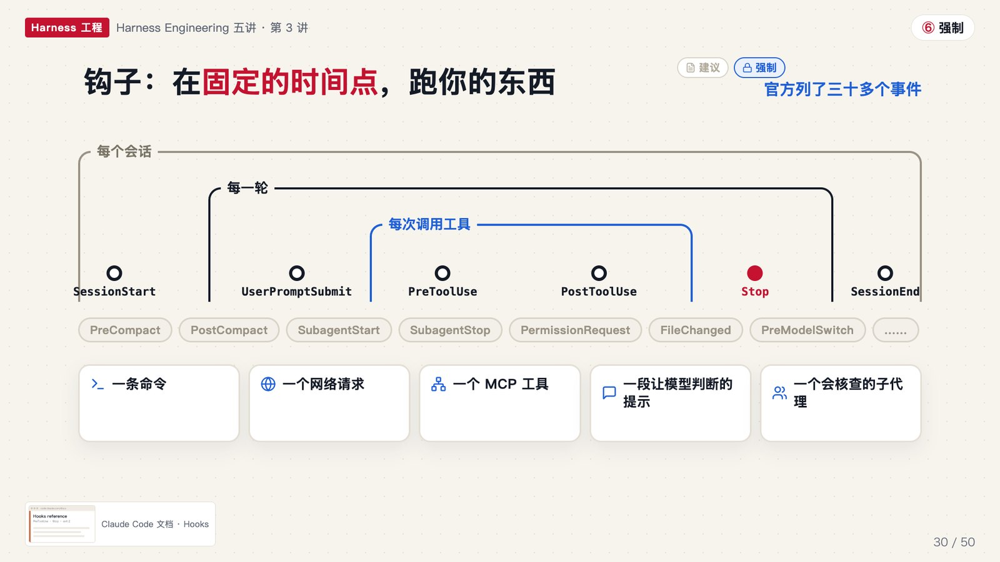

官方文档列了 33 个事件（2026-11），按频率分三层：每个会话（`SessionStart`、`SessionEnd`）、每一轮（`UserPromptSubmit`、`Stop`）、每次工具调用（`PreToolUse`、`PostToolUse`），另有压缩前后、子代理开始结束、权限请求、文件变化、切换模型等。处理方式有五种：命令、HTTP 请求、MCP 工具、让模型判断的提示、能用工具核查的子代理。

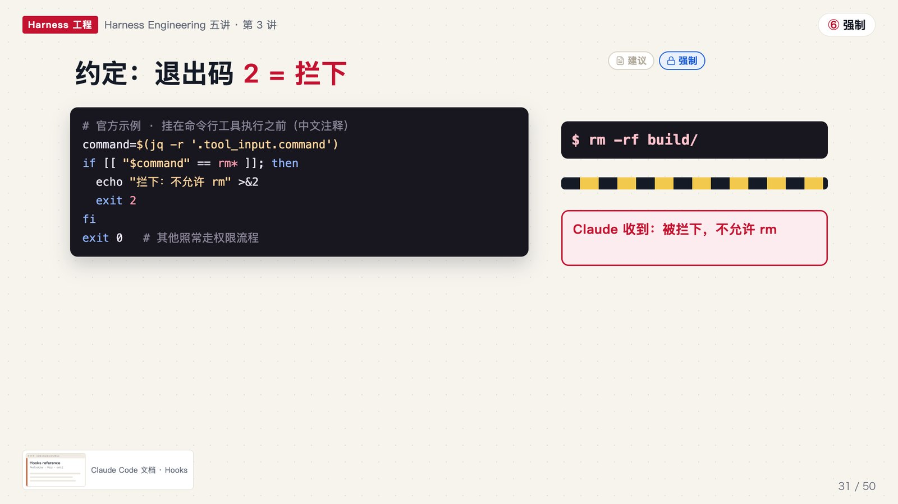

官方示例（挂在 Bash 的 PreToolUse 上）：

```bash
#!/bin/bash
input=$(cat)
command=$(jq -r '.tool_input.command' <<<"$input")
if [[ "$command" == rm* ]]; then
  echo "Blocked: rm commands are not allowed" >&2
  exit 2   # 拦下这次调用，stderr 作为原因交给 Claude
fi
exit 0     # 其他照常走权限流程
```

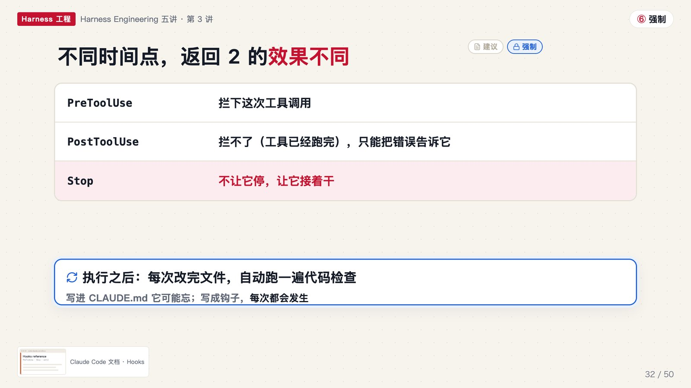

| 事件 | 退出码 2 |
|---|---|
| PreToolUse | 拦下这次工具调用 |
| PostToolUse | 拦不了（已经跑完），把错误给 Claude 看 |
| Stop | 不让 Claude 停，继续干 |

PostToolUse 的典型用法：每次改完文件自动跑一遍代码检查。写进 CLAUDE.md 它可能忘，写成钩子每次都发生。

### 5.2 Stop 钩子：管住会自夸的 agent

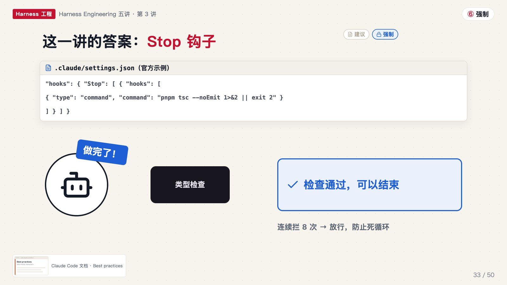

最佳实践文档的例子，`.claude/settings.json`：

```json
{
  "hooks": {
    "Stop": [
      { "hooks": [ { "type": "command", "command": "pnpm tsc --noEmit 1>&2 || exit 2" } ] }
    ]
  }
}
```

Claude 每次想结束这一轮，先跑类型检查；不通过，编译错误作为"还不能结束的理由"送回去，它接着修，直到通过。连续拦 8 次后放行，防止死循环。

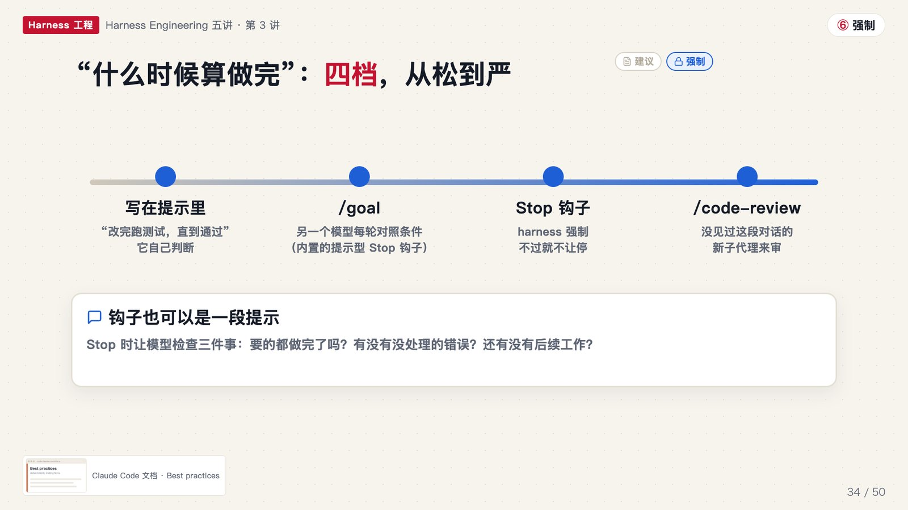

| 档 | 做法 | 谁说了算 |
|---|---|---|
| 1 | 写在提示里："改完跑认证测试，直到通过" | 模型 |
| 2 | `/goal 条件`：每轮后另一个模型对照对话检查（官方说是内置的提示型 Stop 钩子） | 另一个模型 |
| 3 | Stop 钩子 | harness |
| 4 | `/code-review`：从没见过这段对话的新子代理审改动 | 没写代码的人 |

钩子也可以是提示：Stop 时让模型检查"要的都做完了吗、有没有没处理的错误、还有没有后续工作"。

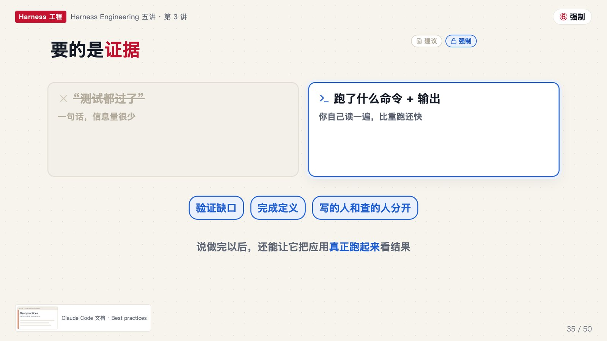

不管哪档，都要 Claude 给证据：跑了什么命令、输出是什么。说做完以后，还可以用 `/verify` 让它把应用真正跑起来看结果。第 1 讲的验证缺口、完成定义、写的人和查的人分开，在这里都成了能配置的机制。

### 5.3 权限

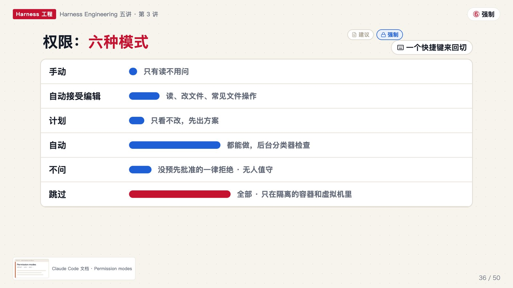

| 模式 | 不用问就能做的 | 适合 |
|---|---|---|
| 手动（default） | 只有读 | 敏感的活 |
| acceptEdits | 读、改文件、常见文件命令 | 边改边审 |
| plan | 读，先出方案不改源文件 | 动手之前先看清 |
| auto | 全部，后台分类器检查 | 长任务 |
| dontAsk | 目录内读和预先批准的工具，其他一律拒绝 | 无人值守 |
| bypassPermissions | 全部 | 只在隔离的容器和虚拟机里 |

`Shift+Tab` 切换。源码里还有一个内部模式，所以 VILA 报告写的是七种。

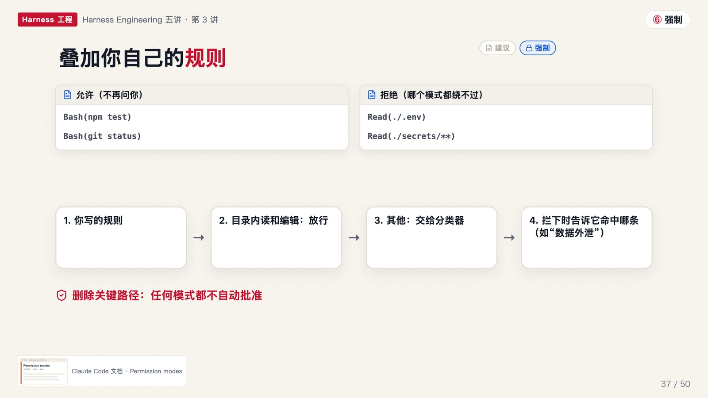

- 允许规则：信得过的命令（如 `Bash(npm test)`）不再问你。
- **拒绝规则在所有模式都生效**，包括 bypassPermissions。
- 自动模式的判定顺序：你的规则 → 工作目录里的读和编辑放行 → 其他交给分类器 → 拦下时告诉 Claude 命中哪条（如"数据外泄"）。
- 删除关键路径的 `rm`，任何模式都不自动批准。

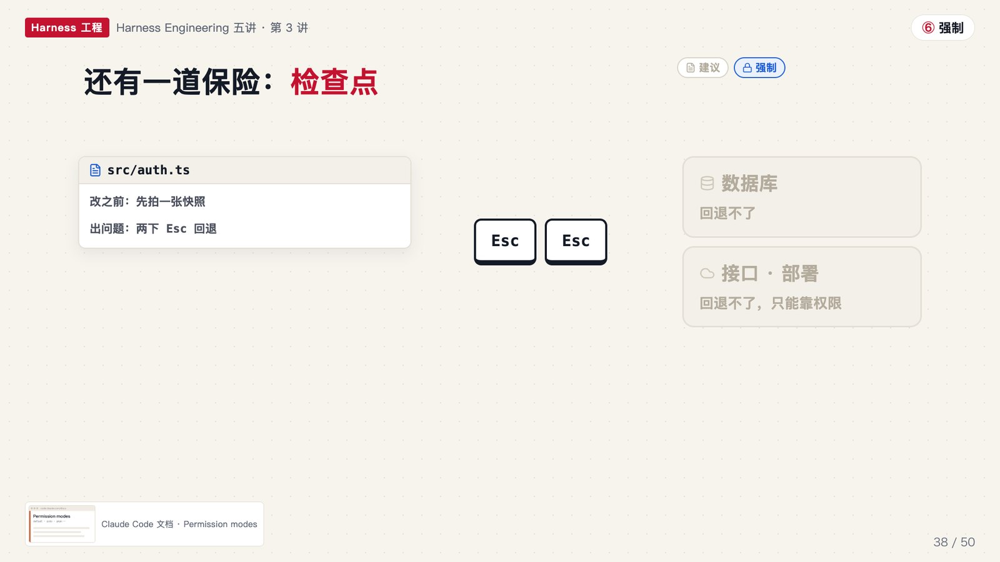

改文件前先快照，两下 Esc 回退；数据库、接口、部署这类远端动作回退不了，只能靠权限。

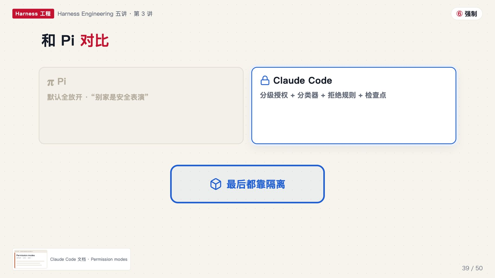

Pi 默认全放开（作者说别家是"安全表演"）；Claude Code 是分级授权 + 分类器 + 拒绝规则 + 检查点。两家一致的一点：真要安全，最后靠隔离。

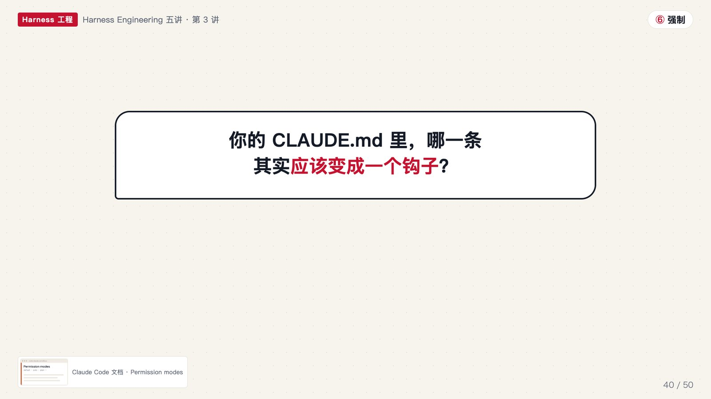

---

## 6 状态：会话记录和长任务交接

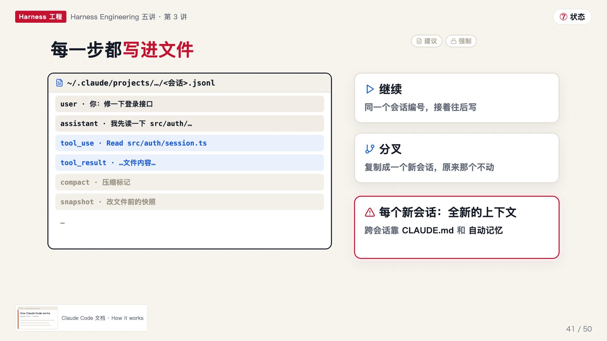

每条消息、工具调用和结果都写进 `~/.claude/projects/` 下的 JSONL 文件。`claude --continue` / `--resume` 用同一个会话 ID 接着写；`--fork-session` 或 `/branch` 复制成新会话。**每个新会话都从全新上下文开始**，跨会话靠 CLAUDE.md 和自动记忆。

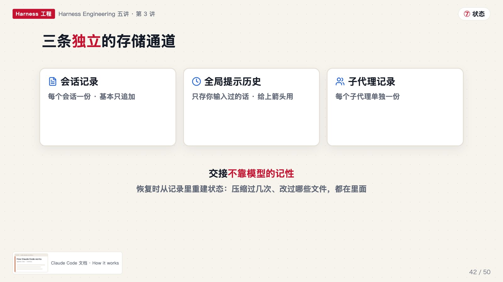

VILA Lab：会话记录（每个会话一份，基本只追加）、全局 `history.jsonl`（只存你输入过的提示）、子代理的 sidechain 记录。恢复时从记录重建状态，交接不靠模型的记性。

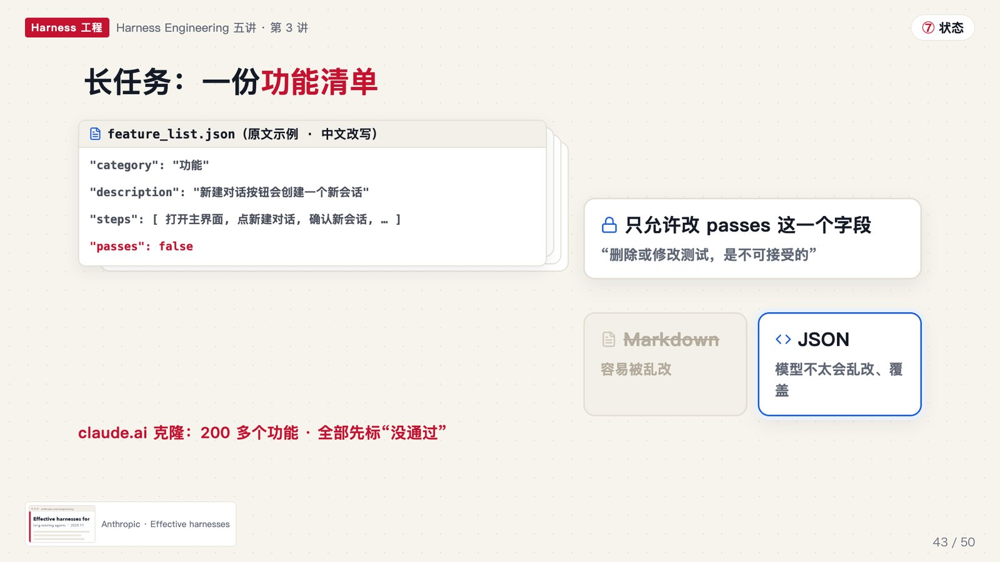

《Effective harnesses》里专门对付"提前宣布完工"的设计：

```json
{
  "category": "functional",
  "description": "New chat button creates a fresh conversation",
  "steps": ["Navigate to main interface", "Click the 'New Chat' button", "Verify a new conversation is created"],
  "passes": false
}
```

- claude.ai 克隆的例子有 200 多个功能，全部先标 `passes: false`。
- 编码 agent 只许改 `passes` 字段，提示里写"删除或修改测试是不可接受的"。
- 用 JSON 而不是 Markdown：模型不太会乱改、覆盖 JSON。

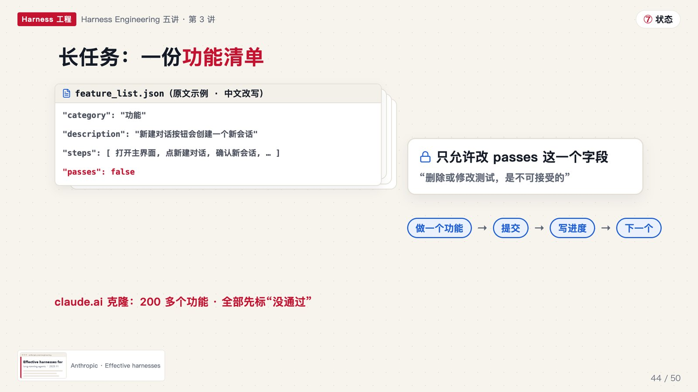

每次只做一个功能，做完提交、写进度，环境保持可以直接合并的状态。这是课程第八讲功能清单、第九讲防止提前宣告完成的原型。

---

## 7 打分，和 Pi 并排看

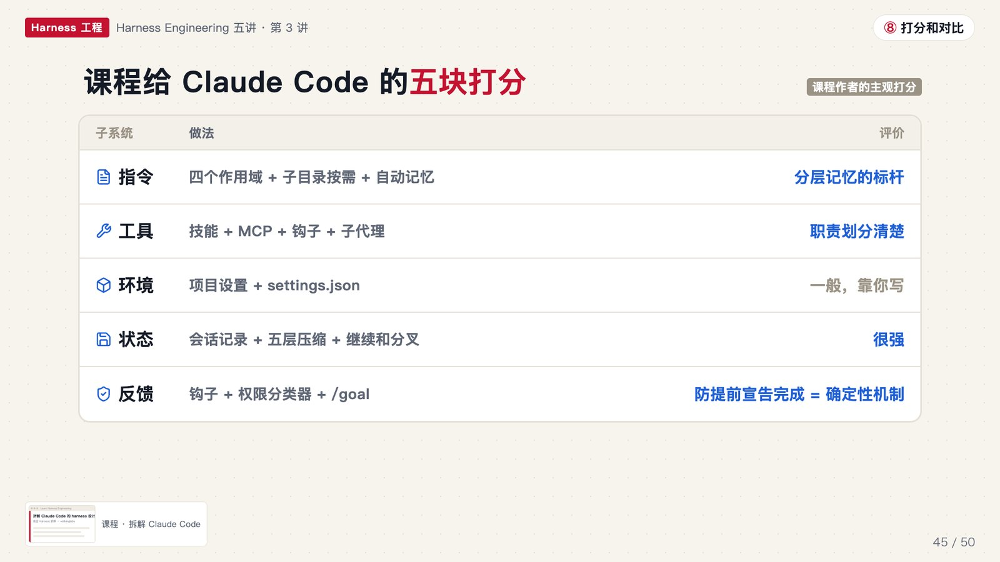

| 子系统 | Claude Code 的做法 | 评价（课程作者的主观打分） |
|---|---|---|
| 指令 | 四个作用域 + 子目录按需 + 自动记忆 | 分层记忆的标杆 |
| 工具 | 技能 + MCP + 钩子 + 子代理 | 职责划分清楚 |
| 环境 | 项目设置 + settings.json | 一般，靠你写 |
| 状态 | 会话记录 + 五层压缩 + 继续和分叉 | 很强 |
| 反馈 | 钩子 + 权限分类器 + `/goal` | 防提前宣告完成做成了确定性机制 |

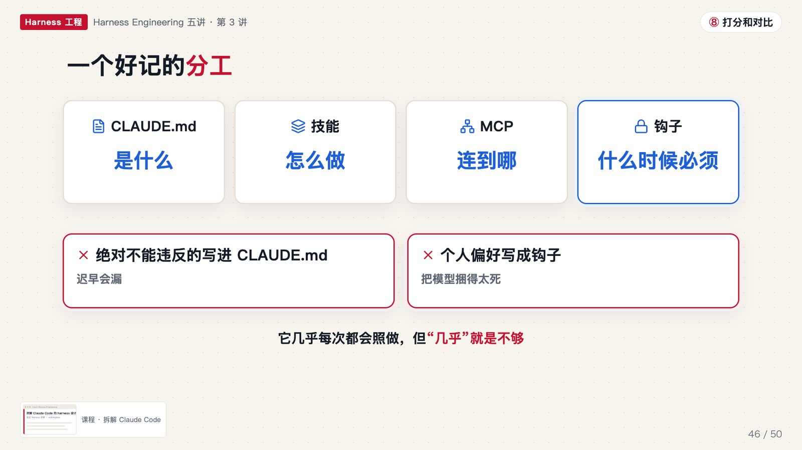

好记的分工：**CLAUDE.md 管"是什么"，技能管"怎么做"，MCP 管"连到哪"，钩子管"什么时候必须"。**绝对不能违反的写进 CLAUDE.md，迟早会漏；个人偏好写成钩子，会把模型捆太死。官方的说法：写在 CLAUDE.md 里它"几乎"每次都会照做，可"几乎"就是不够。

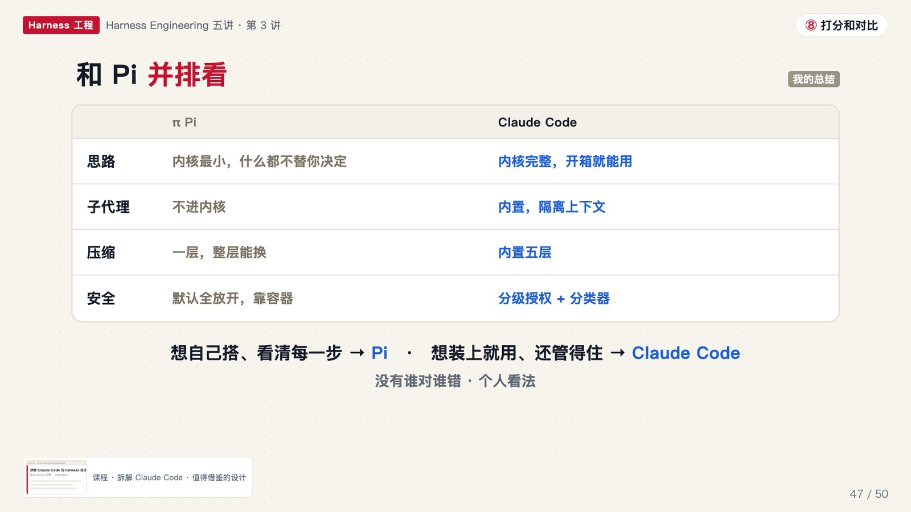

| | Pi | Claude Code |
|---|---|---|
| 思路 | 内核最小，什么都不替你决定 | 内核完整，开箱即用 |
| 子代理 | 不进内核 | 内置，隔离上下文 |
| 压缩 | 一层，整层能换 | 内置五层 |
| 安全 | 默认全放开，靠容器 | 分级授权 + 分类器 |

想自己搭、看清每一步，Pi 更合适；想装上就用、还管得住，Claude Code 更省心。（个人看法）

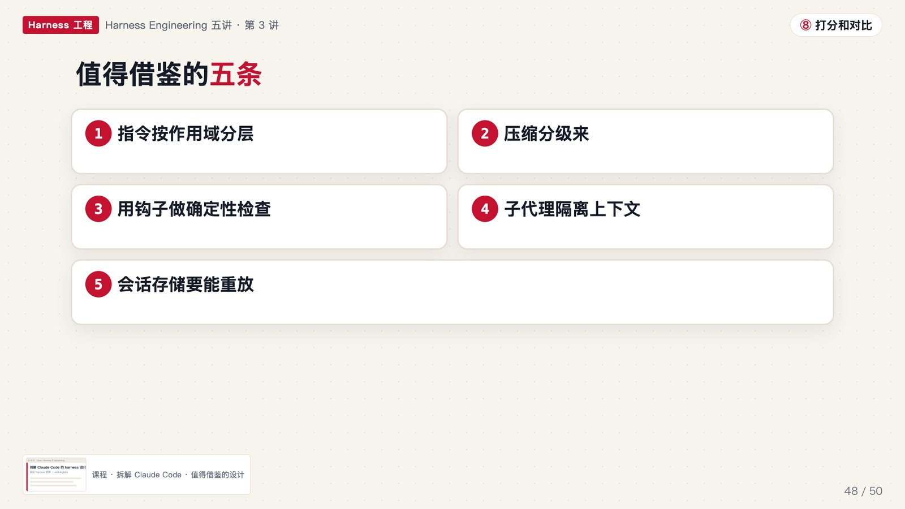

1. 指令按作用域分层，不堆在一个文件里。
2. 压缩分级：先无损后有损。
3. 用钩子做确定性检查，不靠提示词恳求。
4. 子代理隔离上下文。
5. 会话存储追加式、可重放。

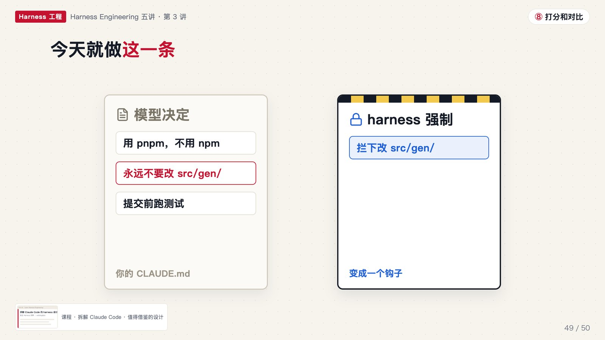

---

## 本讲小结

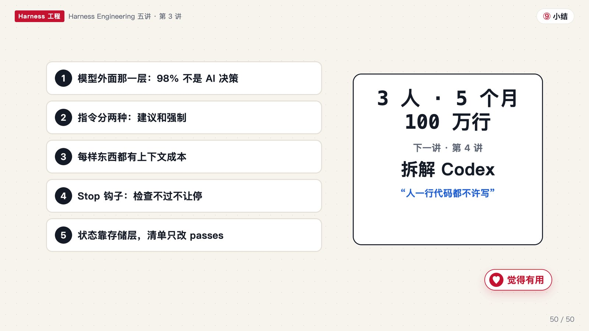

1. Claude Code 官方就叫自己 agentic harness；社区估算它 98% 的代码不是 AI 决策。
2. 所有指令分两种：模型读的建议，和 harness 执行的强制。必须每次发生的才交给强制。
3. 每样东西都有上下文成本：CLAUDE.md 每次都付，技能和 MCP 按需加载，子代理隔离，钩子为零。
4. 管住会自夸的 agent：Stop 钩子检查不过就不让它停，或者让没见过这段对话的子代理来审。
5. 状态靠存储层：会话能继续、能分叉；长任务用只许改 `passes` 的功能清单。

## 下一讲预告

第 4 讲拆 Codex：OpenAI 那个"人一行代码都不许写"的团队，三个人、五个月写出约 100 万行代码，靠的是哪套规矩。

## 关键术语

| 术语 | 意思 |
|---|---|
| agentic harness | 包在模型外面、提供工具和管理上下文的那一层 |
| 非确定性指令 | 你写、模型读的：提示词、CLAUDE.md、技能，没有执行保证 |
| 确定性指令 | 你配置、harness 必须执行的：钩子、拒绝规则、组织设置 |
| CLAUDE.md | 给 Claude Code 的项目说明文件，分组织、用户、项目、本地四个作用域 |
| 自动记忆 | Claude 自己记的跨会话笔记，按 git 仓库存放 |
| 钩子（hook） | 在生命周期固定时间点运行的命令、请求或提示；退出码 2 表示拦下 |
| Stop 钩子 | Claude 想结束一轮时运行；拦下就让它继续干 |
| 子代理 | 在独立上下文里干活、只交回摘要的助手 |
| 检查点 | 改文件前的快照，可回退；不覆盖远端动作 |
| 功能清单 | 列出所有功能和验证步骤、初始都标"没通过"的 JSON 文件 |

## 思考题

1. 为什么 CLAUDE.md 写得再仔细，也不能保证"永远不改 `src/gen/`"？应该怎么做？
2. PostToolUse 钩子拦不住工具调用，那它还有什么用？
3. `/goal` 和 Stop 钩子都能"不让它停"，区别在哪？
4. 子代理的摘要回传，和 Pi 作者说的"黑盒"，各自的代价是什么？
5. 功能清单为什么用 JSON 而不用 Markdown？如果 agent 还是改了测试，你会怎么在 harness 层面拦住？

<details>
<summary>参考答案</summary>

1. CLAUDE.md 是上下文，不是强制配置，模型可以判断这条规则"这次不适用"，或者在长上下文里漏掉它。要每次都生效，写成 PreToolUse 钩子（检查写入路径，命中就退出码 2），或者写拒绝规则。
2. 它能在工具跑完后立刻做确定性的检查，比如每次改完文件跑 lint，把结果摆在 Claude 面前，让它马上修，而不是等到最后。
3. `/goal` 是让另一个模型对照对话判断条件满没满足（基于提示，判断本身仍是模型做的）；Stop 钩子可以跑一个确定性的命令，比如测试或类型检查，结果不依赖模型的判断。
4. 摘要回传省主上下文，代价是主 agent 看不到细节、可能被摘要误导（Claude Code 用 sidechain 记录补审计）；Pi 的做法让人看得见每一步，代价是上下文更容易被支线任务撑满，需要你自己规划好先收集、再干活。
5. Anthropic 发现模型不太会乱改、覆盖 JSON 文件。要从 harness 层面拦住，可以加一个 PreToolUse 钩子：检测对测试文件或功能清单除 `passes` 外字段的修改，命中就拦下。

</details>

## 动手练习

1. 在一个项目里加一个 Stop 钩子：`npm test 1>&2 || exit 2`（换成你项目的测试命令），故意让一个测试失败，看 Claude 会不会接着修。
2. 打开你的 CLAUDE.md，找出一条"绝对不能违反"的规则，把它改写成 PreToolUse 钩子或拒绝规则，再把 CLAUDE.md 里那一行删掉。
3. 用 `/context` 看一眼你现在的上下文被什么占着，关掉一个用不上的 MCP 服务或技能，再看一次。

## 延伸阅读

- 原课程：[walkinglabs/learn-harness-engineering](https://github.com/walkinglabs/learn-harness-engineering)（[中文版网页](https://walkinglabs.github.io/learn-harness-engineering/zh/)）
- Claude Code 文档：[How Claude Code works](https://code.claude.com/docs/en/how-claude-code-works)、[Best practices](https://code.claude.com/docs/en/best-practices)、[Memory](https://code.claude.com/docs/en/memory)、[Hooks](https://code.claude.com/docs/en/hooks)、[Sub-agents](https://code.claude.com/docs/en/sub-agents)、[Permission modes](https://code.claude.com/docs/en/permission-modes)、[Extend Claude Code](https://code.claude.com/docs/en/features-overview)
- Anthropic：[Effective harnesses for long-running agents](https://www.anthropic.com/engineering/effective-harnesses-for-long-running-agents)
- Anthropic：[Harness design for long-running application development](https://www.anthropic.com/engineering/harness-design-long-running-apps)
- VILA Lab：[Dive into Claude Code（PDF）](https://zhiqiangshen.com/projects/Claude_Code_Report/Claude_Code_Report.pdf)
- InfoQ：[Anthropic Accidentally Exposes Claude Code Source via npm Source Map File](https://www.infoq.com/news/2026/04/claude-code-source-leak/)

---

画面和配音由 AI 生成。引语是原文意译；"和 Pi 并排看""适合谁"是个人观点；标"示意"的画面是示意。
