# 第 4 讲 · 100 万行代码零手写：拆解 Codex 和 OpenAI 的 harness 工程

> Harness Engineering 五讲 · 配套课件
> 配套视频（20 分钟）：B 站 / 视频号 / 抖音 / 小红书搜索「竹二木SI」 · 整份幻灯片：[l04-幻灯片.pdf](./l04-幻灯片.pdf)
> 底本：开源课程 [Learn Harness Engineering](https://github.com/walkinglabs/learn-harness-engineering)（walkinglabs，MIT 协议）"前沿 Harness 拆解"栏目的《拆解 Codex 的 harness 设计》。和一手资料对不上的地方（开源时间、实验时长、几个小节名和社区说法），按 OpenAI 工程博客和 Codex 官方文档（2026-11-15 核对）改写；出处见文末"延伸阅读"。本课件是非官方的学习整理。

## 这一讲你会学到

学完这一讲，你应该能做到：

1. 讲清 OpenAI《Harness engineering》里那个实验：五个月、手写代码零行、约 100 万行，以及工程师的工作变成了什么。
2. 说出一个大 AGENTS.md 的四种失败方式，按"目录页 + `docs/`"的思路改写自己的指令文件，并说出 Codex 读取 AGENTS.md 的规则。
3. 说出"让应用对 agent 看得见"的三步：每个改动一份应用、接上浏览器、本地可观测性。
4. 用"守住不变量，不管怎么实现"的思路设计检查，把报错写成修复说明；说清代码库"垃圾回收"怎么做。
5. 把 Codex 的 agent 循环摊开讲：一次请求里有什么、为什么靠提示缓存不慢、压缩怎么做；用 ARC-AGI-3 的例子说明 harness 能改多少结果。
6. 区分沙箱和审批，说出子代理和 Stop 钩子的用法，讲清 app-server 的三个原语，并把 Pi、Claude Code、Codex 三家并排对比。

建议先看一遍视频，再对照本课件逐节复习。每节开头的图就是视频里对应的画面。

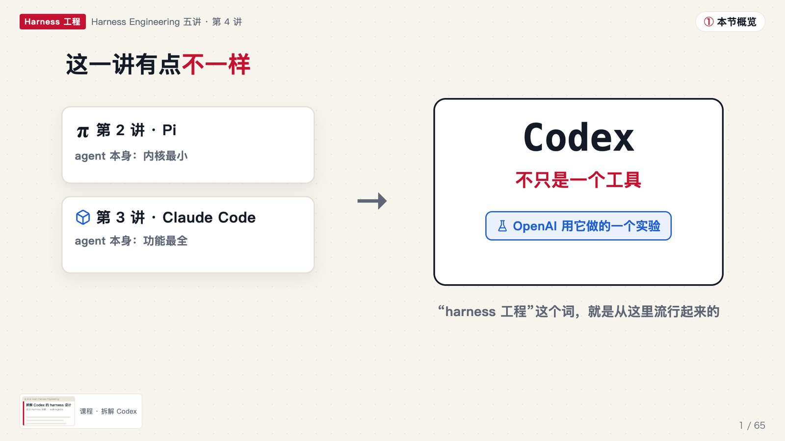

前两讲拆的是 agent 本身：内核最小的 Pi，和功能最全的 Claude Code。这一讲的 Codex 最值得看的，不只是这个工具，而是 OpenAI 用它做的一个实验。"harness 工程"这个词，就是从那个实验流行起来的。

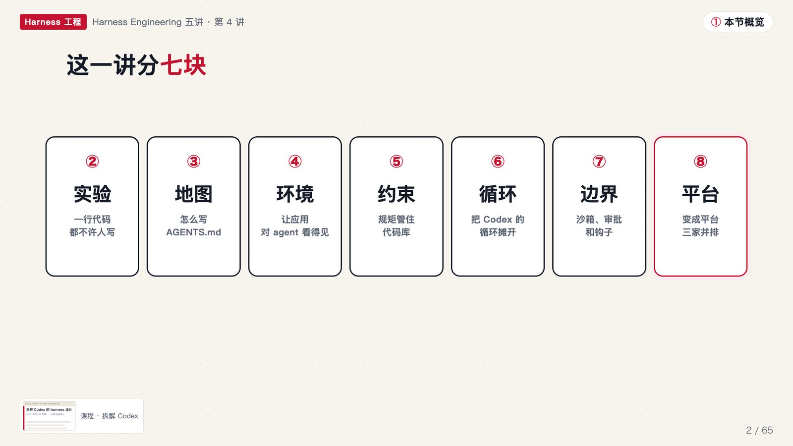

---

## 1 实验：一行代码都不许人写

### 1.1 五个月，约 100 万行

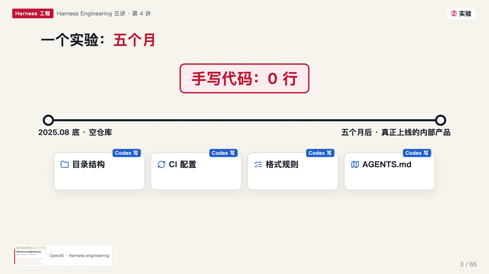

2026 年 2 月，OpenAI 工程师 Ryan Lopopolo 发了《Harness engineering: leveraging Codex in an agent-first world》。文章讲的是一个实验：**用五个月，做一个真正上线的内部测试版产品，手写代码零行**。

- 2025 年 8 月底，空仓库里落下第一个提交。最初的脚手架（目录结构、CI 配置、格式规则、包管理、应用框架），连指导 agent 干活的那份 AGENTS.md，都是 Codex CLI 用 GPT-5 生成的。

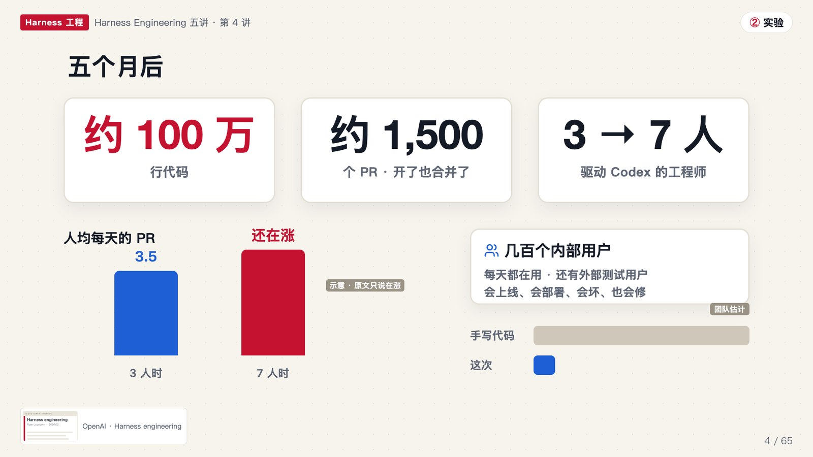

| 指标 | 数字（原文） |
|---|---|
| 代码量 | 约 100 万行（应用逻辑、基础设施、工具、文档、内部开发工具） |
| PR | 约 1,500 个，开了也合并了 |
| 工程师 | 一开始 3 人，后来 7 人；人均每天约 3.5 个 PR，人多了以后人均吞吐还在涨 |
| 用户 | 几百个内部用户（有每天在用的重度用户），还有外部 alpha 测试者 |
| 用时 | 团队估计约为手写代码的十分之一 |

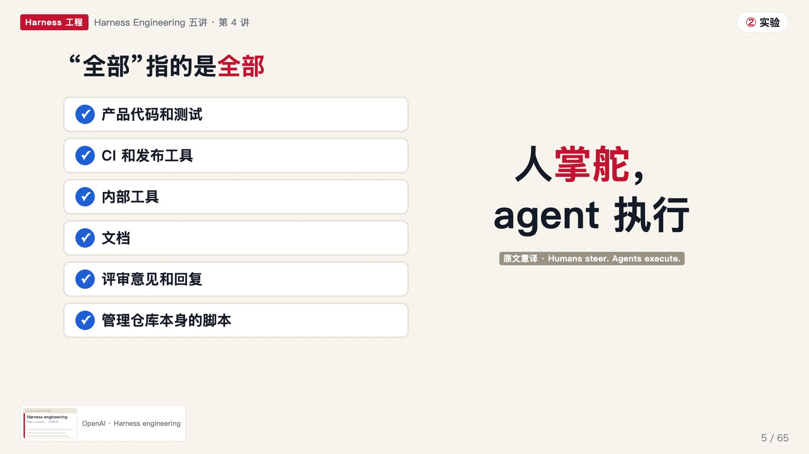

"全部由 agent 写"指的是全部：产品代码和测试、CI 和发布工具、内部开发工具、文档和设计历史、评测 harness、评审意见和回复、管理仓库本身的脚本、生产看板的定义文件。文章的口号：**人掌舵，agent 执行**（Humans steer. Agents execute.）。

### 1.2 工程师的新工作

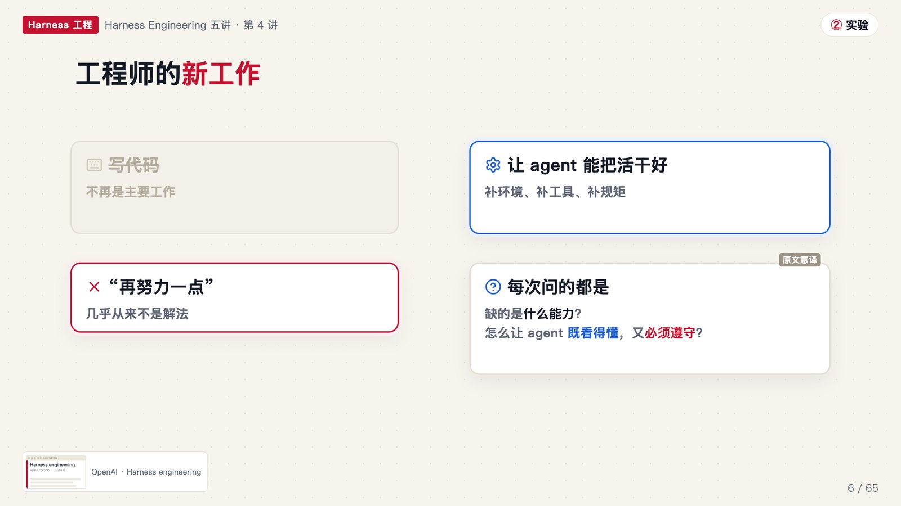

一开始进展比预期慢。原因不是 Codex 不行，是**环境没交代清楚**：agent 缺工具、缺抽象、缺内部结构。于是工程团队的主要工作变成了"让 agent 能把活干好"。出了问题，解法几乎从来不是"再努力一点"，而是问：**缺的是什么能力？怎么让它既看得懂（legible），又必须遵守（enforceable）？**

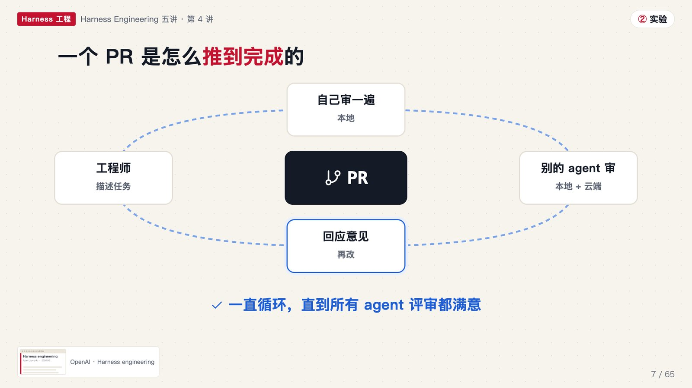

日常流程：工程师描述任务 → agent 去跑、开 PR → 让 Codex 先在本地自审 → 再请别的 agent 在本地和云端审 → 回应所有人和 agent 的意见 → 循环到所有 agent 评审都满意（原文说这就是一个 Ralph Wiggum 循环）。人可以审 PR，但不是必须；评审几乎全推给了 agent 对 agent。

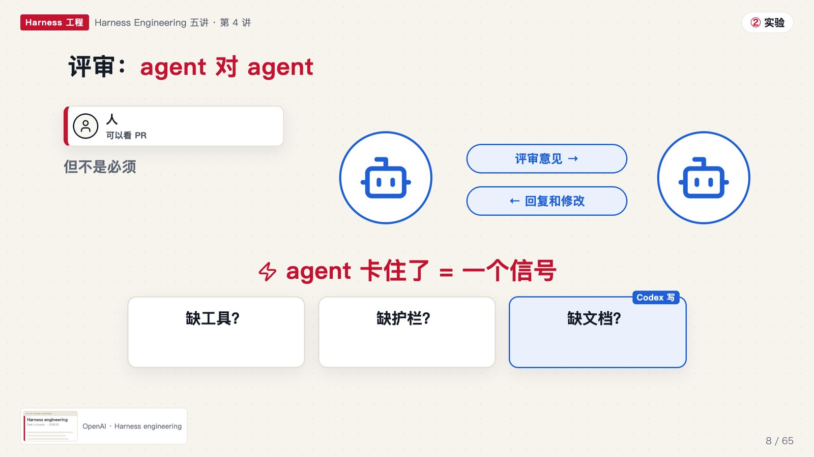

agent 卡住了，就当成一个信号：缺的是工具、护栏，还是文档？找出来补进仓库，**补的那一段也让 Codex 自己写**。这一讲接下来的几节，就是他们给环境补的东西。

---

## 2 地图：给地图，不给一千页的说明书

### 2.1 一个大 AGENTS.md 的四种失败

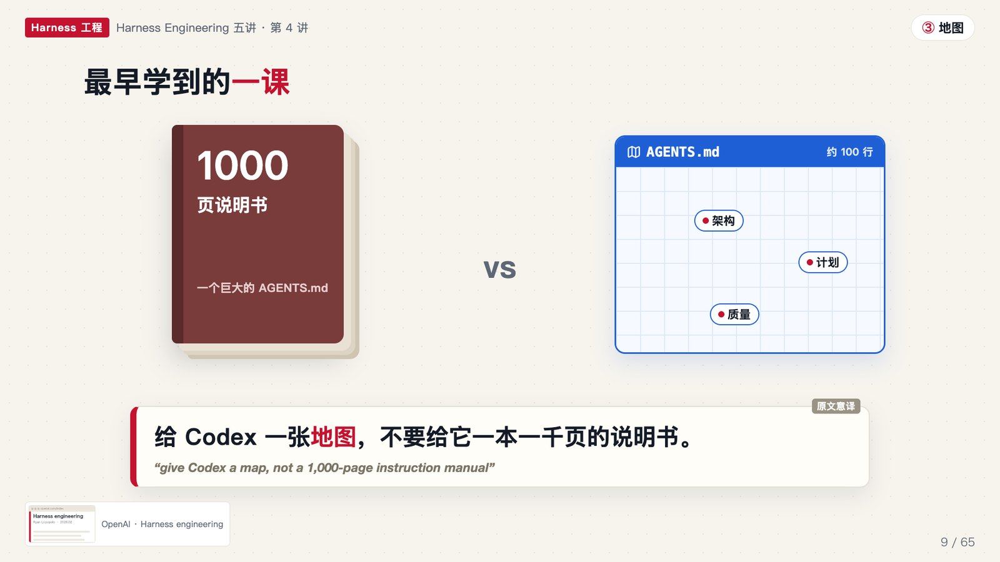

文章最早学到的一课：**给 Codex 一张地图，不要给它一本一千页的说明书**。他们试过"一个大 AGENTS.md"，失败方式全都可以预见：

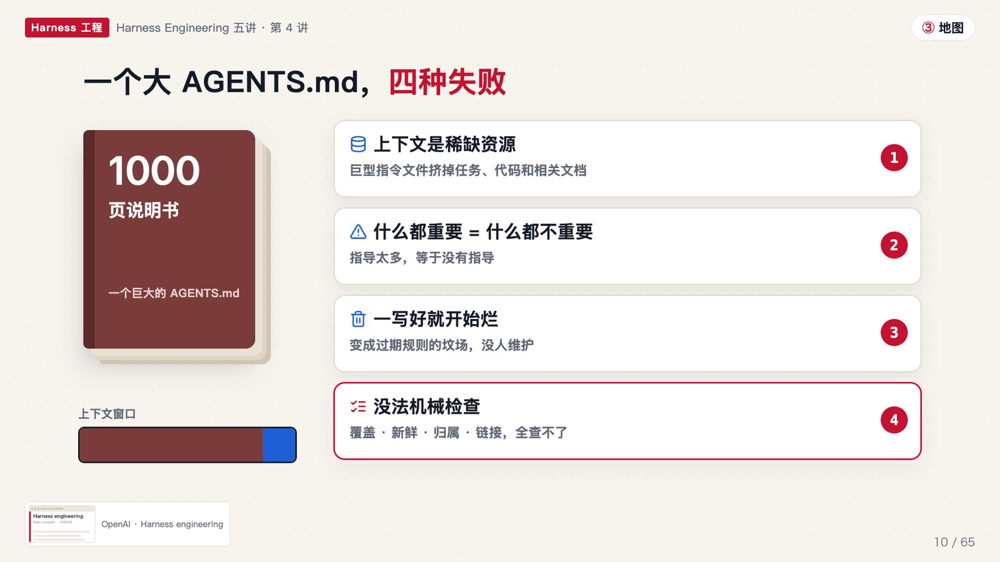

| 失败方式 | 说明 |
|---|---|
| 上下文是稀缺资源 | 巨型指令文件挤掉任务、代码和相关文档；agent 要么漏掉关键约束，要么围着错的约束优化 |
| 什么都重要 = 什么都不重要 | 指导太多等于没有指导，agent 只会在局部套模式 |
| 一写好就开始烂 | 变成过期规则的坟场，agent 分不清哪条还对，人也不维护 |
| 没法机械检查 | 一大坨文字没法检查覆盖、新鲜度、归属、交叉链接，偏离现实是必然的 |

### 2.2 AGENTS.md 是目录页

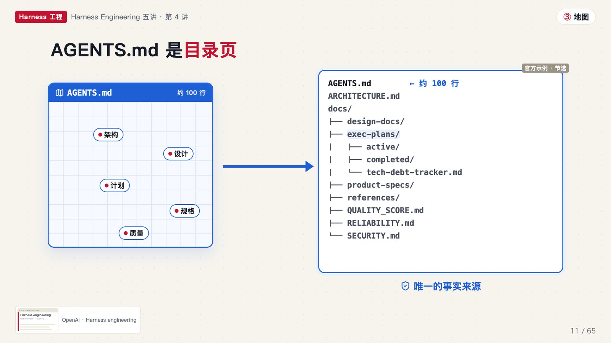

他们的做法：**短的 AGENTS.md（约 100 行）每次注入上下文，主要当地图用**；真正的知识放在结构化的 `docs/` 目录里，作为唯一的事实来源（system of record）。原文给的目录（节选）：

```
AGENTS.md
ARCHITECTURE.md
docs/
├── design-docs/        # 设计文档，带索引和"核心信念"，标着验证过没有
├── exec-plans/
│   ├── active/         # 进行中的执行计划
│   ├── completed/      # 做完的
│   └── tech-debt-tracker.md
├── generated/
│   └── db-schema.md
├── product-specs/
├── references/         # 各种 *-llms.txt
├── DESIGN.md  FRONTEND.md  PLANS.md  PRODUCT_SENSE.md
├── QUALITY_SCORE.md    # 每个产品领域、每层架构的质量评分
├── RELIABILITY.md
└── SECURITY.md
```

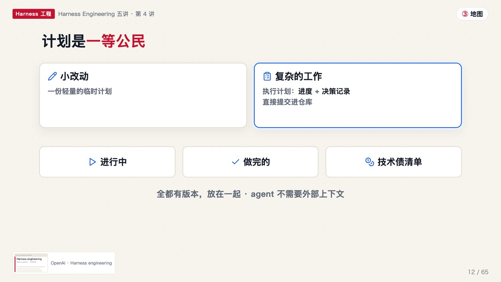

**计划是一等公民**：小改动用一份轻量的临时计划；复杂的工作写成带进度和决策记录的执行计划，提交进仓库。进行中的、做完的、已知的技术债都有版本、放在一起，agent 不需要外部上下文就能干活。

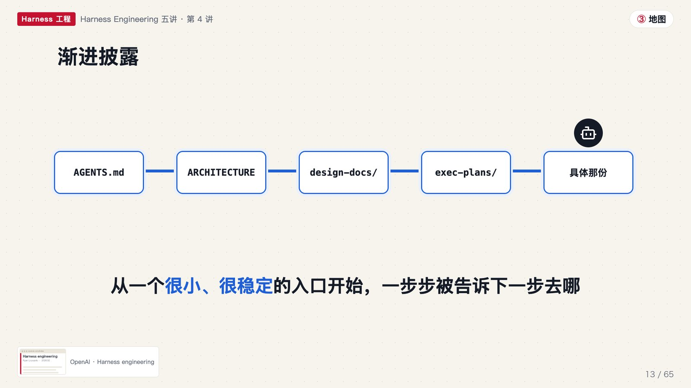

这就是**渐进披露（progressive disclosure）**：agent 从一个小而稳定的入口开始，被一步步告诉下一步去哪看，而不是一上来就被淹没。

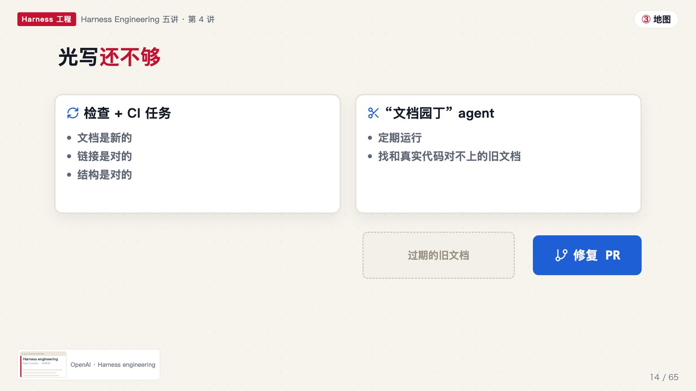

光写不够，还要机械地强制：专门的 lint 和 CI 任务检查知识库是不是新的、交叉链接和结构对不对；一个定期运行的**文档园丁（doc-gardening）agent** 专门找和真实代码对不上的旧文档，开 PR 去修。

### 2.3 看不见的，就不存在

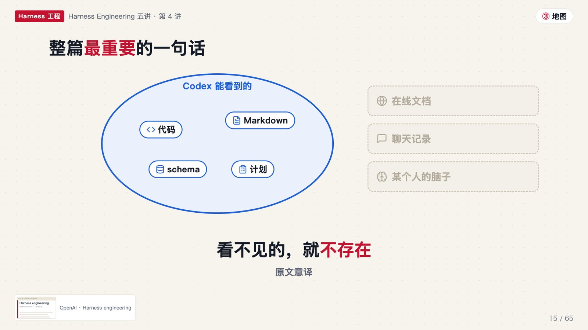

文章里最重要的一句：**对 agent 来说，运行时在上下文里拿不到的东西，就等于不存在**。放在在线文档、聊天记录、某个人脑子里的知识，系统都看不到；它能看到的只有仓库里有版本的东西：代码、Markdown、schema、可执行的计划。

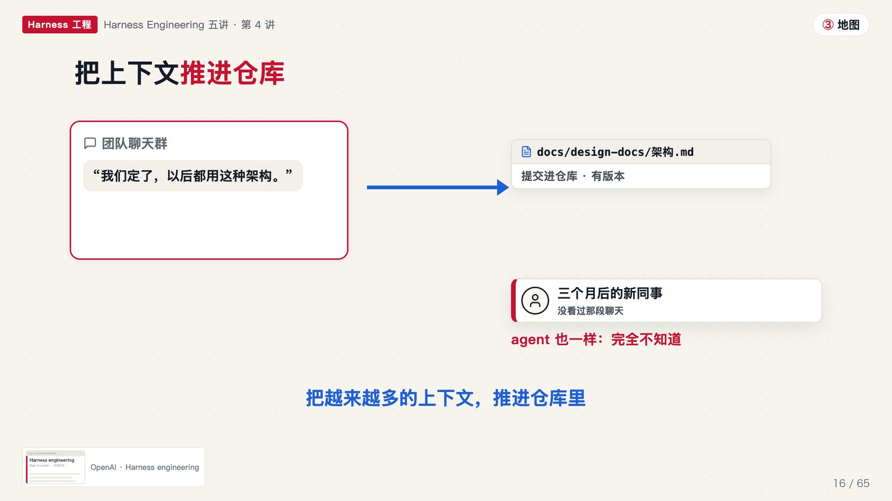

团队在聊天群里讨论定下来的架构模式，agent 找不到，就和三个月后新来的同事一样完全不知道。所以他们一直在把更多上下文推进仓库。这个视角也影响了技术选型：偏爱能在仓库里完全看懂的依赖和"无聊"的技术（好组合、API 稳、训练数据里多）；有时让 agent 自己重写一小块功能，比绕开公共库不透明的行为更便宜。

### 2.4 Codex 怎么读 AGENTS.md

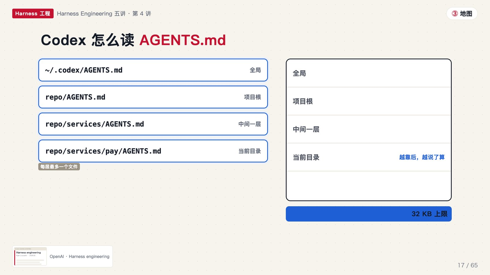

官方文档《Custom instructions with AGENTS.md》：

1. **全局**：Codex 主目录（默认 `~/.codex`）里，有 `AGENTS.override.md` 就读它，否则读 `AGENTS.md`。
2. **项目**：从项目根（通常是 git 根）一路走到当前目录，每一层依次找 `AGENTS.override.md`、`AGENTS.md`、配置里的备用文件名，**每层最多取一个**。
3. **合并**：从根往下拼接，越靠近当前目录的越靠后，也就越说了算。
4. 合起来达到 `project_doc_max_bytes`（默认 **32 KiB**）就不再往里加。

在发给模型的请求里，这条指令链会和技能简介一起，作为一条 `role=user` 的消息放进去（见第 5 节）。

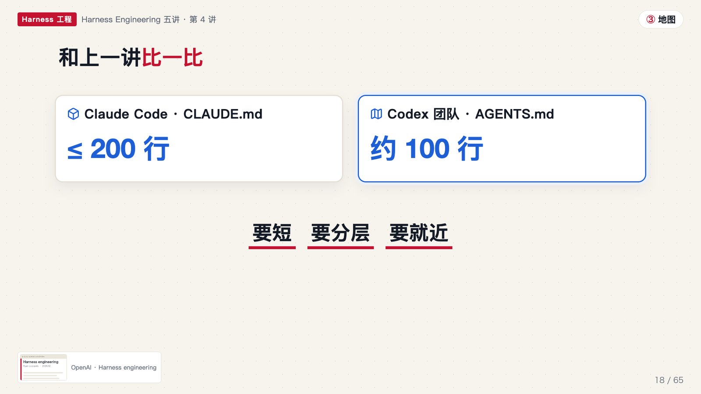

| | Claude Code（第 3 讲） | Codex |
|---|---|---|
| 文件 | CLAUDE.md，四个作用域，逐级拼接 | AGENTS.md，每层一个，越近越优先 |
| 长度 | 官方建议每个文件 200 行以内 | OpenAI 团队约 100 行；合计上限 32 KiB |
| 共同点 | 要短，要分层，要就近 | 同左 |

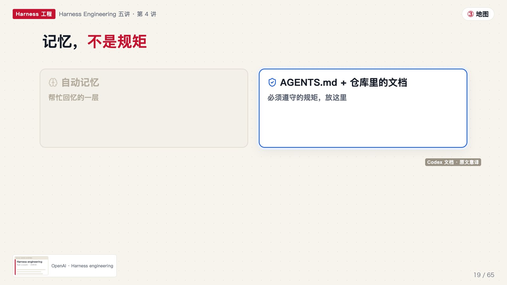

Codex 也有自动记忆（Memories），官方说得很清楚：**必须遵守的团队规则放在 AGENTS.md 和提交进仓库的文档里，记忆只是帮忙回忆的一层**。

---

## 3 环境：让整个应用对 agent 看得见

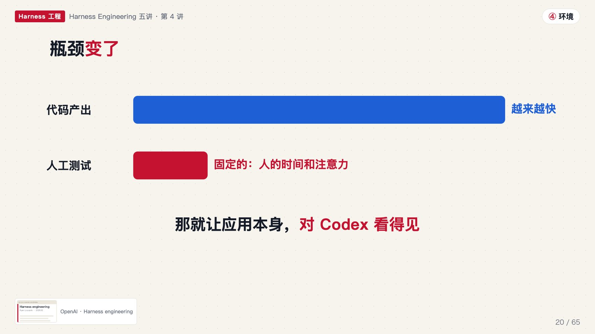

代码写得越来越快以后，瓶颈变成了**人工测试的容量**。人的时间和注意力是固定的，所以他们让应用界面、日志、指标本身对 Codex 可读。

| 步骤 | 做法（原文） | 带来什么 |
|---|---|---|
| 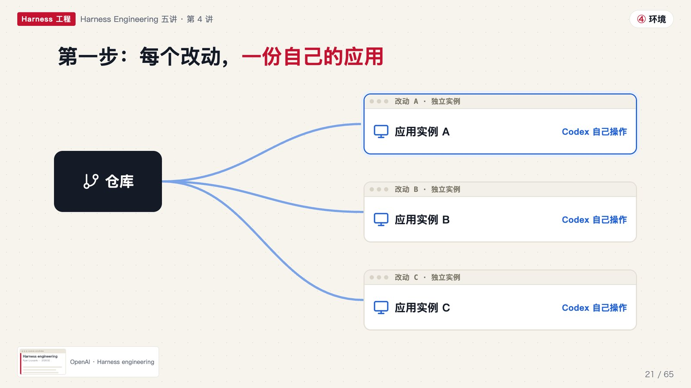 每个改动一份应用 | 应用能按 git worktree 单独启动，Codex 每做一个改动就起一个只属于它的实例 | 改动之间互不干扰，agent 能自己操作 |
| 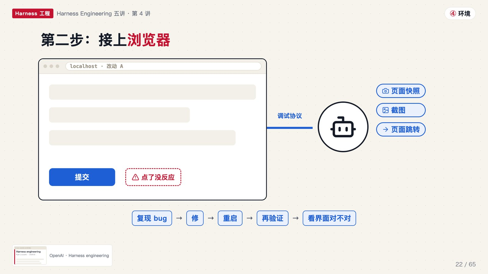 接上浏览器 | 把 Chrome DevTools 协议接进 agent 运行时，做处理 DOM 快照、截图、页面跳转的技能 | 自己复现 bug、验证修复、看界面对不对 |
| 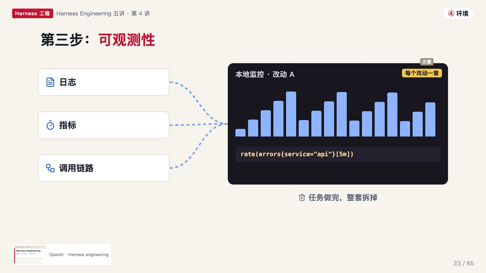 本地可观测性 | 日志、指标、追踪交给一套本地监控栈，每个 worktree 一套、任务做完就拆；agent 用 LogQL、PromQL 查询 | "启动 < 800 毫秒""关键路径每段 < 2 秒"变成 agent 能自己验证的任务 |

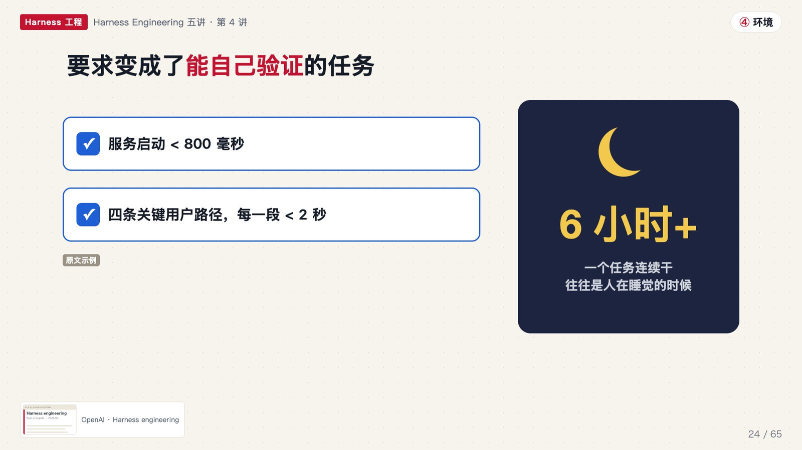

结果：他们经常看到一次 Codex 运行在一个任务上连续干**六个多小时**，往往是人在睡觉的时候。

> 原课程把这一节写成"每个任务在独立的 git worktree 里运行"。原文的说法是"应用能按 worktree 单独启动，每个改动一个实例，配一套用完就拆的监控"，意思接近，本课件按原文写。

---

## 4 约束：守住不变量，不管怎么实现

### 4.1 只管边界，不管写法

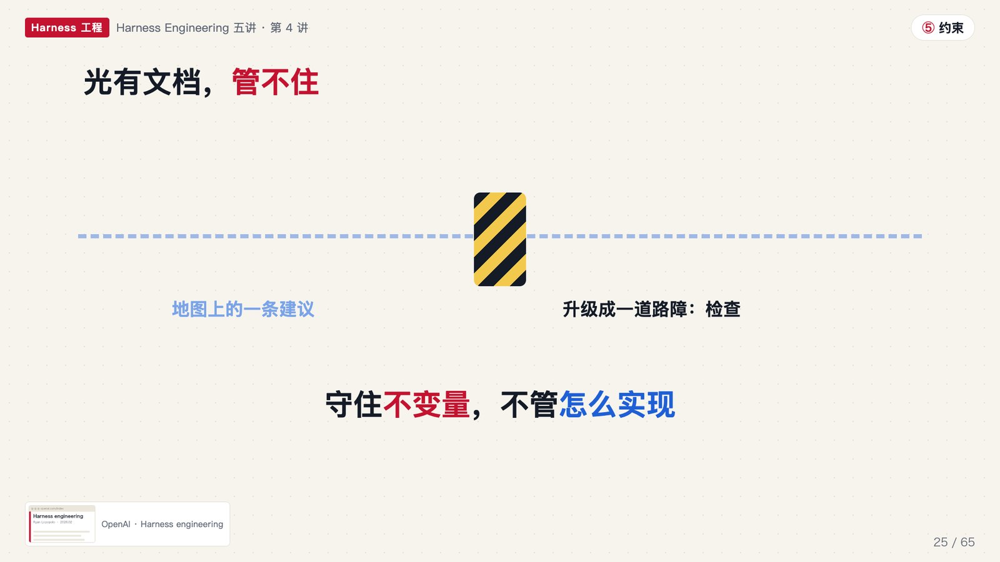

光有文档，管不住一个完全由 agent 生成的代码库。原则是：**强制不变量，不微管实现**（enforcing invariants, not micromanaging implementations）。

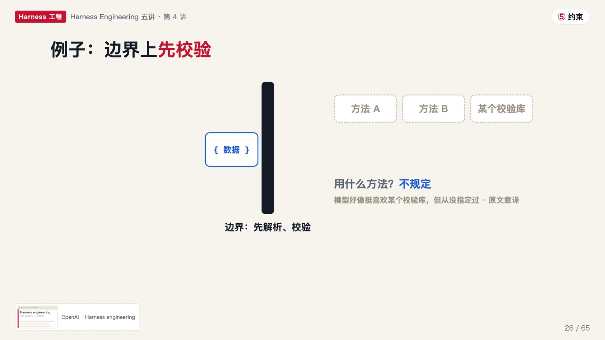

例子：要求 Codex **在边界上解析数据的形状**，但不规定怎么解析（原文说模型好像喜欢用 Zod，但他们没指定这个库）。

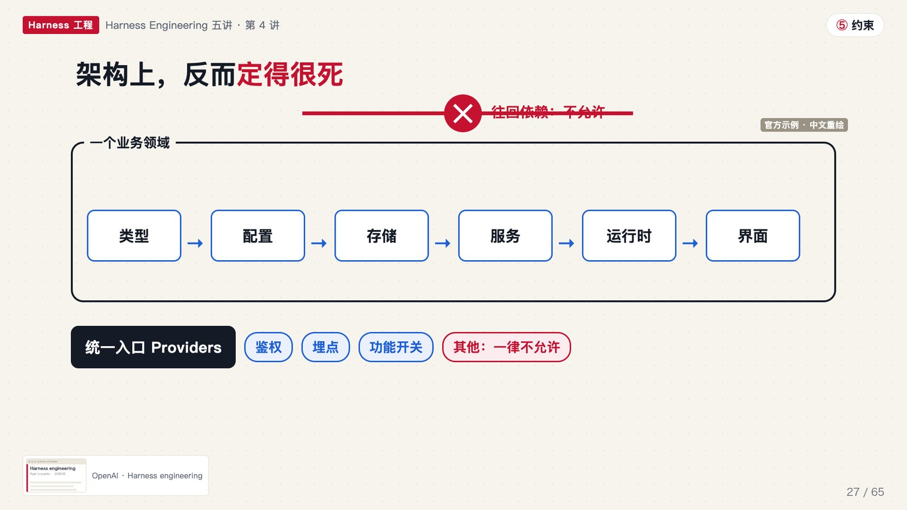

架构上反而定得很死：每个业务领域分成固定几层，依赖只能往前走：**类型 → 配置 → 存储 → 服务 → 运行时 → 界面**；鉴权、连接器、埋点、功能开关这些横切的东西只能从一个统一入口 **Providers** 进来，其他依赖一律不允许。这些规则靠自定义 lint 和结构测试强制，lint 本身也是 Codex 写的。原文的观点：这种架构平时要拖到几百个工程师时才做；有了编程 agent，它是一开始就要有的前提。

### 4.2 报错就是修复说明

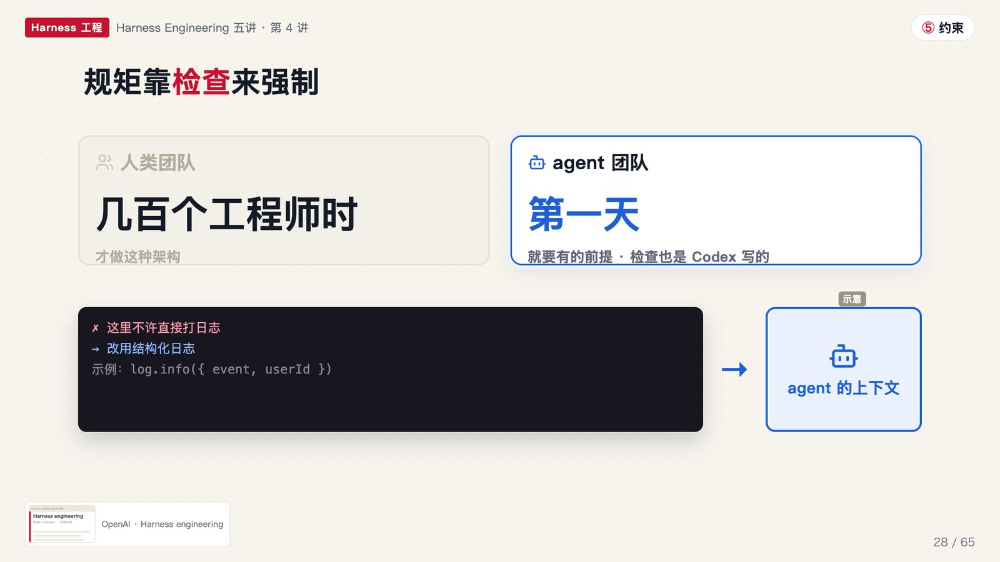

还有一组"品味不变量"：结构化日志、schema 和类型的命名规范、文件大小上限、平台相关的可靠性要求。**因为 lint 是自己写的，报错信息就写成修复指引，直接注入 agent 的上下文**。一个示意：

```text
✗ src/billing/service.ts:42  这里不许直接打日志
→ 改用结构化日志，示例：log.info({ event: "charge_failed", userId })
  规则出处：docs/RELIABILITY.md#logging
```

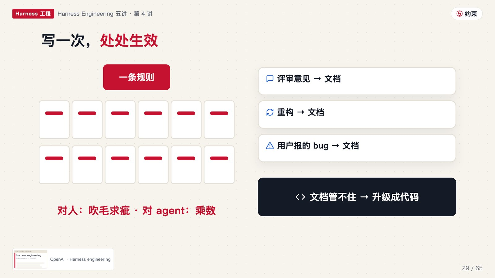

对人来说这些规则可能吹毛求疵，对 agent 却是乘数：写一次，处处生效。人的品味持续补进系统：评审意见、重构 PR、用户报的 bug 都变成文档更新；**文档管不住的，就把规则升级成代码**。

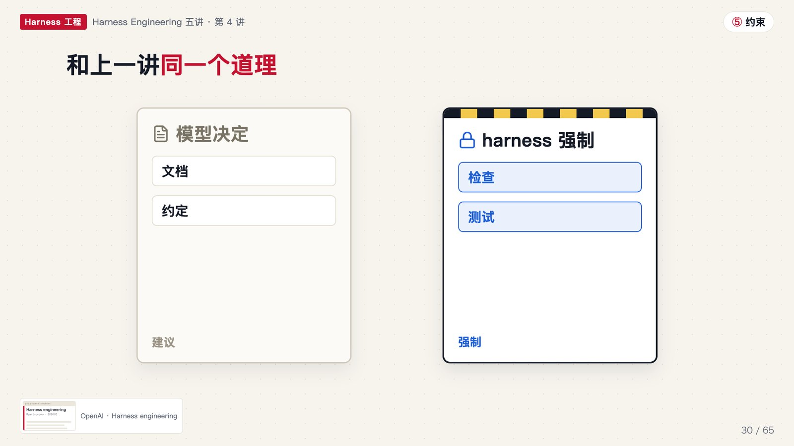

这和第 3 讲"两只手"是一个道理：写在文档里的是建议，写成检查和测试的才是强制。

### 4.3 合并的规矩和垃圾回收

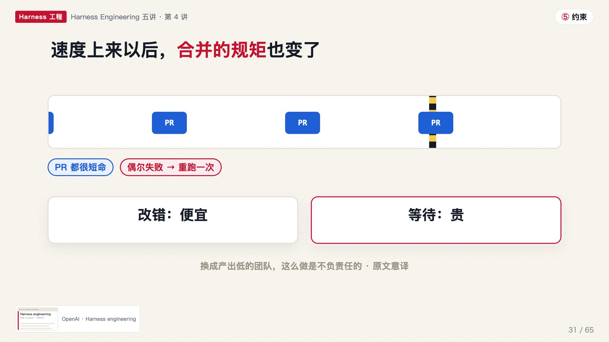

吞吐上来以后，仓库几乎不设阻塞合并的关卡，PR 都很短命，测试偶发失败多半靠重跑。理由：**agent 的产出远超人的注意力时，改错便宜，等待很贵**。原文自己也说，低吞吐的团队这么做是不负责任的。

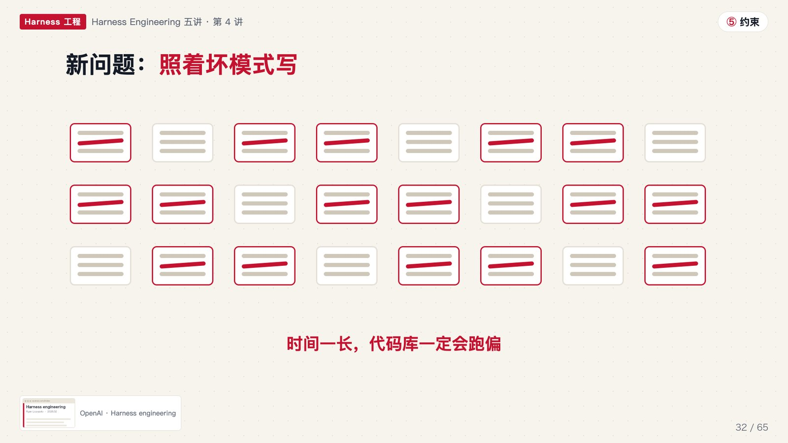

完全放手给 agent 的新问题：Codex 会照着仓库里已有的模式写，**包括不好的模式**，时间一长必然跑偏。

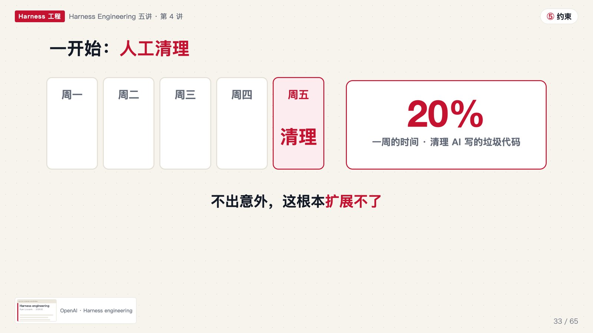

一开始靠人：团队每周五（一周的 20%）都在清理 AI 写出来的垃圾代码（AI slop），扩展不了。

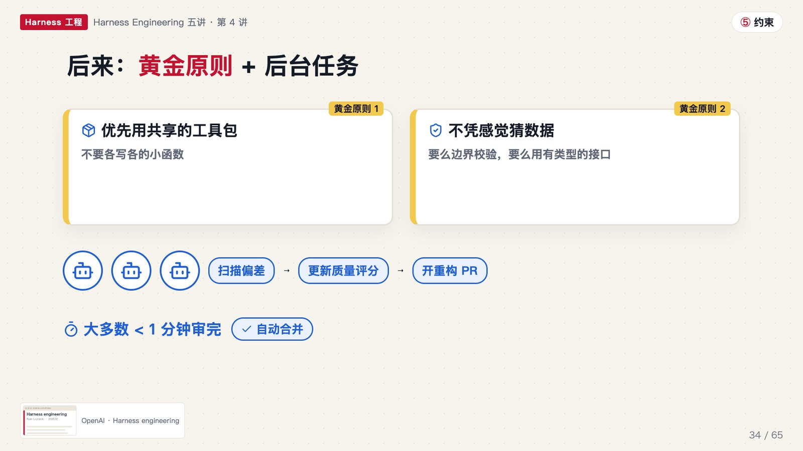

后来的做法：把有主见的、机械的"**黄金原则**"写进仓库（例：优先用共享工具包，不各写各的小函数；不凭感觉猜数据形状，要么在边界校验，要么用有类型的 SDK），再定期跑一批后台 Codex 任务：扫描偏差、更新质量评分、开针对性的重构 PR，大多数一分钟内就能审完、自动合并。

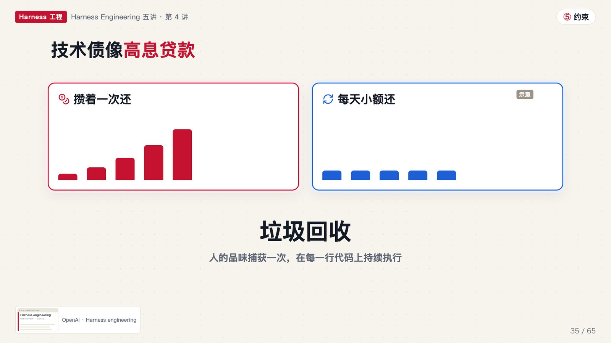

原文把这叫作**垃圾回收**：技术债像高息贷款，持续小额地还几乎总比攒着一次性还好；人的品味捕获一次，就在每一行代码上持续执行。

### 4.4 一句提示，做完一个功能

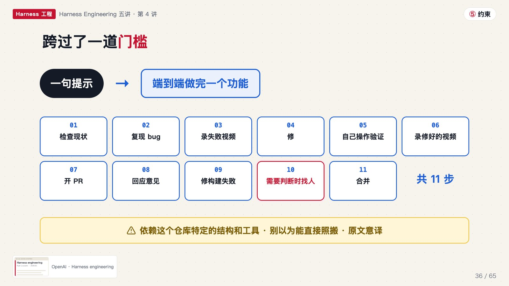

这些都做到位以后，给一句提示，Codex 能端到端推进一个新功能：检查现状 → 复现 bug → 录失败视频 → 修 → 自己操作应用验证 → 录修好的视频 → 开 PR → 回应 agent 和人的意见 → 发现并修好构建失败 → **只在需要判断时才找人** → 合并。原文紧跟着提醒：这很依赖这个仓库特定的结构和工具，没有类似的投入，别以为能照搬。

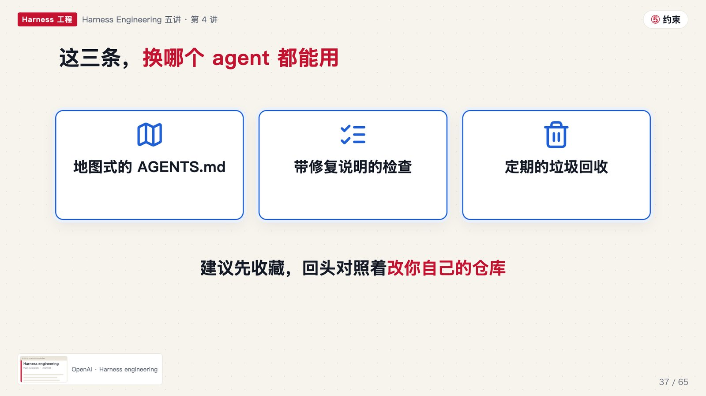

---

## 5 循环：把 Codex 的 agent 循环摊开看

### 5.1 ARC-AGI-3：改两个设置，分数翻三倍

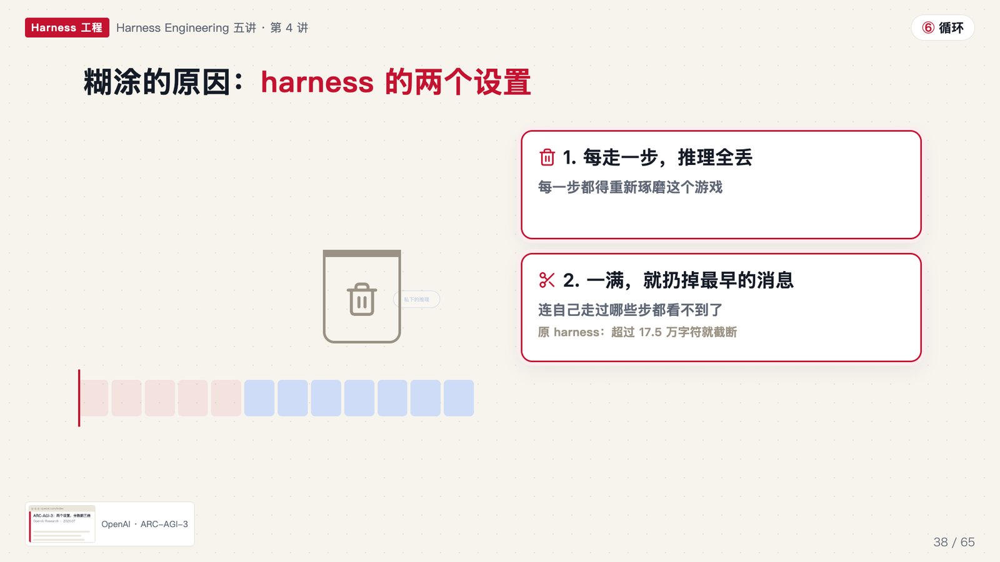

ARC-AGI-3 是一套二维解谜游戏基准，agent 进一个陌生游戏、没有说明，自己摸规则；它故意用一个没有工具的通用 harness。OpenAI 看失败记录发现，很多糊涂来自 harness 的两个设置：

1. **每走一步就丢掉模型私下的推理**，每一步都得重新琢磨游戏；
2. **滚动截断**：上下文超过 17.5 万字符就扔掉最早的消息，时间一长连自己走过的步都看不到。

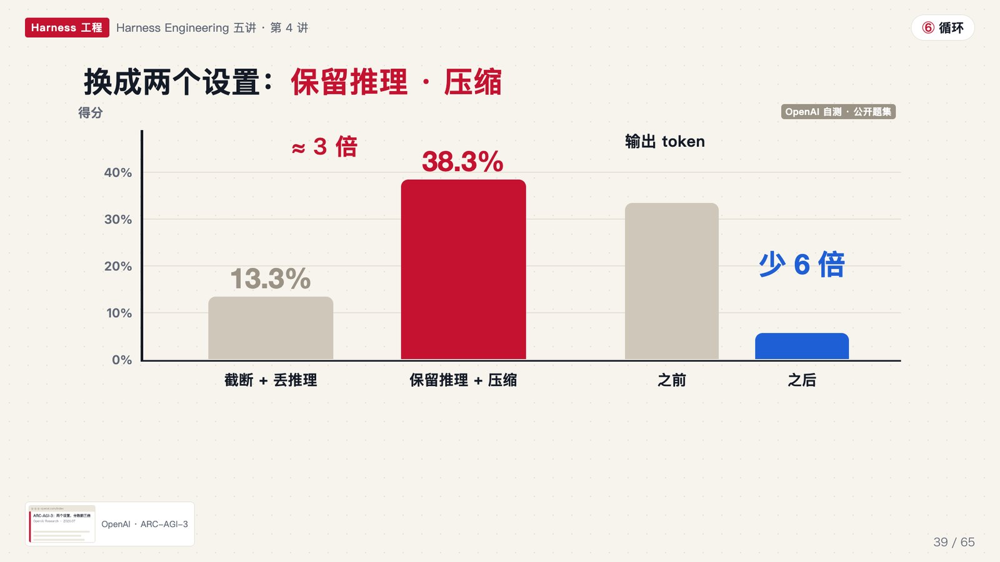

换成 ChatGPT 和 Codex 在产品里用的设置：**保留推理、用压缩代替截断**。按《Codex as a platform》的说法，GPT-5.6 Sol 的分数从 **13.3% 涨到 38.3%**（约 3 倍），输出 token **少了 6 倍**（OpenAI 自测，公开题集）。

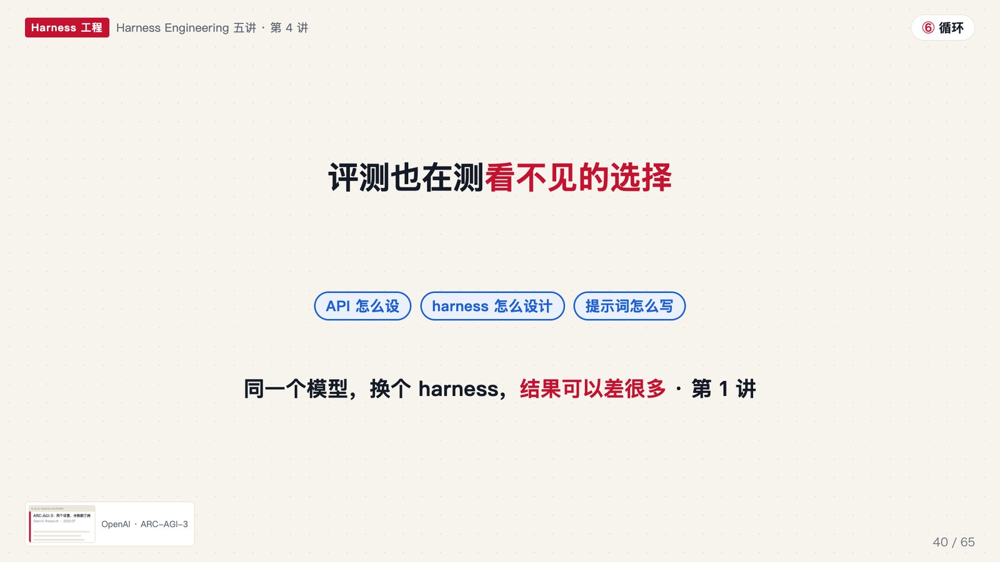

结论：**评测很少只测模型，它同时在测 API 设置、harness 设计和提示词**。这就是第 1 讲说的，同一个模型换个 harness，结果可以差很多。

### 5.2 一次请求里装了什么

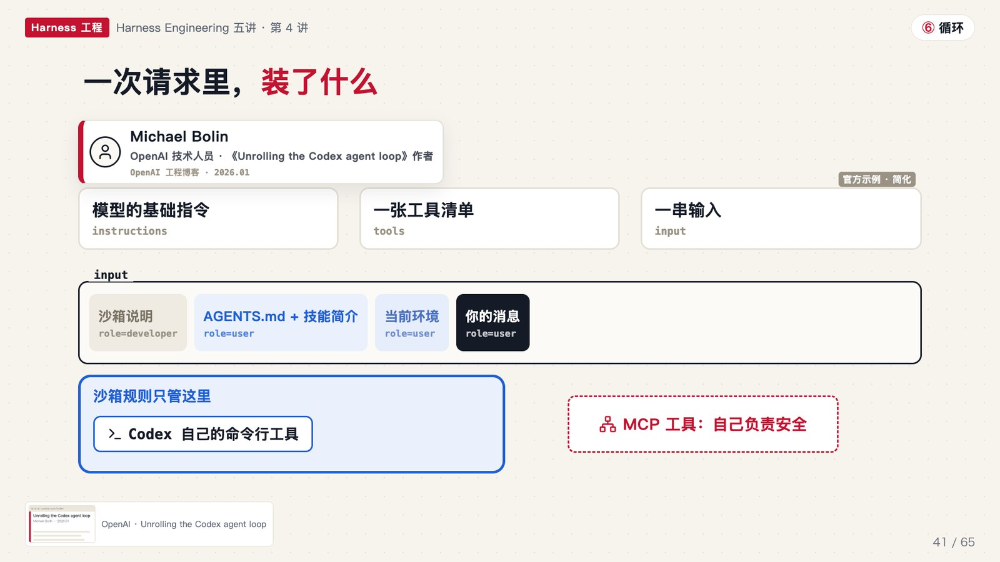

Michael Bolin《Unrolling the Codex agent loop》：Codex CLI 用 HTTP 调 Responses API，一次请求主要三个字段：

| 字段 | 内容 |
|---|---|
| `instructions` | 模型的基础指令（随 CLI 打包，按模型不同），或配置里指定的文件 |
| `tools` | Codex 自己的工具 + Responses API 提供的工具 + 用户通过 MCP 接的工具 |
| `input` | 一串条目：沙箱说明（`developer`）→ 可选的开发者指令（`developer`）→ AGENTS.md 指令链和技能简介（`user`）→ 当前环境：工作目录、shell（`user`）→ 你的消息 |

角色优先级从高到低：`system` > `developer` > `user` > `assistant`。注意：**沙箱说明只管 Codex 自己的 shell 工具**，MCP 服务提供的工具不归 Codex 的沙箱管，要自己负责护栏。

### 5.3 越滚越长，为什么不慢

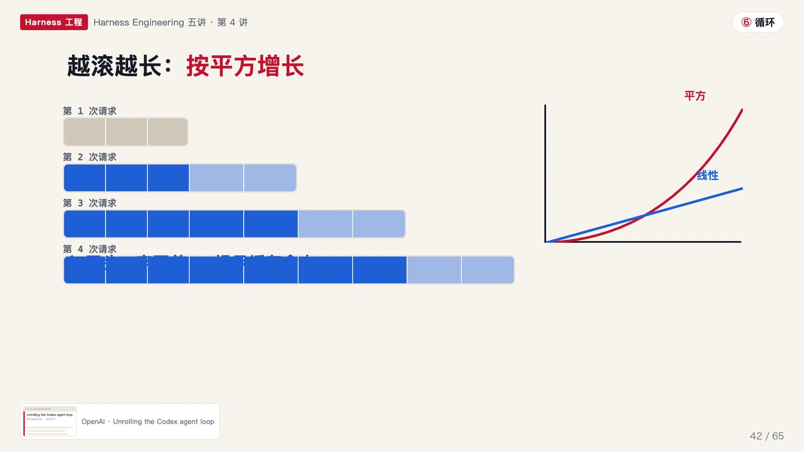

每调一次工具，结果追加到 `input` 后面，整段对话发出去的数据量是**平方增长**的。Codex 故意不用服务端保存状态的 `previous_response_id`，每次请求无状态，这样才能支持零数据保留（ZDR）的客户。靠的是**提示缓存**：只要新请求的开头和上一次一字不差，前面那段计算就能复用，采样成本从平方变成**线性**。所以 Codex 刻意保证旧请求永远是新请求的精确前缀。

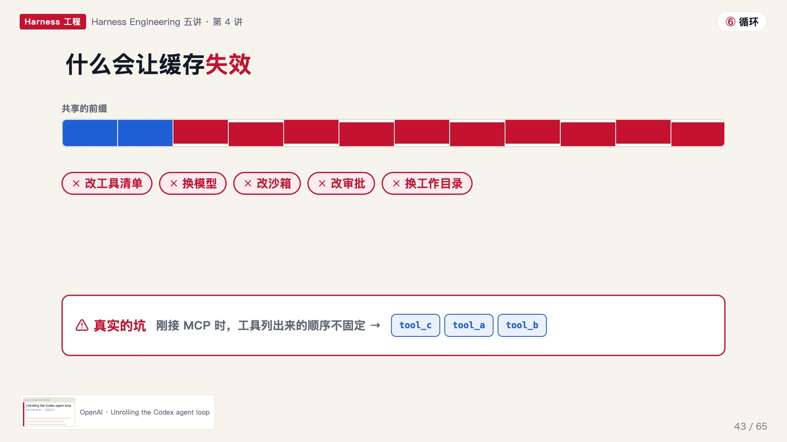

会让缓存失效的操作：对话中途改工具列表、换模型、改沙箱配置或审批模式、换工作目录。真实踩过的坑：最早接 MCP 时工具列举顺序不固定，缓存一直不命中。

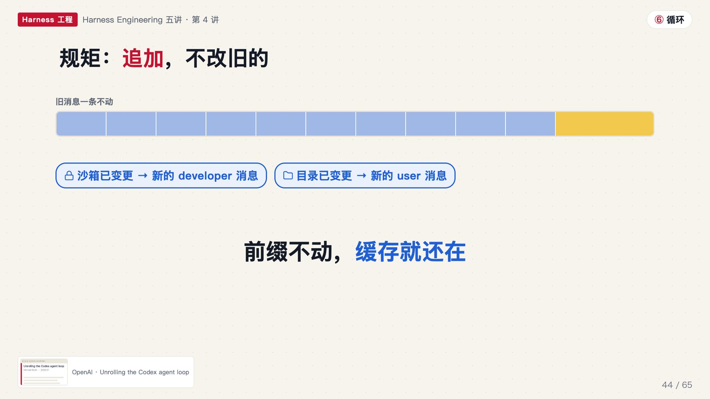

所以对话中途配置变了，Codex 的做法是**往后追加一条新消息，而不是改前面的旧消息**：沙箱或审批变了，插一条新的 `developer` 权限说明；工作目录变了，插一条新的 `user` 环境说明。前缀不动，缓存就还在。

### 5.4 压缩

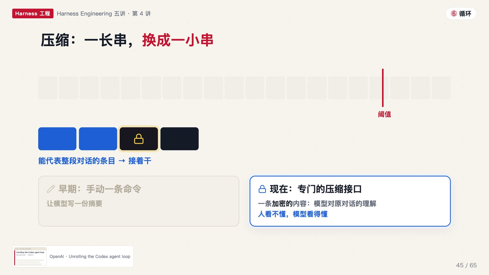

token 超过阈值时，把 `input` 换成一串更短的、能代表整段对话的条目。早期要用户手动 `/compact`，让模型写摘要；现在 Responses API 有专门的压缩接口，返回的条目里有一条 `type=compaction`、带加密内容（`encrypted_content`）的条目，保存模型对原对话的潜在理解。超过 `auto_compact_limit` 时 Codex 自动调用。

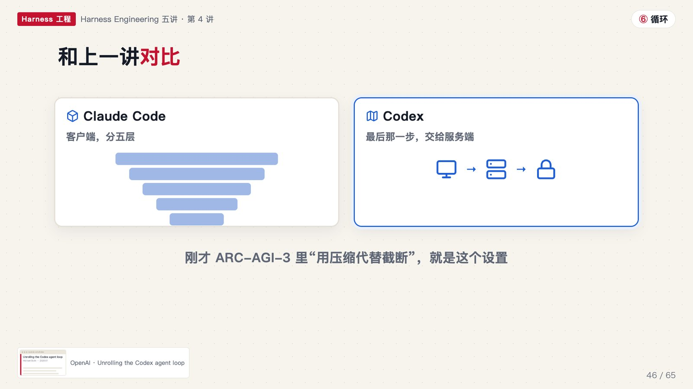

| | Claude Code | Codex |
|---|---|---|
| 压缩在哪 | 客户端，五层管线，最后一层模型写摘要 | 最后一步交给服务端，返回加密的压缩条目 |

---

## 6 边界：沙箱、审批、子代理、Stop 钩子

### 6.1 沙箱定边界，审批定什么时候问

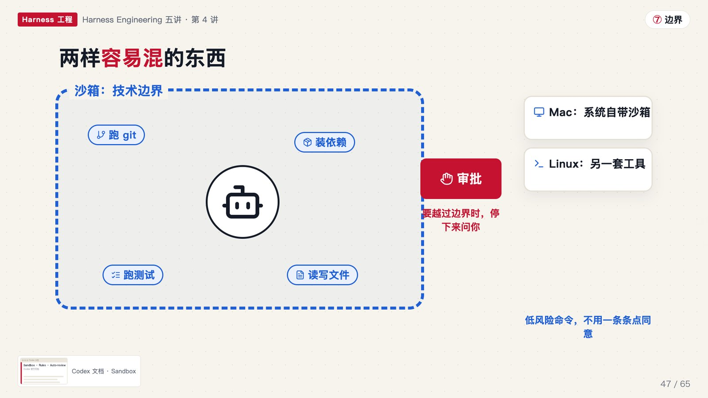

官方文档：**沙箱定义技术边界；审批策略决定 agent 什么时候必须停下来问你，才能越过边界**。沙箱管的是 agent 启动的每条命令（git、包管理器、测试都继承同样的边界）；macOS 用系统自带的 Seatbelt，Linux 和 WSL2 用 bubblewrap，Windows 用原生沙箱。好处是减少审批疲劳。

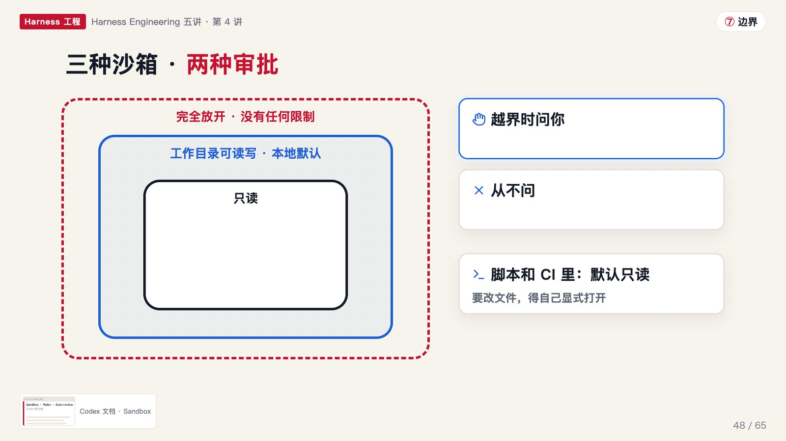

| 沙箱模式 | 能做什么 |
|---|---|
| `read-only` | 只能看，改文件、跑命令要批准 |
| `workspace-write` | 工作区里读写、跑常规本地命令；**本地默认** |
| `danger-full-access` | 没有沙箱限制 |

| 审批策略 | 意思 |
|---|---|
| `on-request` | 在沙箱里干，要越界时问 |
| `never` | 不停下来问（原来的 `untrusted` 已不再支持） |

`codex exec`（脚本、CI 用的非交互模式）**默认只读沙箱**，要改文件得显式加 `--sandbox workspace-write`。

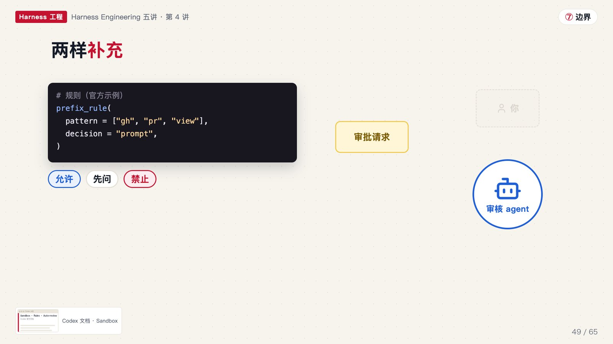

两样补充：**规则**（Rules，实验功能），按命令前缀决定沙箱外的命令允许、先问还是禁止；**自动审核**（Auto-review），把审批请求发给一个单独的审核 agent 而不是你，它不改变沙箱边界。和第 3 讲比：Claude Code 自动模式靠后台分类器，Codex 用审核 agent，思路都是"问人 → 问另一个模型，边界不动"。

```python
# ~/.codex/rules/default.rules（官方示例，Starlark 语法）
prefix_rule(
    pattern = ["gh", "pr", "view"],   # 匹配的命令前缀
    decision = "prompt",              # 在沙箱外运行前先问
)
```

### 6.2 子代理

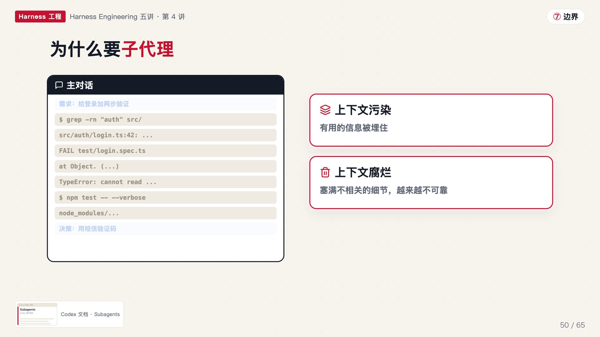

官方理由：就算上下文窗口很大，把探索笔记、测试日志、报错和命令输出都灌进主对话，会话会越来越不可靠，叫**上下文污染**和**上下文腐烂**。


主 agent 专注需求、决策和最终结果；探索、测试、日志分析交给子代理并行做，只交回摘要。内置三种：`default`（通用）、`worker`（动手实现）、`explorer`（读代码库）；自定义的放 `.codex/agents/*.toml`，每个文件一个，必填 `name`、`description`、`developer_instructions`。


子代理能换模型、换指令、关掉部分能力，但**权限、沙箱、MCP 都继承主 agent，自定义文件改不了**。官方提醒：读多的活适合并行，写多的活并行要小心，几个 agent 同时改代码会冲突。

### 6.3 Stop 钩子


原课程说 Codex"靠约定，不靠花哨的扩展点"。2026-11 的官方文档里，Codex 已经有十几个钩子事件：会话开始和结束、子代理开始和结束、工具调用前后、权限请求、每次模型请求前后、压缩前后、提交提示、Stop、中断。非托管的钩子要先审阅、信任了才会跑。


**Stop**：一轮要结束时，钩子返回下面的 JSON（或退出码 2、理由写到 stderr）。Codex **不会拒绝这一轮，而是把 `reason` 当成一条新的用户消息自动续写，让它接着干**。输入里的 `stop_hook_active` 告诉你这一轮是不是已经被续过一次，防止死循环。

```json
{
  "decision": "block",
  "reason": "Run one more pass over the failing tests."
}
```


第 3 讲 Claude Code 的 Stop 钩子（返回 2 就不让它停）和这里几乎一模一样。两家从不同方向出发，在"管住一个想提前收工的 agent"这件事上走到了同一个机制。

---

## 7 平台，和三家并排看

### 7.1 把 agent 循环做成一个协议


Codex 有桌面应用、命令行、编辑器插件、网页版，底下是同一个 harness。命令行版从 2025 年 4 月发布起就开源（[openai/codex](https://github.com/openai/codex)，Apache-2.0，主要是 Rust）；官方 Open Source 页写明：CLI、SDK、app-server 在 openai/codex 仓库里，技能在 openai/skills，**编辑器插件和 Codex 云端不开源**；仓库接受 issue，不接受外部 PR。


Celia Chen《Unlocking the Codex harness》：做 VS Code 插件时不想重写循环，先试了把 Codex 包成 MCP 服务，发现 MCP 的语义很难贴合编辑器的需要；于是做了一套照着终端界面循环设计的双向 JSON-RPC 协议，这就是 app-server 的第一版。后来 JetBrains、Xcode 和 Codex 桌面应用都要用，它就变成了稳定、向后兼容的平台接口。


| 原语 | 是什么 |
|---|---|
| Item（条目） | 输入输出的最小单位：用户消息、agent 消息、工具执行、审批请求、代码差异；生命周期 `item/started` → 可选的 `item/*/delta` → `item/completed` |
| Turn（回合） | 一次用户输入引起的一段 agent 工作，包含一串条目 |
| Thread（线程） | 持久的会话容器，包含多个回合；能新建、恢复、分叉、归档 |


协议是双向的：agent 需要审批时，服务端会反过来向客户端发请求，并把这一回合暂停，直到客户端回"允许"或"拒绝"。

接法有四种：`codex exec`（脚本和 CI，`--json` 输出事件流，`--output-schema` 约束最终输出）、Codex SDK、app-server（官方说以后重点维护的一等方式）、`codex mcp-server`（只拿得到 MCP 暴露的那部分）。


2026 年 8 月《Codex as a platform》：与其让每个团队把工作搬进一个通用聊天框，不如把 agent 带进围绕真实工作设计的软件里；**界面本身，就是最重要的上下文**。


示例应用 Relay（虚构数据）：在货运看板旁边放一个 agent，接上应用自己的 MCP 工具；用户选中一批货、点"比较恢复方案"，agent 给出选项；**改订货物这种有后果的操作必须人工批准**。harness 负责循环、会话、流式活动和工具调用，产品继续拥有自己的看板、记录和控制。

### 7.2 打分和三家对比


| 子系统 | Codex 的做法 | 评价（课程作者的主观打分） |
|---|---|---|
| 指令 | AGENTS.md 当目录页 + `docs/` + 强制不变量 | 教科书级，定义了"给地图不给说明书" |
| 工具 | exec / SDK / app-server 三层入口 + MCP + 沙箱 | 接多深自己选 |
| 环境 | 每个改动一个隔离实例 + 可观测性 + 沙箱 | 隔离是招牌 |
| 状态 | 仓库里的计划和文档 + 线程 + 压缩 + 分叉 | 更依赖约定 |
| 反馈 | 验证命令 + 自定义 lint + 审批 + CI 自动修复 | 反馈路径默认化，值得抄 |


| | Pi | Claude Code | Codex |
|---|---|---|---|
| 思路 | 内核最小，什么都不替你决定 | 内核完整，开箱即用 | 循环开源，规矩写在仓库里 |
| 指令文件 | AGENTS.md，全局 + 父目录 + 当前目录 | CLAUDE.md 四个作用域，200 行内 | AGENTS.md 每层一个，越近越优先，32 KiB |
| 压缩 | 一层，可整体替换 | 客户端五层管线 | 服务端压缩接口，加密条目 |
| 安全 | 默认全放开，靠容器 | 六种权限模式 + 分类器 + 拒绝规则 | 三种沙箱 + 两种审批 + 规则 + 审核 agent |
| 强制 | 自己写扩展拦 | 30 多个钩子事件，Stop 钩子 | 十几个钩子事件，Stop 钩子 |
| 开源 | 开源 | 不开源 | CLI、SDK、app-server 开源 |

（这张表是我自己整理的，不是课程内容。）


我的观察：课程说 Claude Code 做加法、Codex 做减法；但现在 Codex 也有了钩子、子代理、技能、记忆和审核 agent，两家的 Stop 钩子几乎一样。


真正拉开差距的不是功能清单，而是 OpenAI 那篇文章里的工程习惯：**仓库是唯一的事实来源、不变量写成检查、定期做垃圾回收**。这些不依赖用哪个工具，换成 Claude Code 也一样能做。

---

## 本讲小结

1. 人掌舵，agent 执行：工程师的工作变成"缺什么能力，就补进环境"。
2. 给地图，不给说明书：AGENTS.md 约 100 行，是目录页；知识放进仓库，agent 看不见的就不存在。
3. 守住不变量，不管怎么实现：规矩写成检查，报错就是修复说明，再定期做垃圾回收。
4. 循环本身也是 harness：保住缓存前缀，配置变了追加新消息，满了就压缩；ARC-AGI-3 上两个设置让分数翻了三倍。
5. 沙箱定边界，审批定什么时候问，Stop 钩子让它接着干。

## 下一讲预告

第 5 讲是这套课的最后一讲，拆 DeepSeek Harness：按原课程的说法，它连模型适配器都做成了插件，问的是一个更激进的问题：harness 能不能脱离具体的模型，变成一个独立的运行时。

## 关键术语

| 术语 | 意思 |
|---|---|
| 唯一的事实来源（system of record） | 仓库里有版本的文档和代码；agent 只认这些 |
| 目录页式 AGENTS.md | 约 100 行、只当地图的指令文件，指向 `docs/` 里的细节 |
| 渐进披露（progressive disclosure） | 从小入口开始，一步步告诉 agent 下一步去哪看 |
| 不变量（invariant） | 必须一直成立的约束，如"边界上先校验数据"；只管它，不管怎么实现 |
| 黄金原则（golden principles） | 写进仓库的、有主见的机械规则，后台任务据此开重构 PR |
| 垃圾回收 | 定期扫描偏差、小额持续地还技术债 |
| 提示缓存（prompt caching） | 新请求与旧请求前缀一字不差时复用计算 |
| 压缩（compaction） | 把长输入换成短条目；Codex 用服务端接口返回加密的压缩条目 |
| 沙箱 / 审批 | 沙箱定技术边界；审批决定什么时候停下来问人 |
| Stop 钩子 | 一轮要结束时运行；返回 block 和理由，Codex 把理由当新消息接着干 |
| Thread / Turn / Item | app-server 的三个原语：会话、回合、条目 |

## 思考题

1. 你的 AGENTS.md（或 CLAUDE.md）现在多少行？按"目录页"的思路，哪些内容该挪进 `docs/`，哪些该留下？
2. "守住不变量，不管怎么实现"和"微管实现"的区别是什么？各举一个你项目里的例子。
3. 为什么改配置时要"追加新消息"而不是"改旧消息"？如果改了旧消息会怎样？
4. 沙箱和审批都能挡住危险操作，为什么要分成两样东西？
5. OpenAI 说十一步端到端"别以为能照搬"，你觉得最难照搬的是哪一步需要的投入？

<details>
<summary>参考答案</summary>

1. 留下的应该是：项目是什么、怎么跑测试和检查（验证命令）、绝对不能违反的硬约束、去哪找更深的文档。挪走的：架构细节、设计决策、产品规格、各模块的约定、计划，按主题放进 `docs/`，在 AGENTS.md 里只留一行指向。
2. 不变量只规定结果必须满足什么（"边界上的数据必须先校验"），可以机械检查；微管实现是规定具体写法（"必须用某个库、写成某种结构"），既难检查，又挤占模型自己选更好做法的空间。例子因项目而异。
3. 提示缓存只在前缀一字不差时命中。改旧消息会让那条之后的所有内容缓存失效，每次请求的成本又回到平方增长；追加新消息，旧前缀不变，缓存还在。
4. 沙箱是技术上做不到（操作系统强制），审批是流程上要先问（人或审核 agent 决定）。分开以后，边界内的低风险操作可以不问直接做，减少审批疲劳；只有越界时才进审批。
5. 一般最难的是"自己操作应用验证"和"录视频"：需要每个改动能单独起应用、接好浏览器和可观测性；以及"只在需要判断时才找人"：需要清楚定义哪些事要人判断。

</details>

## 动手练习

1. 把你仓库的 AGENTS.md 改成目录页：控制在 100 行左右，新建 `docs/` 放挪出去的内容，再写一个小脚本检查 AGENTS.md 里的每个链接都指向存在的文件，接进 CI。
2. 挑一条你最常在评审里说的话（比如"别直接 `console.log`"），写成一条自定义 lint，报错信息写成修复说明：错在哪、应该怎么改、规则出处在哪。
3. 给 Codex 配一个 Stop 钩子：跑一遍测试，失败就返回 `{"decision":"block","reason":"测试没过：<失败用例>，请修完再结束"}`；输入里 `stop_hook_active` 为 true 时直接放行。只在你信任的仓库里启用。

## 延伸阅读

- 原课程：[walkinglabs/learn-harness-engineering](https://github.com/walkinglabs/learn-harness-engineering)（[中文版网页](https://walkinglabs.github.io/learn-harness-engineering/zh/)）
- OpenAI：[Harness engineering: leveraging Codex in an agent-first world](https://openai.com/index/harness-engineering/)
- OpenAI：[Unrolling the Codex agent loop](https://openai.com/index/unrolling-the-codex-agent-loop/)
- OpenAI：[Unlocking the Codex harness: how we built the App Server](https://openai.com/index/unlocking-the-codex-harness/)
- OpenAI：[How enabling two settings tripled our scores on the ARC-AGI-3 benchmark](https://openai.com/index/how-two-settings-tripled-our-arc-agi-3-scores/)
- OpenAI Developers：[Codex as a platform: build on the open agent harness](https://developers.openai.com/blog/codex-as-a-platform)
- Codex 文档：[AGENTS.md](https://learn.chatgpt.com/docs/agent-configuration/agents-md)、[Sandbox](https://learn.chatgpt.com/docs/sandboxing)、[Rules](https://learn.chatgpt.com/docs/agent-configuration/rules)、[Auto-review](https://learn.chatgpt.com/docs/sandboxing/auto-review)、[Subagents](https://learn.chatgpt.com/docs/agent-configuration/subagents)、[Hooks](https://learn.chatgpt.com/docs/hooks)、[Memories](https://learn.chatgpt.com/docs/customization/memories)、[Non-interactive mode](https://learn.chatgpt.com/docs/non-interactive-mode)、[Open Source](https://learn.chatgpt.com/docs/open-source)、[App Server](https://developers.openai.com/codex/app-server)
- 源码：[openai/codex](https://github.com/openai/codex)

---

画面和配音由 AI 生成。引语是原文意译；ARC-AGI-3 的数字是 OpenAI 自测；"三家并排看""越走越近"是个人观点；标"示意"的画面和 lint 报错示例是示意。
