# 第 5 讲 · 拆解 DeepSeek Harness：连 agent 循环都是插件

> Harness Engineering 五讲 · 配套课件（系列最后一讲）
> 配套视频（19 分钟）：B 站 / 视频号 / 抖音 / 小红书搜索「竹二木SI」 · 整份幻灯片：[l05-幻灯片.pdf](./l05-幻灯片.pdf)
> 底本：开源课程 [Learn Harness Engineering](https://github.com/walkinglabs/learn-harness-engineering)（walkinglabs，MIT 协议）"前沿 Harness 拆解"栏目的《拆解 DeepSeek Harness 的设计》。DeepSeek Harness 还在开发者预览，改得很快；本课件按 2026-11-15 的源码仓库（master `39163dd`，最新预发布版 `dsh-v0.2.2-rc.3`）核对，原课程有几处说法已经过时，按源码改写，见文末"和原课程不一样的地方"。本课件是非官方的学习整理。

## 这一讲你会学到

学完这一讲，你应该能做到：

1. 说清 DeepSeek Harness 的定位："一切皆插件"有多彻底，为什么说它连 agent 循环都做成了插件。
2. 讲出 Cordis 内核的五个想法，以及瀑布式事件（waterfall）为什么能让一个策略插件直接拒绝请求。
3. 用"定义、提供方、消费方"三个角色解释能力接缝，说明为什么换一个提供方就能把整个执行环境搬走。
4. 把一轮里的事件流水线摊开讲，并会用"新功能该放在哪"那张表给自己的 agent 找扩展点。
5. 解释"模型可见即已记录"：为什么每个模型请求都必须能从只追加的日志重建，以及它怎么约束插件、日志格式和压缩。
6. 说出它怎么兼容别家的钩子、mod、子代理和指令文件，并把 Pi、Claude Code、Codex、DeepSeek Harness 四家并排对比，讲出五讲的四个共同点。

建议先看一遍视频，再对照本课件逐节复习。每节开头的图就是视频里对应的画面。

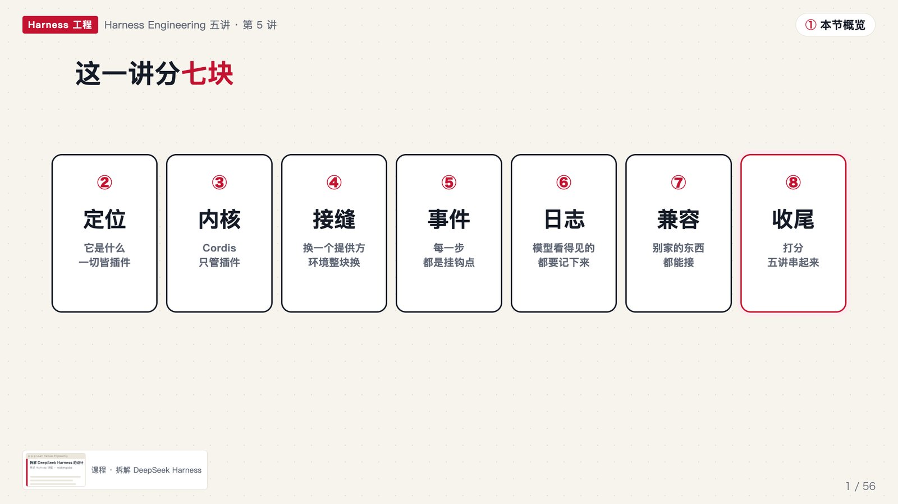

前四讲拆过三款 agent：Pi 内核最小，Claude Code 功能最全，Codex 把循环开源、把规矩写进仓库。它们都是在一个具体的 agent 里优化 harness。原课程说，DeepSeek Harness 问的是一个更激进的问题：**harness 能不能离开具体的模型，变成一个独立的运行时？**

---

## 1 定位：一切皆插件

### 1.1 它是什么

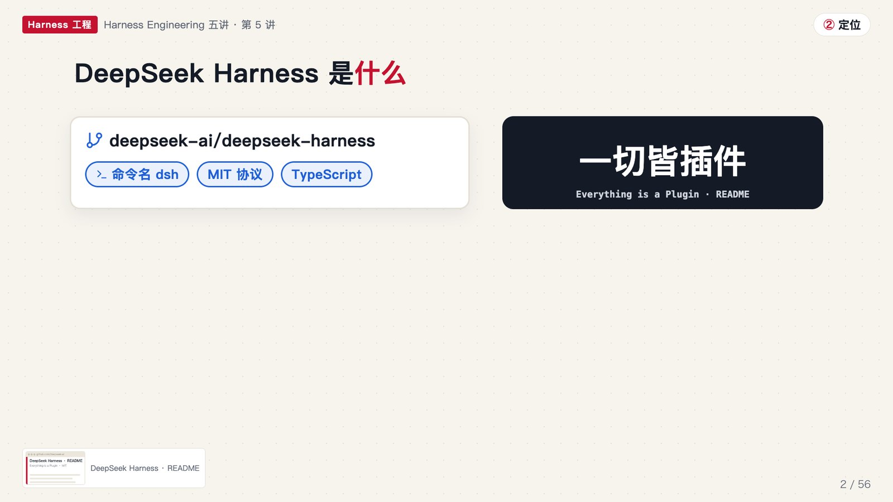

- **DeepSeek Harness**，命令名 `dsh`，DeepSeek 开源的 agent harness，MIT 协议，主体是 TypeScript。README 的一句话介绍：构建在"**一切皆插件**"的架构上，由 Cordis 驱动。
- 仓库 2026 年 8 月 13 日建立，到 11 月 13 日已经发了 39 个预发布版本（最早 `dsh-v0.1.0-rc.7`，最新 `dsh-v0.2.2-rc.3`）。
- 现在处在**开发者预览**：README 原话是正在快速迭代，未来会出现破坏兼容性的变更。

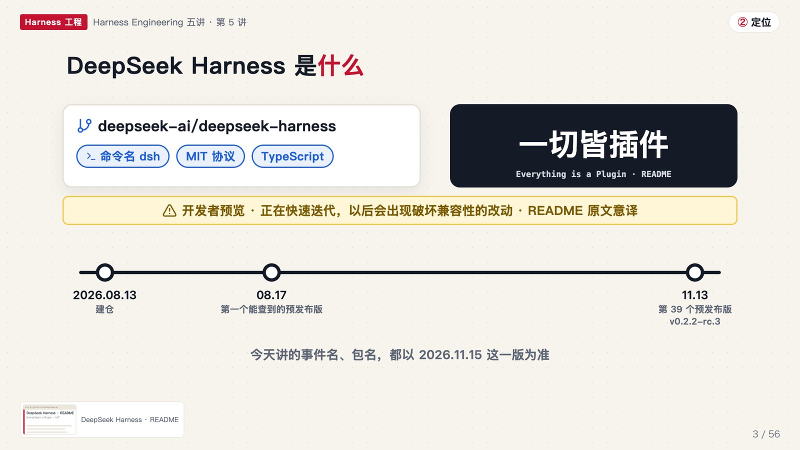

- 有桌面端、网页版，也能用代码启动。官网演示了一个"创造模式"：用对话让它给自己写一个番茄时钟插件，装好、验证通过，演示里用了 5 分 24 秒。
- 官网的定位：日常工作、写代码，还是构建你自己的 harness，都可以从这里开始；面向全球开放测试、同步开源，用可以自由组合的插件扩展 agent 的能力。

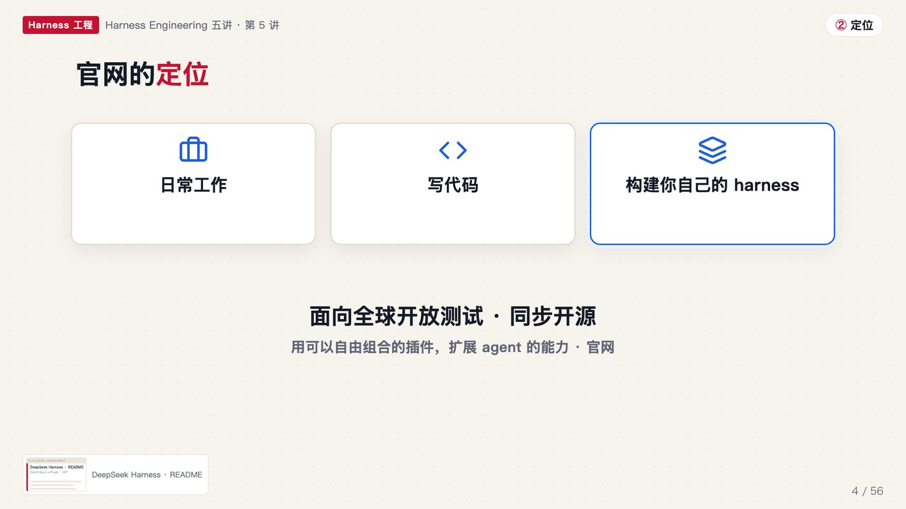

### 1.2 连循环都是插件

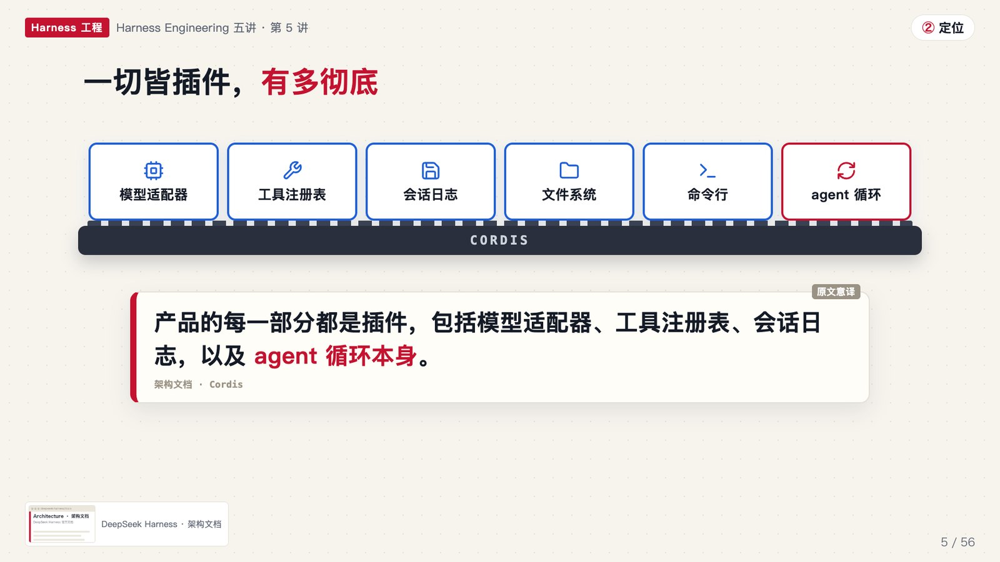

架构文档开头就讲这件事（原文意译）：

> 产品的每一部分都是插件，包括模型适配器、工具注册表、会话日志，以及 agent 循环本身，所以每一样都能从配置里替换。

插件往一个共享的上下文里贡献三样东西：**服务、类型化的事件、可以撤销的副作用**。


注意最后那个：**agent 循环本身**。前几讲一直说 harness 的核心是一个循环；在这里，连循环都只是一块可以拔下来、换一块插回去的积木。

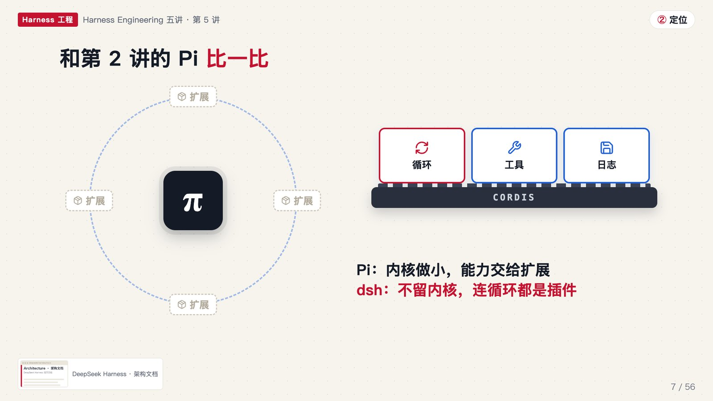

| | Pi（第 2 讲） | DeepSeek Harness |
|---|---|---|
| 内核 | 做到最小：四个工具加一个小循环 | 干脆不留：连循环都是插件 |
| 扩展 | 大部分能力交给扩展 | 一切都是插件，挂在别的插件旁边 |

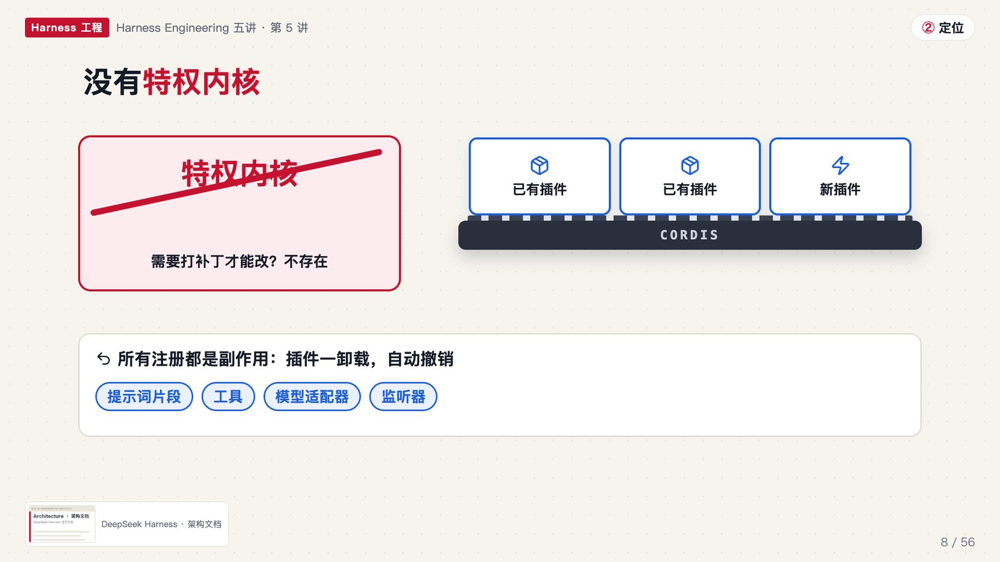

文档还有一句：**不存在需要打补丁的特权内核**。扩展它的方式，是把一个插件挂到其他插件旁边；所有注册都是副作用，插件一卸载，就自动撤销。

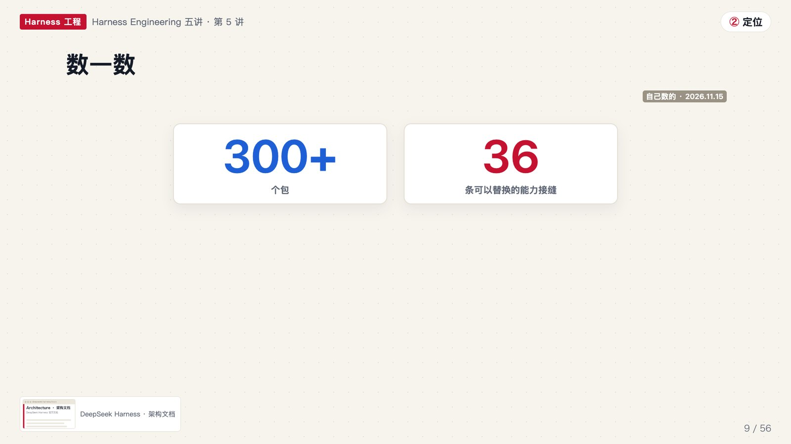

我自己数了一下（2026-11-15）：`packages/` 下有三百多个包（约 380 个），自动生成的能力图里登记了 113 个服务，其中 36 条是可以替换的能力接缝。

### 1.3 一个运行中的 dsh，是一棵插件树

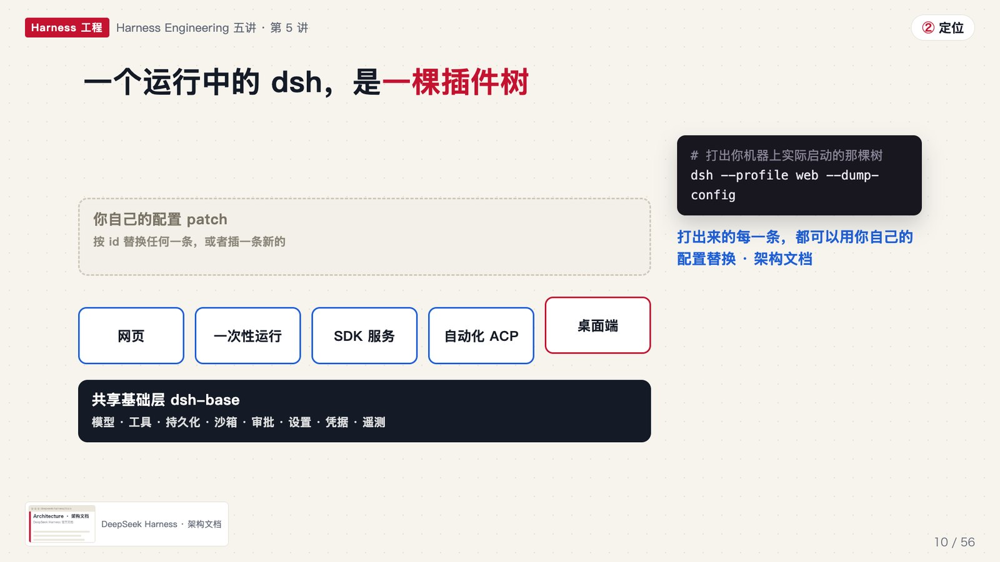

- 启动时按顺序叠几层配置，拼成一棵插件树。**profile** 是一种具名的组装，发行版带了几个模板：`web`（浏览器应用）、`headless`（不带服务器的一次性运行）、`sdk`（JSON-RPC 服务）、`sdk-minimal`、`acp`（只给自动化用）；**桌面端也是一个 profile**：同一套插件，换一层外壳。
- 大多数 profile 共用最底下一层 `dsh-base`：模型适配器、工具、持久化、沙箱和审批策略、设置、凭据、遥测。
- 一条命令能把你机器上实际启动的那棵树打出来：

```bash
dsh --profile web --dump-config
```

文档说，打出来的每一条，都可以用你自己的配置替换。

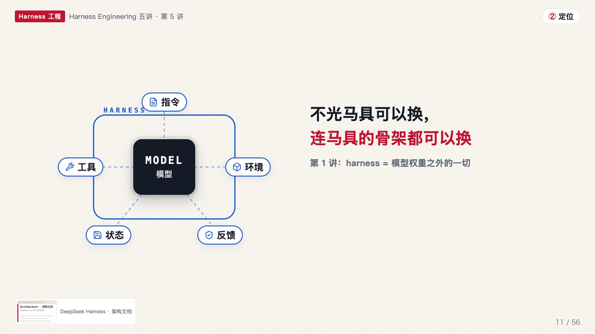

第 1 讲说，harness 是模型权重之外的一切。DeepSeek Harness 把这句话做到了头：不光马具可以换，连马具的骨架（循环）都可以换。

---

## 2 内核：Cordis 只管插件

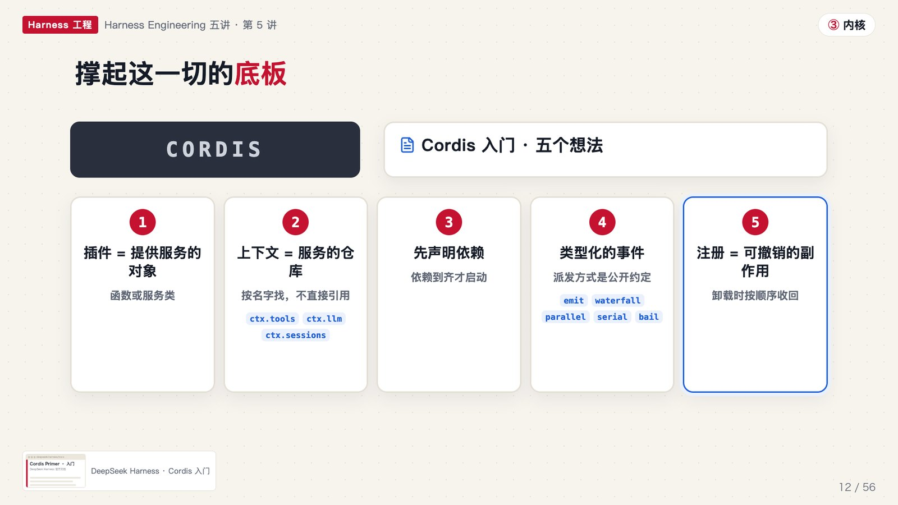

Cordis 是 dsh 底下的插件框架。入门文档用五个想法讲它：

| # | 想法 | 意思 |
|---|---|---|
| 1 | 插件就是一个提供服务的对象 | 可以是带 `inject` 和 `apply(ctx)` 的函数，也可以是一个服务类 |
| 2 | 上下文是服务的仓库 | 每个服务占一个固定的键，比如 `ctx.tools`、`ctx.llm`、`ctx.sessions`；别的插件按键去找，不 import 具体实现 |
| 3 | 用 `inject` 声明依赖 | 插件等它要的服务都出现了才启动；加载顺序靠依赖关系表达，不用人手排 |
| 4 | 类型化的事件 | 五种派发方式：`emit`、`waterfall`、`parallel`、`serial`、`bail`；派发方式是事件公开约定的一部分 |
| 5 | 注册是可撤销的副作用 | 提示词片段、工具、模型适配器、监听器，都通过 `ctx.effect()` 或 `ctx.on()` 装上；热重载或卸载时按顺序收回 |

比如工具注册表这个服务还没出现，挂工具的插件就先等着；工具注册表一出现，它就自己装上。

### 瀑布式事件：一串中间件

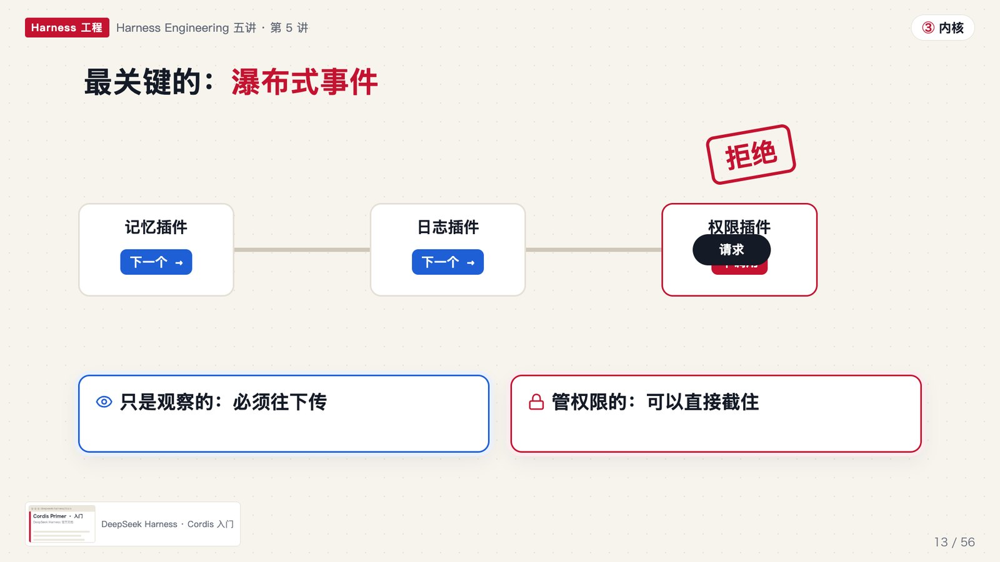

最关键的一种事件是 **waterfall（瀑布式）**。它像一串环绕式中间件：每个监听器拿到参数和一个 `next()`，调用 `next()` 就交给后面；不调用，就在这里截住。

- 管权限、管策略的插件：可以不调 `next()`，直接拒绝。
- 只是在旁边观察的插件：必须调 `next()`，往下传。

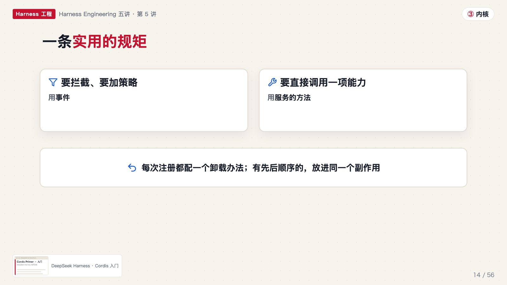

入门文档还给了一条实用的规矩：**要拦截、要加策略，用事件；要直接调用一项能力，用服务的方法**。每一次注册都要配一个卸载的办法；卸载有先后顺序的，放在同一个副作用里，让它按顺序收回。

README 还引了一篇论文：《A Programming Paradigm for Spatiotemporal Composability》（arXiv 2608.25512），讲的就是这种可以随时组合、随时拆开的编程方式。

> 这一节记住一句：内核不做任何 agent 的事，它只负责让插件装得上、拆得下。

---

## 3 接缝：依赖能力，不依赖具体工具

### 3.1 三个角色

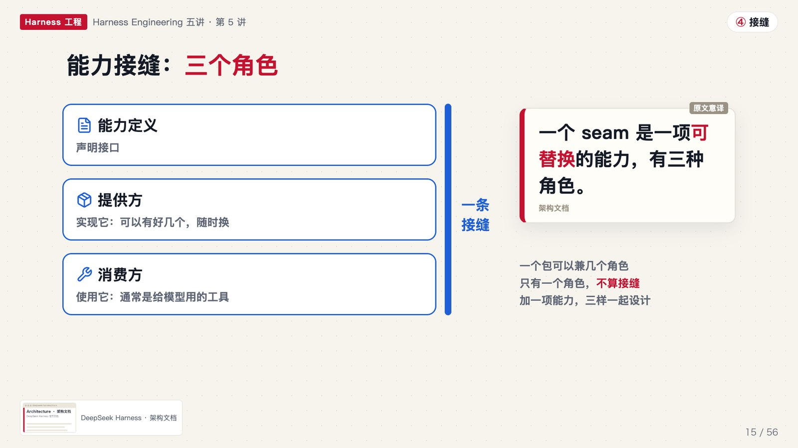

架构文档的定义（原文意译）：一条**接缝（seam）**是一项可以替换的能力，有三种角色：

| 角色 | 做什么 |
|---|---|
| 能力定义（Service Definition） | 声明接口 |
| 提供方（Service Provider） | 实现它；可以有好几个，随时换 |
| 消费方（Consumer） | 使用它；通常是给模型用的工具 |

一个包可以同时兼几个角色，但只有一个角色的不算接缝；加一项新能力，三者要一起设计。

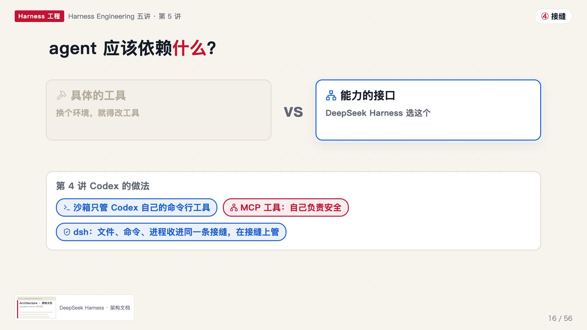

原课程把它归结成一个问题：agent 到底应该依赖具体的工具，还是依赖能力的接口？DeepSeek Harness 选后者。这个问题前几讲已经冒过头：第 4 讲 Codex 的沙箱只管它自己的命令行工具，通过 MCP 接进来的工具要自己负责安全；dsh 的思路是把文件、命令、进程都收进同一条接缝，在接缝上管。

### 3.2 换一个提供方，环境整块搬走

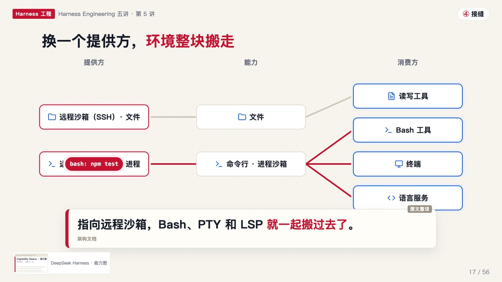

文档里有一句话说得特别好：**接缝，正是替换一个提供方就能改变整个产品的原因**。文件系统和进程共用同一个执行环境，把这两样的提供方指向一台远程沙箱，Bash、终端（PTY）和语言服务（LSP）就一起搬过去了，模型看到的工具一个都不用改，也不用为提供方单独 fork。

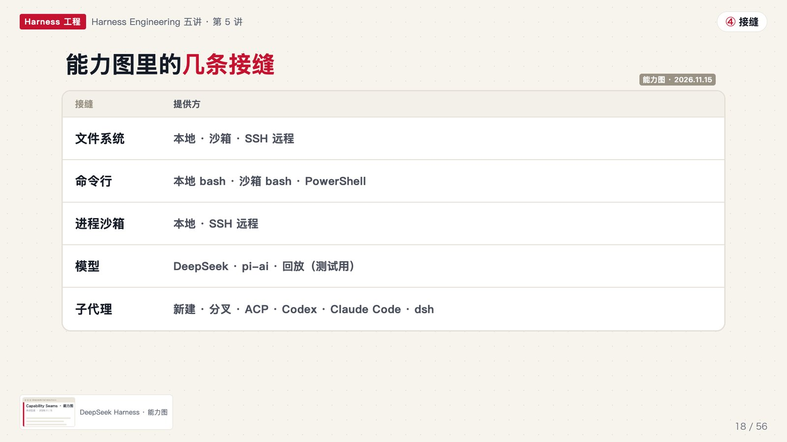

2026-11-15 能力图里的几条接缝：

| 接缝 | 提供方 | 消费方 |
|---|---|---|
| `ctx.fs` 文件系统 | 本地、沙箱、SSH 远程 | 读写编辑工具 |
| `ctx.shell` 命令行 | 本地 bash、沙箱 bash、PowerShell | bash / pwsh 工具，Claude Code 和 Codex 的钩子桥 |
| `ctx.sandbox` 进程沙箱 | 本地、SSH 远程 | 沙箱 bash、终端 |
| `ctx.llm` 模型 | DeepSeek、pi-ai（多家模型）、回放（测试用） | 循环、压缩 |
| `ctx.subagents` 子代理 | 进程内新建、进程内分叉、ACP、Codex、Claude Code、dsh SDK | 委派工具、工作流 |

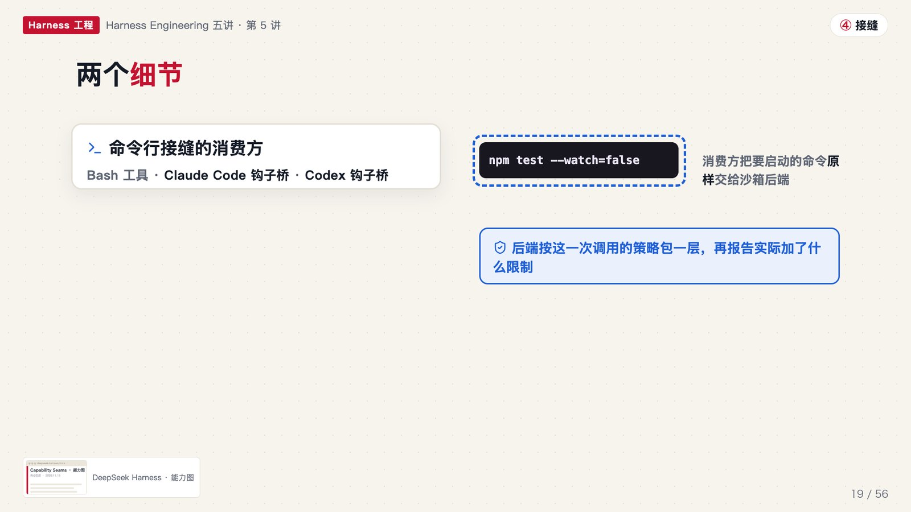

命令行这条接缝的消费方里，除了给模型用的 Bash 工具，还有 Claude Code 和 Codex 的钩子桥。消费方把要启动的命令原样交给进程沙箱的后端，后端按这一次调用的策略包一层，再报告实际加了什么限制。

### 3.3 模型和子代理：可以是别家的

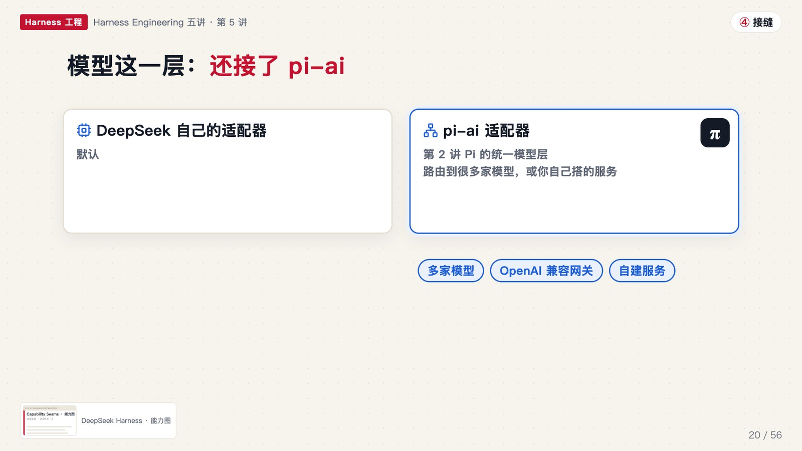

- **模型**：除了 DeepSeek 自己的适配器，还有一个接的是 **pi-ai**，也就是第 2 讲 Pi 的统一模型层，可以路由到很多家模型、OpenAI 兼容网关，或者你自己搭的服务。

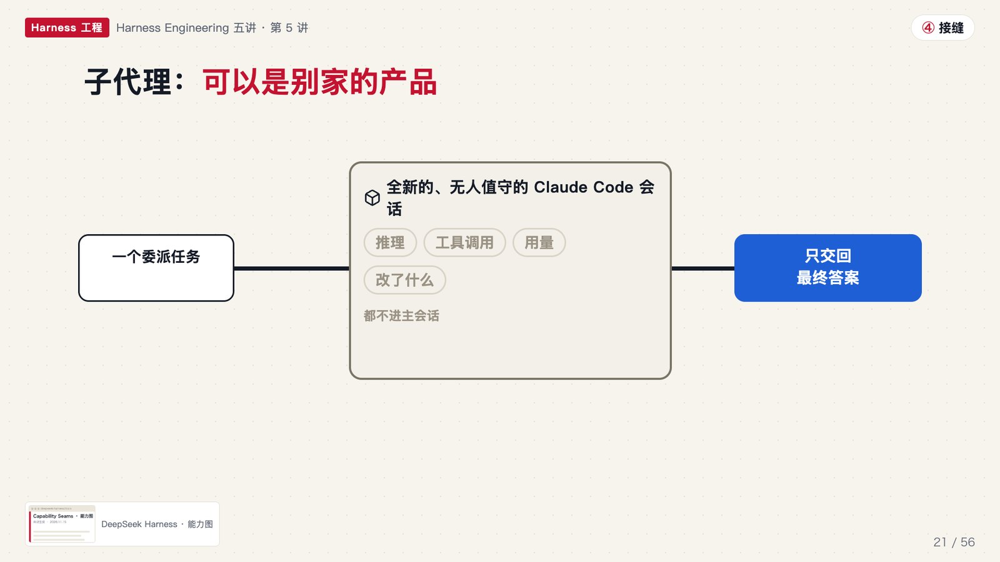

- **子代理**：提供方里有 Codex，也有 Claude Code。委派一个任务，可以交给一个全新的、无人值守的 Claude Code 会话；它的推理、工具调用、用量、改了什么，都不进主会话，只把最终答案（或失败说明）交回来。

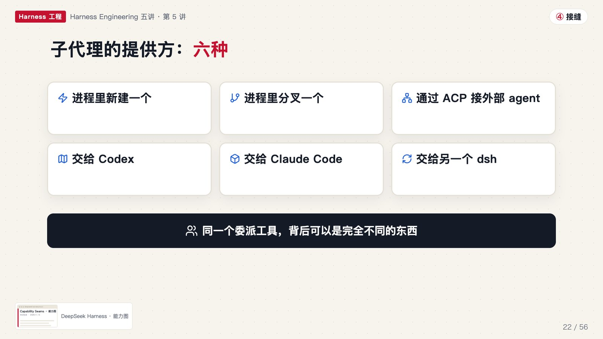

> 这一节记住一句：依赖能力，不依赖具体工具，环境才能整块换。

---

## 4 事件：循环的每一步，都是一个挂钩点

### 4.1 三类事件

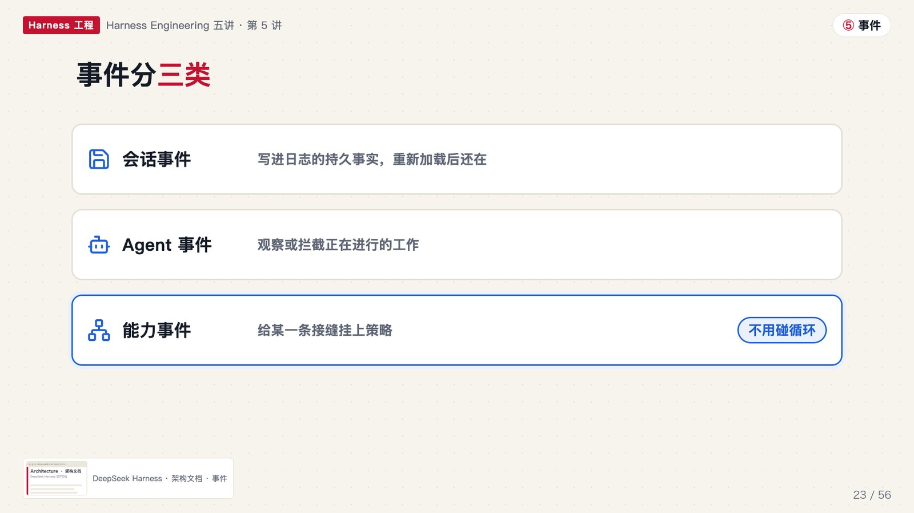

| 类型 | 用途 |
|---|---|
| 会话事件 | 写进日志的持久事实，重新加载后还在 |
| Agent 事件（`agent/*`） | 观察或拦截正在进行的工作：收件箱、步骤、请求、续跑 |
| 能力事件（`fs/*`、`tools/*`、`telemetry/*`…） | 不碰循环，就能给某一条接缝挂上策略和适配器 |

第三类最实用：想给文件读写加一条规矩，不用碰循环，挂在文件那条接缝的事件上就行。

### 4.2 一轮里发生了什么

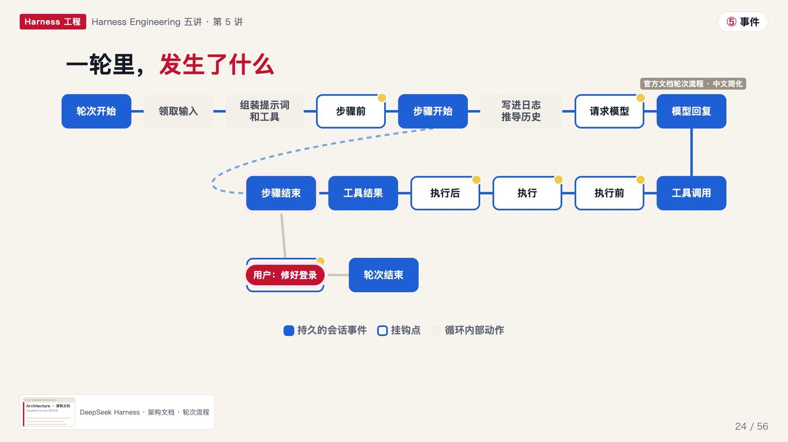

一个**步骤**是一次模型请求加上它调用的工具；一个**轮次**包含一个或多个步骤。官方文档的轮次流程（简化）：

```
turn/start
  领取输入 → 组装提示词片段和工具 schema
  → agent/pre-step（可以接纳、改写或拒绝这条输入）
  step/start → 准备调用 → 把消息写进日志 → 从日志推导模型历史
  → 流式请求模型（llm/stream）→ assistant/message
  → tool/call → tools/pre-execute → tools/execute → tools/post-execute → tool/result
  step/end → 还欠工具结果，或者来了新输入 → 下一步
→ agent/turn-stopping
turn/end
```

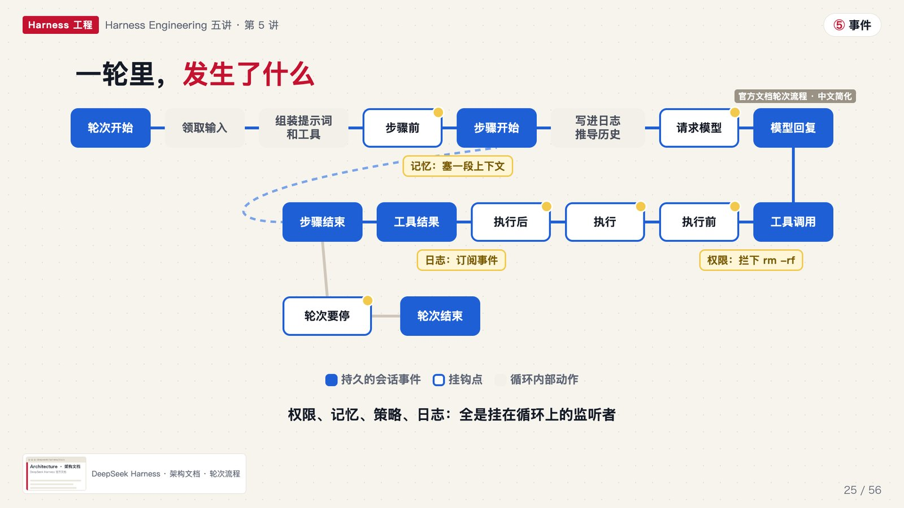

每一个点都可以挂插件：想在工具执行前做安全检查，挂在执行前（`tools/pre-execute`）；想加记忆，在步骤前（`agent/pre-step`）注入一段上下文；想记录行为，订阅会话事件。

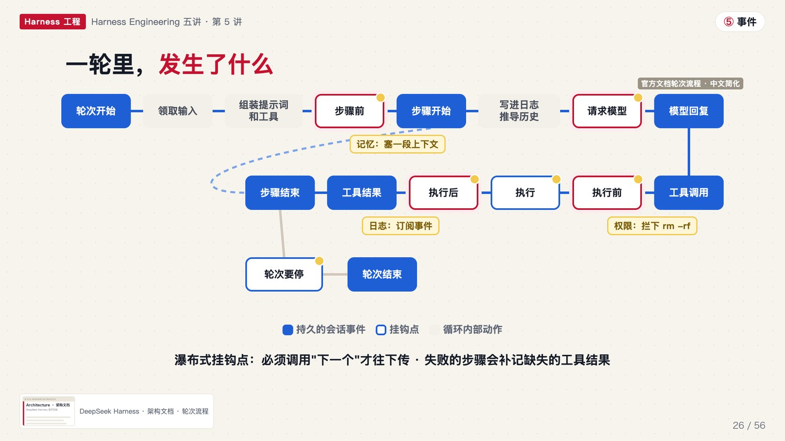

- `agent/pre-step`、`llm/stream` 和三个 `tools/*` 是瀑布式事件，监听器必须调用 `next()` 才往下传；步骤前的监听器如果拒绝了第一条输入，这一轮就直接关掉，一个步骤都不走。
- 哪一步失败了，循环会把缺失的工具结果补记进日志，免得历史断掉。
- `agent/turn-stopping`（轮次要停）是一个 serial 事件，插件在这里可以停住这一轮。第 3、4 讲的 Stop 钩子，在这里只是一个普通的监听者。

### 4.3 新功能该放在哪

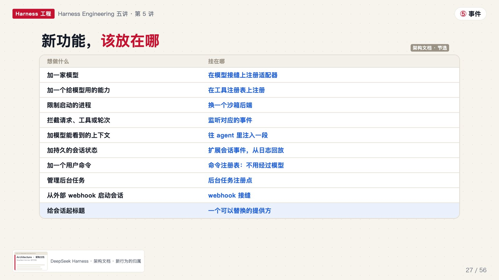

架构文档里有一张"新行为的归属位置"表，我觉得是整个仓库最值得看的一页（节选）：

| 想做什么 | 挂在哪 |
|---|---|
| 加一家模型 | 在 `ctx.llm` 上注册适配器 |
| 加一个给模型用的能力 | 在 `ctx.tools` 上注册，schema 自动进提示词组装 |
| 限制启动的进程 | 换一个 `ctx.sandbox` 后端 |
| 拦截请求、工具或轮次 | 监听对应的 `agent/*` 或 `tools/*` 事件 |
| 加模型能看到的上下文 | 调 `agent.inject()`，落到下一次获准的请求里 |
| 加持久的会话状态 | 扩展会话事件，从日志渲染和回放 |
| 加一个用户命令 | 命令注册表：不用经过模型 |
| 管理后台任务 | 后台任务注册点 |
| 从外部 webhook 启动会话 | webhook 接缝 |
| 给会话起标题 | 一个可以替换的提供方 |

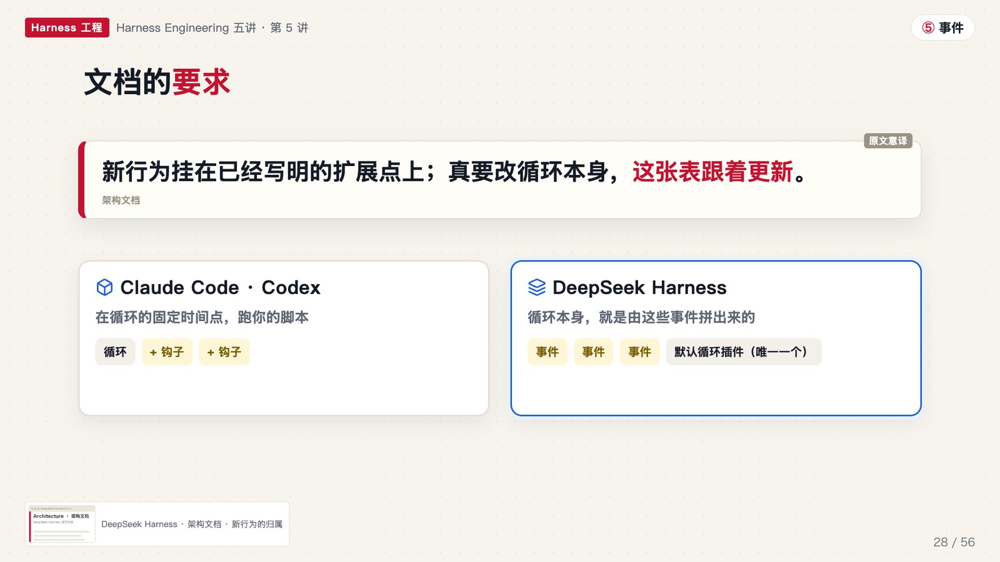

文档的要求：新行为都挂在已经写明的扩展点上；真要改循环本身，这张表要跟着更新。和前两讲比：Claude Code 和 Codex 的钩子，是在循环的固定时间点跑你的脚本；DeepSeek Harness 是循环本身就由这些事件拼出来，默认的循环只是"唯一一个具体的循环插件"，其他所有扩展都只依赖事件和服务。

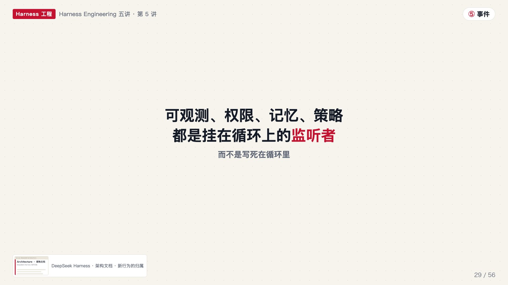

> 这一节记住一句：可观测、权限、记忆、策略，都是挂在循环上的监听者，而不是写死在循环里。自己设计 agent 时，"新功能该放在哪"这张表几乎可以直接照着用。

---

## 5 日志：模型看得见的，都必须记下来

### 5.1 一份只追加的日志，是唯一的事实来源

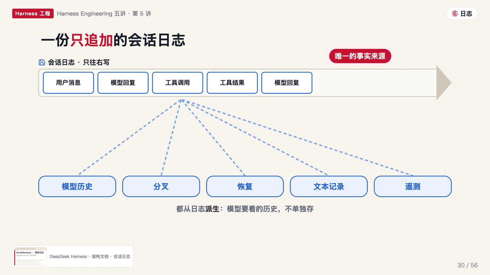

- 核心包 `core/session` 负责一份**只追加**的会话事件日志，文档叫它"唯一的事实来源"。
- 模型要看的历史由 `deriveMessages()` 从日志推导出来，不单独存；分叉、恢复、文本记录、遥测、持久化，也全都从日志派生。
- 每一条模型回复，都连同产生它的完整流式输出一起存进日志：事后不光能看到它说了什么，还能看到它是怎么一个字一个字说出来的。
- 失败、重试、取消的尝试记成 `assistant/attempt`，留在日志里，但不进模型的历史。

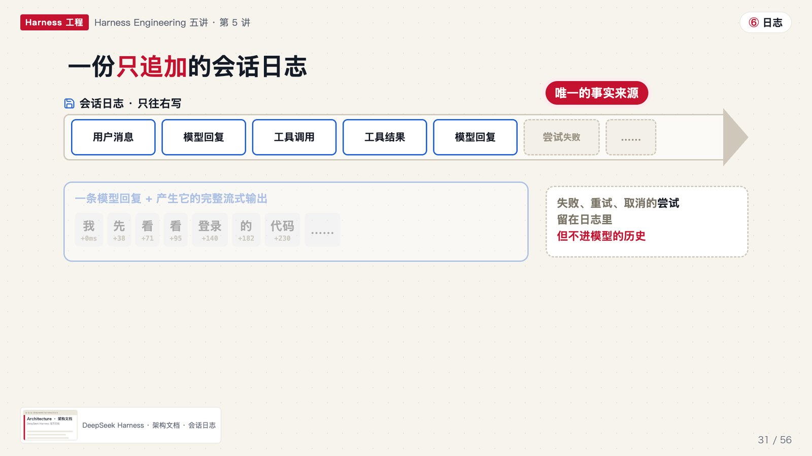

### 5.2 模型可见即已记录

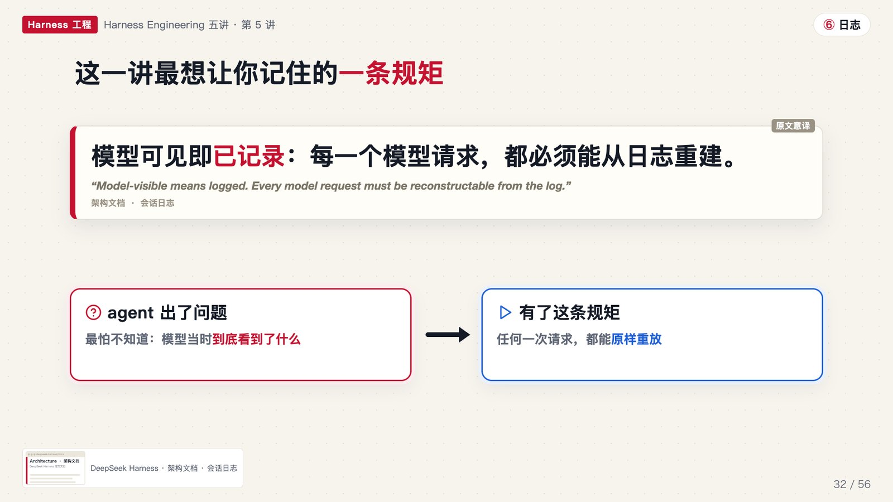

架构文档原话（意译）：

> **模型可见即已记录**：每一个模型请求，都必须能从日志重建。
> *Model-visible means logged. Every model request must be reconstructable from the log.*

为什么这条这么重要？agent 出了问题要复盘，最怕不知道模型当时到底看到了什么。有了这条规矩，任何一次请求都能原样重放。

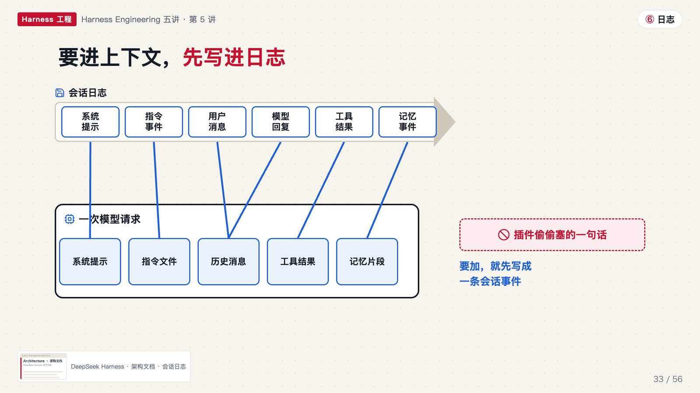

它对插件的约束：

- 任何一段要进模型上下文的东西，都得先变成日志里的一条事件。插件不能在请求里偷偷塞一句话；要加，就先写成会话事件。
- 插件要改一条已有消息的内容（比如把一大段工具输出换成摘要），不能直接改日志，而是登记一个**纯函数的投影**（message projection）；别的读取方用同一个定义，就能复现出完全一样的结果。

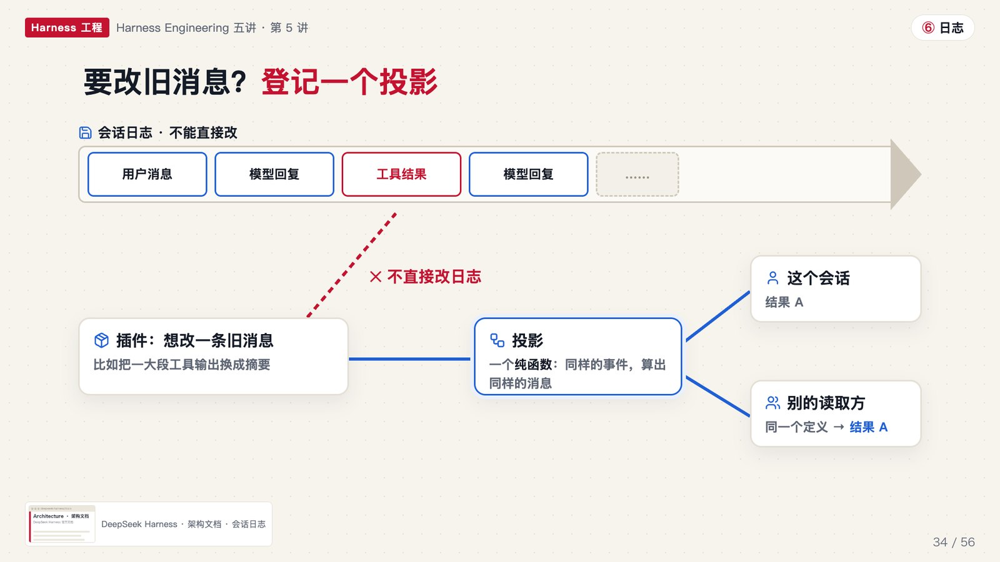

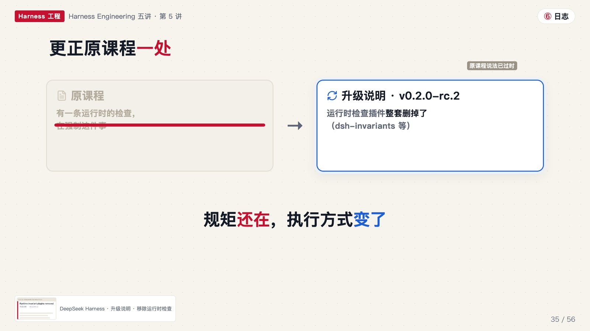

**更正原课程**：原课程说"有一条运行时不变量在强制检查这件事"。最新的升级说明《Runtime invariant plugins are removed》写明，`v0.2.0-rc.2` 之后整套运行时检查插件（`dsh-invariants` 和各包的 `./invariant`）都删掉了。规矩还在，执行方式变了。

### 5.3 日志格式和压缩，也守同一套规矩

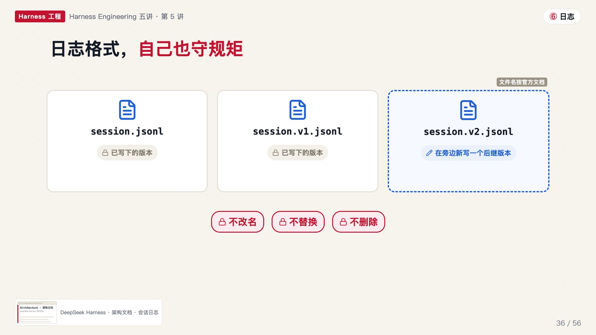

- 会话文件按版本命名（`session.jsonl`、`session.v1.jsonl`……）。已经写下的版本，**永远不改名、不替换、不删除**；要升级，只能在旁边新写一个后继版本。
- 压缩是**一项可选的能力，不是循环主干的一部分**。它在日志里写三个只记录的事件：`compaction/start`、`compaction/summary`、`compaction/end`；摘要作为一条替换消息进模型能看到的历史。

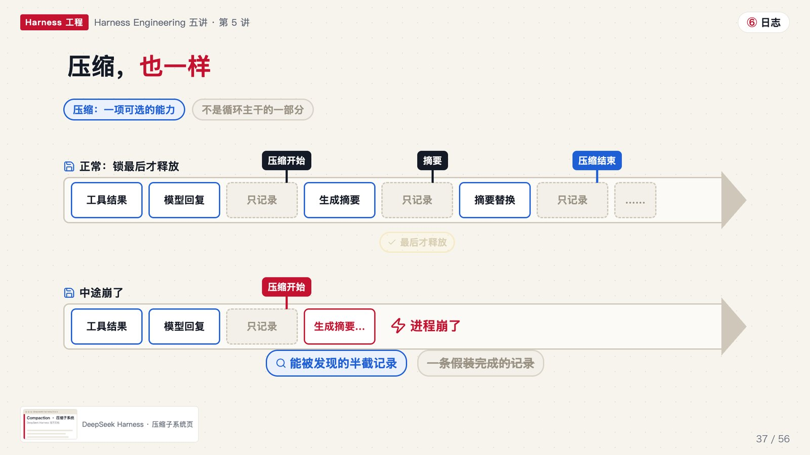

- 锁最后才释放：`compaction/start` 先写，摘要、替换消息都落下以后，最后才写 `compaction/end`。就算进程中途崩了，留下的也是一个**能被发现的半截记录**（只有开始、没有结束的孤儿锁），而不是一条假装完成的记录。
- 压缩没有给模型用的工具，模型不能自己决定压缩；手动压缩是给人用的一条命令（`dsh-command-compact`，接缝里的"人用消费方"）。

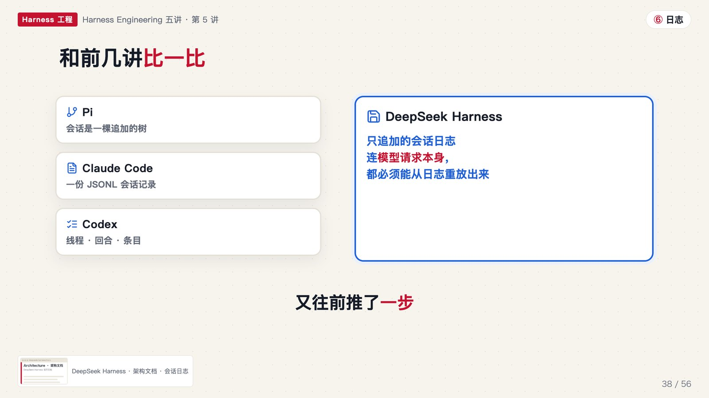

| | 会话状态怎么存 |
|---|---|
| Pi | 一棵追加的会话树 |
| Claude Code | 一份 JSONL 会话记录 |
| Codex | 线程 · 回合 · 条目（Thread / Turn / Item） |
| DeepSeek Harness | 只追加日志，**连模型请求本身都必须能从日志重放** |

---

## 6 兼容：harness 当成操作系统

### 6.1 别家的东西，它都想接上

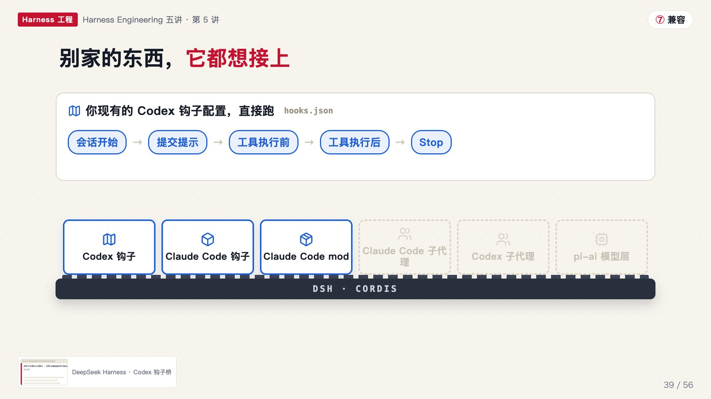

- **Codex 的钩子**：`hooks-codex` 直接跑你现有的 Codex `hooks.json`，五个时间点都支持：会话开始、提交提示、工具执行前、工具执行后、Stop。能做的事和在 Codex 里一样：用模型看得见的理由拦下一个提示或一次工具调用，往对话里补一段上下文，或者强制它再多走一步。
- **Claude Code 的钩子和 mod**：各有一座专门的桥。

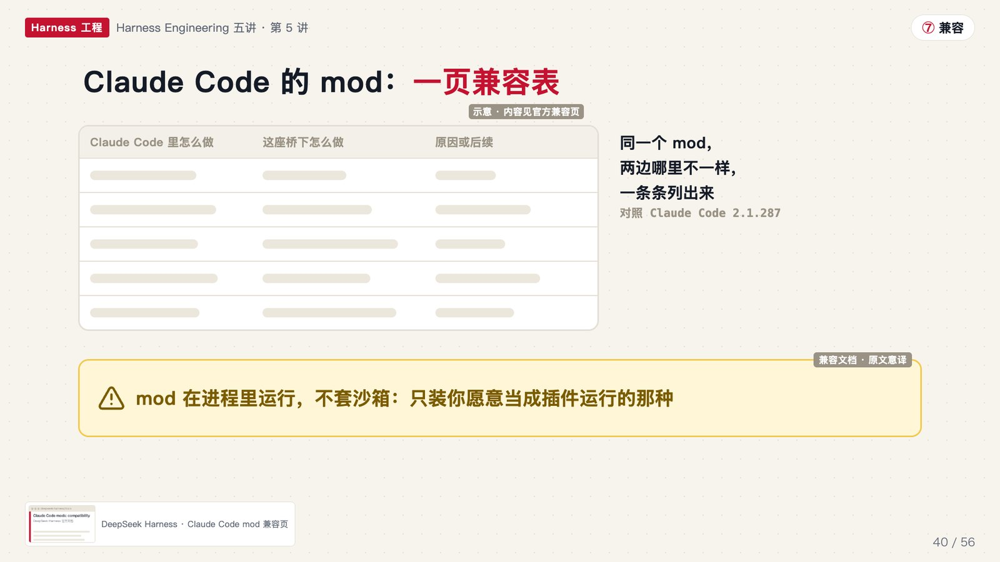

- Claude Code 的 mod 有一页兼容表，一条条列出同一个 mod 在这座桥下和在 Claude Code 里有什么不一样（对照 Claude Code 2.1.287）。文档也提醒得很诚实：**mod 在进程里运行，不套沙箱，只装你愿意当成插件运行的那种**。
- 交给 Claude Code 的子代理，尊重你本机 Claude Code 自己的设置和登录，不另起一套。
- 再加上第 3 节讲的：任务可以交给 Claude Code 或 Codex 去做，模型层可以接 Pi 的 pi-ai。

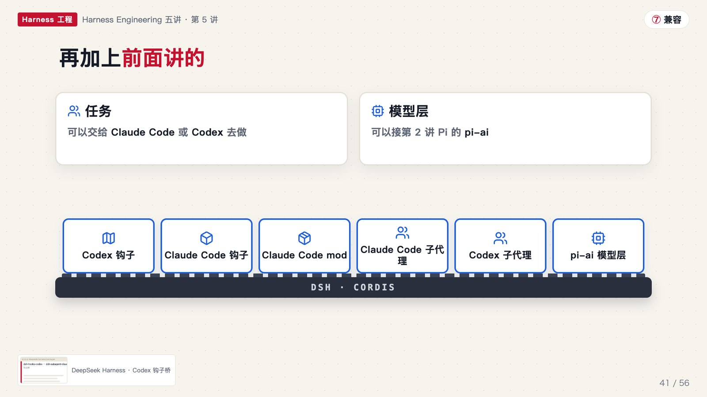

### 6.2 指令文件：也认 CLAUDE.md

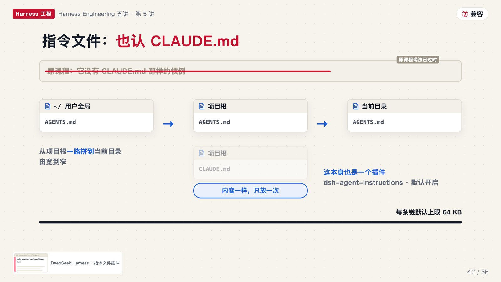

**更正原课程**：原课程说它"没有内置的 CLAUDE.md 式惯例"，这一点已经过时。现在有一个默认开启的插件 `dsh-agent-instructions`：

- 加载用户全局和项目级的 `AGENTS.md`，也认 `CLAUDE.md`，还支持 `AGENTS.local.md` 这类本地叠加；
- 从项目根一路拼到当前目录，由宽到窄；
- `CLAUDE.md` 和 `AGENTS.md` 内容相同时只放一次；
- 每条链默认上限 64 KB（65,536 字节）。

当然，这本身也是一个插件。

### 6.3 权限和审批

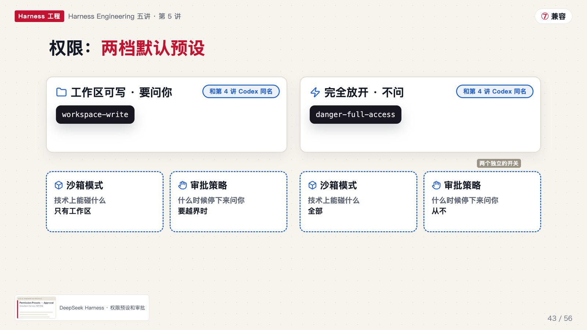

| 预设 | 沙箱模式（技术上能碰什么） | 审批策略（什么时候停下来问你） |
|---|---|---|
| `workspace-write` | 只有工作区可写 | 要越界时问你 |
| `danger-full-access` | 完全放开 | 不问 |

两档预设的名字和第 4 讲 Codex 的沙箱模式一模一样，而且同样是把两个互相独立的开关打包在一起。

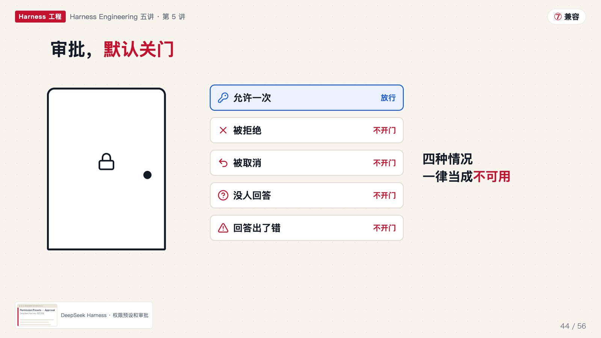

**审批默认关门**：审批结果是一个封闭的集合，只有"允许一次"才放行；被拒绝、被取消，或者根本没人回答、回答出了错，一律当成不可用，不开门。这和第 3 讲 Claude Code 的拒绝规则是同一种精神：拿不准的时候，宁可不做。

### 6.4 把 harness 当成操作系统

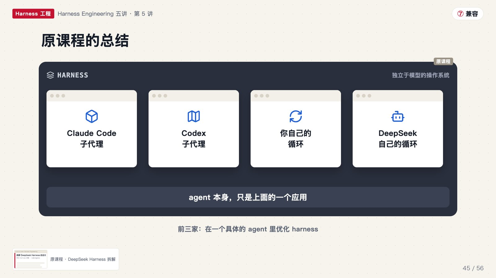

原课程的总结：前三家都是在一个具体的 agent 里优化 harness；DeepSeek Harness 把 harness 当成一个**独立于模型的操作系统**，agent 本身只是上面的一个应用。代价也很明显：自由度越高，配置成本越高；而且它还在开发者预览，接口一直在变。

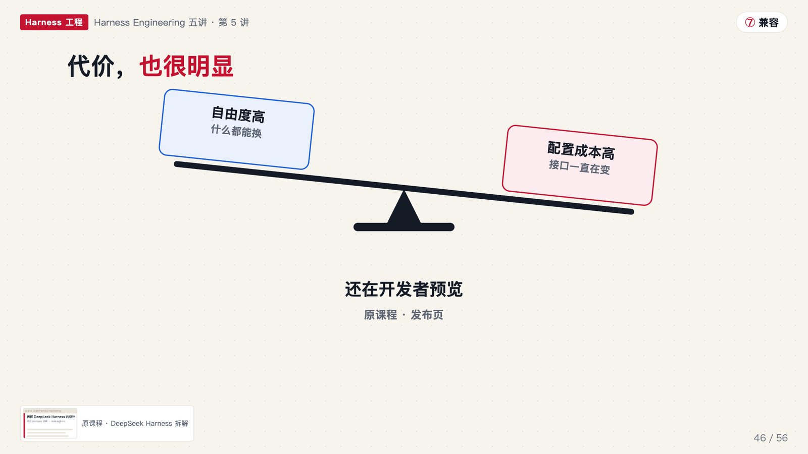

### 6.5 它自己的 AGENTS.md

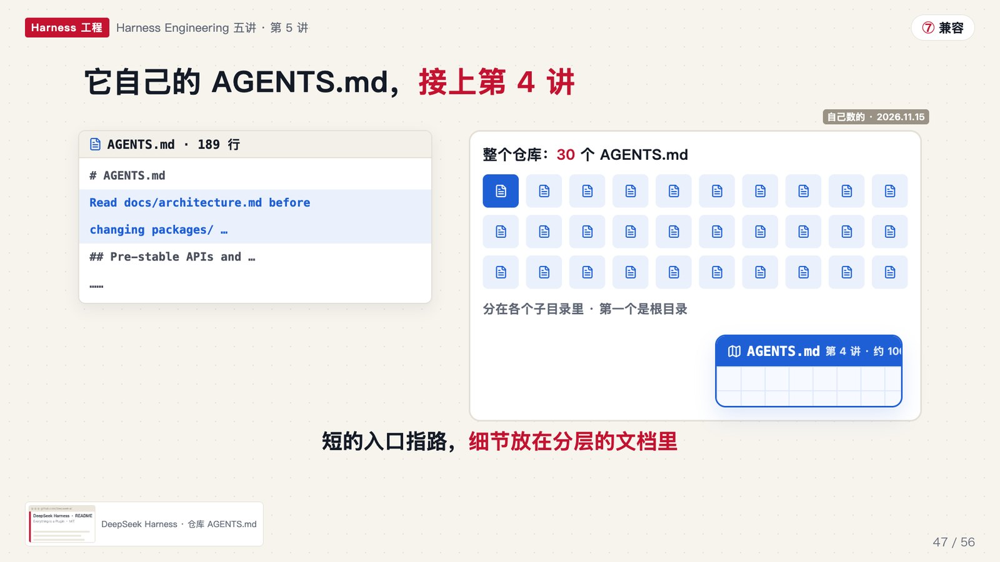

DeepSeek Harness 自己仓库根目录的 AGENTS.md 有 189 行，第一句话就让 agent 改 `packages/` 之前先读 `docs/architecture.md`；整个仓库一共有 30 个 AGENTS.md，分在各个子目录里（2026-11-15 自己数的）。短的入口指路，细节放在分层的文档里，和第 4 讲 OpenAI 那个团队是同一个思路，只是写得比 100 行长一些。

---

## 7 打分，和五讲收尾

### 7.1 映射到五个子系统

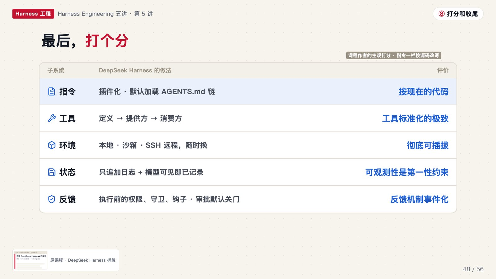

| 子系统 | DeepSeek Harness 的做法 | 评价 |
|---|---|---|
| 指令 | 插件化；默认插件加载 AGENTS.md / CLAUDE.md 链 | （原课程说"没有 CLAUDE.md 式惯例"，已按源码改写） |
| 工具 | 定义 → 提供方 → 消费方的能力接缝 | 工具标准化的极致 |
| 环境 | 文件系统、命令行、沙箱都能换提供方（本地、沙箱、SSH 远程） | 彻底可插拔 |
| 状态 | 只追加的会话日志 + 模型可见即已记录 | 可观测性是第一性约束 |
| 反馈 | 执行前的权限、守卫、策略、钩子；审批默认关门 | 反馈机制事件化 |

评价是课程作者的主观打分，指令一栏按源码改写。

### 7.2 值得借鉴的四条

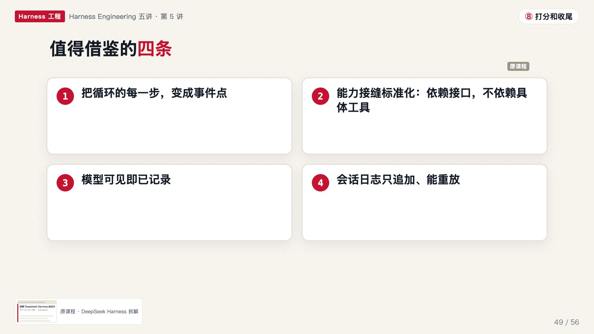

1. **把循环的每一步变成事件点**：权限、记忆、策略、日志都作为监听者挂在循环上。
2. **能力接缝标准化**：依赖能力接口，不依赖具体工具，环境可以整块替换。
3. **模型可见即已记录**：凡是模型能看到的，都必须能从日志重建。
4. **只追加的会话日志**：状态可以重放，交接可靠。

### 7.3 四家并排看（我的总结）

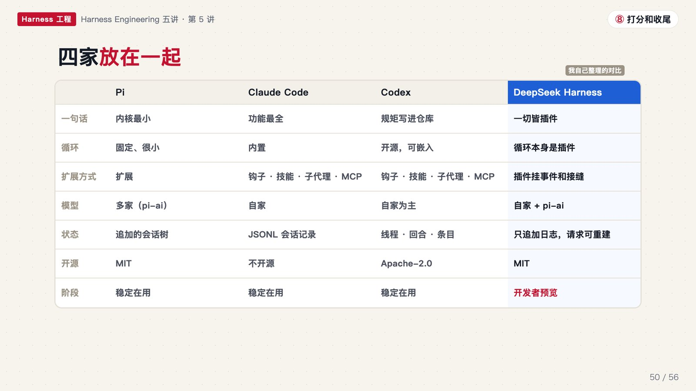

| | Pi | Claude Code | Codex | DeepSeek Harness |
|---|---|---|---|---|
| 一句话 | 内核最小 | 功能最全 | 规矩写进仓库 | 一切皆插件 |
| 循环 | 固定、很小 | 内置 | 开源，app-server 可嵌入 | 循环本身是插件，可替换 |
| 扩展方式 | 扩展 | 钩子、技能、子代理、MCP | 钩子、技能、子代理、MCP | 插件挂事件和接缝；能桥接别家钩子 |
| 模型 | 多家（pi-ai） | 自家 | 自家为主 | 自家 + pi-ai 多家 |
| 状态 | 追加的会话树 | JSONL 会话记录 | Thread / Turn / Item | 只追加日志，模型请求可重建 |
| 开源 | MIT | 不开源 | Apache-2.0（CLI 等） | MIT |
| 阶段 | 稳定在用 | 稳定在用 | 稳定在用 | 开发者预览，接口会变 |

这张表是我自己整理的，不是原课程内容。

### 7.4 五讲串起来

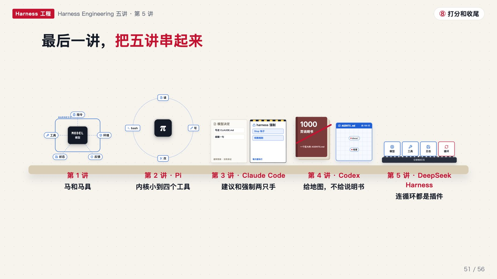

| 讲次 | 母题 | 一句话 |
|---|---|---|
| 第 1 讲 | 马和马具 | harness 是模型权重之外的一切；五个子系统：指令、工具、环境、状态、反馈 |
| 第 2 讲 · Pi | π 内核 | 内核可以小到四个工具 |
| 第 3 讲 · Claude Code | 两只手 | 指令分建议和强制；Stop 钩子管住一个会自夸的 agent |
| 第 4 讲 · Codex | 地图和千页说明书 | 给地图不给说明书，把规矩写成检查 |
| 第 5 讲 · DeepSeek Harness | 积木和底板 | 连循环都做成了插件 |


这五讲里的很多东西在别家都能找到对应：Pi 的会话树、Claude Code 的分层 CLAUDE.md、Codex 的 100 行目录页、DeepSeek Harness 的指令链，讲的其实是同一件事：**怎么把对的上下文，在对的时候交给模型**。


四家放在一起，我看到四个共同点（个人观察）：

1. **指令文件都在变短、变分层**。
2. **该强制的事，都交给 harness，不交给提示词**：Claude Code 和 Codex 的 Stop 钩子，dsh 的"轮次要停"事件和默认关门的审批。
3. **状态都靠追加的日志**：没有一家靠模型的记性交接。
4. **它们在互相兼容**：DeepSeek Harness 能跑 Codex 的钩子、Claude Code 的 mod，能把任务交给 Claude Code 和 Codex，模型层用的是 Pi 的 pi-ai。harness 正在变成一层可以拆开、互相拼装的基础设施。


如果这五讲你只带走一件事：下次你的 agent 出了问题，先别急着换模型，先问一句，是 harness 里缺了什么。缺的是指令、工具、环境、状态，还是反馈？把它补上，往往比换一个更大的模型更管用。

---

## 本讲小结


1. DeepSeek Harness 问的是：harness 能不能离开具体的模型。它的回答是一切皆插件，连 agent 循环都能换。
2. Cordis 内核不做任何 agent 的事，只负责让插件装得上、拆得下。
3. 能力接缝：定义、提供方、消费方；换一个提供方，就把整个执行环境搬走。
4. 循环的每一步都是挂钩点，权限、记忆、策略都是挂在上面的监听者。
5. 模型可见即已记录：每个模型请求，都必须能从只追加的日志重建。

## 下一讲预告：系列到这里结束

Harness Engineering 五讲到这里就全部讲完了。五讲的课件都在本仓库：[第 1 讲](../l01-what-is-harness/) · [第 2 讲](../l02-pi/) · [第 3 讲](../l03-claude-code/) · [第 4 讲](../l04-codex/) · 第 5 讲（本讲）。谢谢你一路看到这里。

## 关键术语

| 术语 | 解释 |
|---|---|
| dsh | DeepSeek Harness 的命令名 |
| Cordis | dsh 底下的插件框架：服务、类型化事件、可撤销的副作用 |
| 插件（plugin） | 往共享上下文里贡献服务、事件监听和副作用的单元；dsh 的每一部分都是插件，包括循环 |
| profile | 一种具名的插件组装，如 `web`、`headless`、`sdk`、`acp`、桌面端 |
| 服务（service） | 占一个固定键的能力对象，如 `ctx.tools`、`ctx.llm` |
| 瀑布式事件（waterfall） | 环绕式中间件：监听器调 `next()` 往下传，不调就截住 |
| 能力接缝（seam） | 一项可替换的能力，有定义、提供方、消费方三个角色 |
| 提供方（provider） | 接缝的一个实现，如本地、沙箱、SSH 远程文件系统 |
| 轮次 / 步骤（turn / step） | 一个步骤是一次模型请求加它调用的工具；一个轮次包含一个或多个步骤 |
| 会话日志（session log） | 只追加的事件日志，唯一的事实来源；模型历史从它推导 |
| 模型可见即已记录 | 每个模型请求都必须能从日志重建 |
| 投影（message projection） | 插件改旧消息内容的方式：登记一个纯函数，不改日志 |
| 孤儿锁 | 只有 `compaction/start` 没有 `compaction/end` 的半截记录，崩溃后能被发现 |
| 默认关门（fail-closed） | 审批只有"允许一次"才放行，其余一律当不可用 |

## 思考题

1. Pi 是"内核做小"，DeepSeek Harness 是"不留内核"。两种做法各自的好处和代价是什么？
2. 为什么瀑布式事件要求"只观察的监听器必须调 `next()`"？如果一个日志插件忘了调，会发生什么？
3. 你的 agent 现在是"依赖具体工具"还是"依赖能力接口"？如果要把它从本地搬到远程沙箱，要改几处？
4. "模型可见即已记录"会让哪些常见做法变得不合规？举一个你见过的例子。
5. 五讲的四个共同点里，你觉得哪一条在你的项目里最缺？

<details>
<summary>参考答案</summary>

1. 内核做小：核心稳定、好读，扩展有明确的边界，但循环本身改不了，深度定制要 fork。不留内核：连循环都能换，组合自由度最高，但每一样都要配置，概念和包多，接口也更容易变（dsh 现在还在开发者预览）。
2. 瀑布式事件是一串中间件，不调 `next()` 就截住了，后面的监听器和真正的执行都不会发生。日志插件忘了调，这一步就被它悄悄拦下了：工具不执行、请求不发出，看起来像 agent 卡住。所以入门文档规定：只有要拒绝的策略插件才不调。
3. 依赖具体工具时，读写、执行、终端、语言服务各自写死了本地实现，要逐个改；依赖能力接口时，只要换文件系统和进程的提供方，消费方（模型看到的工具）不用动。
4. 例如：插件在发请求前临时拼一段"当前时间""用户偏好"进提示词，却没记进日志；或者直接改写历史里的旧工具输出来省 token。按这条规矩，前者要先写成一条会话事件，后者要登记一个纯函数投影。
5. 因项目而异。常见的是第 2 条（很多"必须做"的事还写在提示词里，没交给钩子或检查）和第 3 条（交接靠模型自己总结，没有追加日志）。

</details>

## 动手练习

1. 用"新功能该放在哪"那张表，给你正在用（或在做）的 agent 列一份清单：加一家模型、加一个工具、拦截一次工具调用、加一段上下文，各自挂在哪；找不到地方挂的，就是你的 harness 缺的扩展点。
2. 给你的 agent 加一条"模型可见即已记录"的自检：每次请求前，把完整的请求内容（系统提示、历史、工具 schema）追加写进一份 JSONL；出问题时，挑一条记录原样重放，看结果是否一致。
3. 想上手试 DeepSeek Harness：`npx @deepseek-ai/dsh web` 会在本机起一个网页服务（默认 `http://127.0.0.1:3080`）。它还在开发者预览，接口会变；先读仓库 README 和官方的安全说明，只在你信任的项目目录里用。

## 和原课程不一样的地方

- 原课程说官方定义是"Agent = Model + Environment + Tools + State"。2026-11-15 在官网正文和整个仓库里都搜不到这句话，本课件不用。
- 原课程说"有一条运行时不变量在强制检查模型可见即已记录"。`v0.2.0-rc.2` 之后运行时不变量插件已经整套移除（见升级说明），规矩还在，执行方式变了。
- 原课程说文件系统提供方有 E2B。现在能力图里是本地、沙箱、SSH 三种，没有 E2B 提供方。
- 原课程说指令子系统"没有内置的 CLAUDE.md 式惯例"。现在默认开启的 `dsh-agent-instructions` 加载 AGENTS.md 和 CLAUDE.md 链。
- 原课程把 `agent/request` 当成改模型请求的挂钩点。现在文档标注这个钩子已弃用，只能调控制参数。

## 延伸阅读

- 原课程：[walkinglabs/learn-harness-engineering](https://github.com/walkinglabs/learn-harness-engineering)（[中文版网页](https://walkinglabs.github.io/learn-harness-engineering/zh/)）
- 源码：[deepseek-ai/deepseek-harness](https://github.com/deepseek-ai/deepseek-harness)：[README](https://github.com/deepseek-ai/deepseek-harness/blob/master/README.md)、[AGENTS.md](https://github.com/deepseek-ai/deepseek-harness/blob/master/AGENTS.md)、[架构文档](https://github.com/deepseek-ai/deepseek-harness/blob/master/docs/architecture.md)（[中文](https://github.com/deepseek-ai/deepseek-harness/blob/master/docs/architecture.zh.md)）、[Cordis 入门](https://github.com/deepseek-ai/deepseek-harness/blob/master/docs/cordis-primer.md)、[能力图](https://github.com/deepseek-ai/deepseek-harness/blob/master/docs/capability-seams.md)
- 子系统页：[会话](https://github.com/deepseek-ai/deepseek-harness/blob/master/docs/subsystems/session.md)、[压缩](https://github.com/deepseek-ai/deepseek-harness/blob/master/docs/subsystems/compaction.md)、[Claude Code mod 兼容表](https://github.com/deepseek-ai/deepseek-harness/blob/master/docs/subsystems/claude-code-mods.md)
- 官网：[deepseek.com/harness](https://www.deepseek.com/harness)
- 论文：A Programming Paradigm for Spatiotemporal Composability（arXiv 2608.25512，README 引用）

---

画面和配音由 AI 生成。引语是原文意译；包数、接缝数、AGENTS.md 行数和个数是 2026-11-15 自己数的；"四家并排看""四个共同点""harness 在变成可拼装的基础设施"是个人观点；标"示意"的画面是示意。
